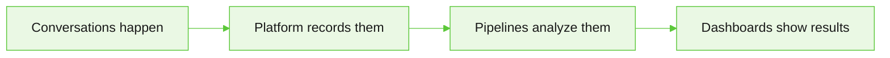

**Insights** tells you how your agents perform: how conversations end, how well the agent handles them, how customers react, and what it all costs.

## How Insights works

Insights turns each conversation into metrics in four steps:

1. **Conversations happen.** Every chat, API call, and phone call with your agents starts the flow.
2. **The platform records them.** It stores messages, tool calls, handoffs, errors, timings, tokens, and cost, plus any [custom tags](/agent-platform/analytics-insights/custom-tags) you add.
3. **Pipelines analyze them.** Built-in and custom [pipelines](/agent-platform/analytics-insights/analytics-pipelines) read each finished conversation and score it with an LLM.
4. **Dashboards show the results.** The prebuilt pages, custom dashboards, and Analytics Explorer read from one analytics store.

Three more sources feed Insights: your settings (costs, thresholds, and billing policy), customer surveys, and telephony call reports. To learn how each metric is calculated and how to compare numbers across pages, see [How Insights metrics work](/agent-platform/analytics-insights/how-metrics-work).

{/* SCREENSHOT (new): Optional diagram of the four steps in How Insights works: conversations, platform records, pipelines, dashboards. Show settings, surveys, and telephony as extra inputs. Use a neutral project with no customer data. */}

## Insights dashboards

In the product, the **Insights** sidebar groups the dashboards as follows:

| Document | Sidebar group and pages | When to use it |
|:---|:---|:---|
| [How Insights metrics work](/agent-platform/analytics-insights/how-metrics-work) | All pages | Read first. Explains where each number comes from, when it updates, and why two pages can show different totals. |
| [Usage insights](/agent-platform/analytics-insights/executive-dashboard-usage) | **Overview**: At a Glance; **Usage**: Billing & Usage | Start here. Gives the outcome, quality, sentiment, and cost position for a period, and reconciles what the project consumed with what it billed. |
| [Quality insights](/agent-platform/analytics-insights/performance-quality) | **Quality & Performance**: Quality Monitor, Agent Performance | Open when the quality figure on At a Glance moves and you need to know which aspect of quality slipped and which agent caused it. |
| [Customer voice](/agent-platform/analytics-insights/customer-voice) | **Customer Voice**: Customer Insights, Feedback Insights | Open when you need the customer's side of the conversation: what they asked for, how their sentiment moved, and what they said in surveys. |
| [Voice analytics](/agent-platform/analytics-insights/voice-analytics) | **Channels**: Voice Analytics | Open when voice conversations underperform their chat equivalents. Separates agent reasoning problems from call quality, speech recognition, and latency problems. |
| [Agent transfer](/agent-platform/analytics-insights/agent-transfer) | Agent Transfer | Open when escalation volume concerns you more than the agent's own handling, and you need queue and human handling performance for transferred conversations. The page appears only after you connect Kore SmartAssist to the project. |
| [Analytics explorer](/agent-platform/analytics-insights/analytics-explorer) | **Explore & Build**: Analytics Explorer | Open when the prepared pages don't answer your question. Gives near real-time event, model, token, and cost data, session and trace drill-down, and custom queries over project event data. |
| [Custom dashboards](/agent-platform/analytics-insights/custom-dashboards) | **Explore & Build**: Custom Dashboards | Open to build and share your own charts from SQL queries when no prebuilt page shows what you need. |
| [Analytics pipelines](/agent-platform/analytics-insights/analytics-pipelines) | **Explore & Build**: Pipelines | Open to see which evaluations run today, or to define your own evaluation logic when the built-in dimensions don't score what your business cares about. |
| [Custom tags](/agent-platform/analytics-insights/custom-tags) | Agents, Settings | Open to add your own business data to conversations, so custom dashboards can chart and filter by it. |
| [Insights metrics reference](/agent-platform/analytics-insights/metrics-reference) | All pages | Look up the definition, calculation, and source of any metric. |

## Before you begin

Insights pages report on data that other parts of the platform produce, so several of them stay empty until you put the source in place.

* You need at least **Viewer** access to the project.
* **Quality Monitor**, **Agent Performance**, and **Customer Insights** depend on the built-in analytics pipelines. Enable them in **Insights** → **Pipelines** before you expect scores on these pages. Parts of **At a Glance**, such as quality, sentiment, and outcomes, depend on them too.
* **Voice Analytics** needs at least one voice channel deployment. Without one, the page has no calls to report on.
* **Agent Transfer** needs an active Kore SmartAssist connection that your Agent Transfer settings select. Until then, the page doesn't appear in the navigation at all.
* Metric cards across the section show a dash until a pipeline evaluates enough conversations in the selected period. A dash means the measure has no data, not that it scored zero.
* Platform counts, such as conversations, latency, and LLM calls, update as conversations happen. LLM-scored metrics, such as quality and sentiment, appear only after a pipeline analyzes the finished conversation.

## Extend Insights

Use these options when the prebuilt pages don't answer your question.

| Option | What it does |
|---|---|
| [Custom pipelines](/agent-platform/analytics-insights/analytics-pipelines#custom-pipelines) | Add your own LLM analysis, for example whether the customer's goal was met. Every field the pipeline stores becomes available to custom dashboards. |
| [Custom dashboards](/agent-platform/analytics-insights/custom-dashboards) | Build charts from SQL or visual queries over the project's analytics data, and share them with the project. |
| [Custom tags](/agent-platform/analytics-insights/custom-tags) | Tag conversations with business data, such as payment type or customer ID, so you can chart and filter by it. |
