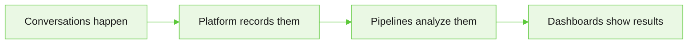

**Insights** tells you how your agents perform: how conversations end, how well the agent handles them, how customers react, and what it all costs.

## How Insights works

Insights turns each conversation into metrics in four steps:

1. **Conversations happen.** Every chat, API call, and phone call with your agents starts the flow.
2. **The platform records them.** It stores messages, tool calls, handoffs, errors, timings, tokens, and cost, plus any [custom tags](/agent-platform/analytics-insights/custom-tags) you add.
3. **Pipelines analyze them.** Built-in and custom [pipelines](/agent-platform/analytics-insights/analytics-pipelines) read each finished conversation and score it with an LLM.
4. **Dashboards show the results.** The prebuilt pages, custom dashboards, and Analytics Explorer read from one analytics store.

Three more sources feed Insights: your settings (costs, thresholds, and billing policy), customer surveys, and telephony call reports. To learn how each metric is calculated and how to compare numbers across pages, see [How Insights metrics work](/agent-platform/analytics-insights/how-metrics-work).

## Before you begin

* Enable the built-in pipelines in **Insights → Pipelines**. The quality, sentiment, and outcome metrics and the other dashboards depend on them. 
* Platform counts update in real time, and LLM-scored metrics appear after the conversation ends. A dash means no data yet, not zero.

## Insights dashboards

In the product, the **Insights** sidebar groups the dashboards as follows:

| Document | Sidebar group and pages | When to use it |
|:---|:---|:---|
| [How Insights metrics work](/agent-platform/analytics-insights/how-metrics-work) | All pages | Read first. Shows where each number comes from, when it updates, and why pages can show different totals. |
| [Usage insights](/agent-platform/analytics-insights/executive-dashboard-usage) | **Overview**: At a Glance; **Usage**: Billing & Usage | Start here. Shows outcome, quality, sentiment, and cost for a period, and reconciles consumed usage with billed usage. |
| [Quality insights](/agent-platform/analytics-insights/performance-quality) | **Quality & Performance**: Quality Monitor, Agent Performance | Use when the quality figure on At a Glance changes. Shows which quality aspect and which agent caused it. |
| [Customer voice](/agent-platform/analytics-insights/customer-voice) | **Customer Voice**: Customer Insights, Feedback Insights | Use to see the customer's side: what they asked for, how sentiment changed, and what they said in surveys. |
| [Voice analytics](/agent-platform/analytics-insights/voice-analytics) | **Channels**: Voice Analytics | Use when voice conversations underperform chat. Separates agent reasoning issues from call quality, speech recognition, and latency issues. |
| [Agent transfer](/agent-platform/analytics-insights/agent-transfer) | Agent Transfer | Use to track escalation volume, queue performance, and human handling of transferred conversations. |
| [Analytics explorer](/agent-platform/analytics-insights/analytics-explorer) | **Explore & Build**: Analytics Explorer | Use when prebuilt pages don't answer your question. Shows near real-time event, model, token, and cost data, with session and trace drill-down and custom queries. |
| [Custom dashboards](/agent-platform/analytics-insights/custom-dashboards) | **Explore & Build**: Custom Dashboards | Use when no prebuilt page shows the metric you need. Build charts from SQL or visual queries over the project's analytics data, and share them with the project. |
| [Analytics pipelines](/agent-platform/analytics-insights/analytics-pipelines) | **Explore & Build**: Pipelines | Use to see which evaluations run, or to add your own LLM analysis, such as whether the customer's goal was met. See [Custom pipelines](/agent-platform/analytics-insights/analytics-pipelines#custom-pipelines). Fields a custom pipeline stores are available to custom dashboards. |
| [Custom tags](/agent-platform/analytics-insights/custom-tags) | Agents, Settings | Use to tag conversations with business data, such as payment type or customer ID, so you can chart and filter by it. |
| [Insights metrics reference](/agent-platform/analytics-insights/metrics-reference) | All pages | Use to look up the definition, calculation, and source of any metric. |

