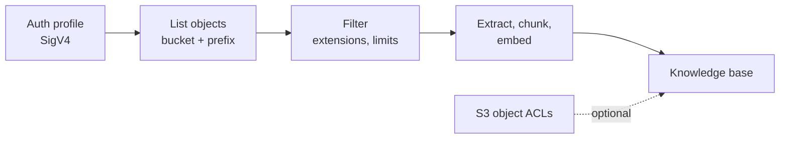

<Badge icon="arrow-left" color="gray">[Back to list of knowledge sources](/agent-platform/integrations/knowledge-sources)</Badge>

Use the Amazon S3 connector to index files from one or more S3 buckets into a knowledge base. Agents then retrieve that content to ground their answers. The connector signs every request with AWS Signature Version 4 (SigV4) through an **AWS IAM** auth profile, so the connector stores no credentials of its own.

## At a glance

<CardGroup cols={2}>
  <Card title="Authentication" icon="key" href="#step-1-prepare-aws-access">
    AWS IAM (SigV4). Assume role (recommended) or access keys.
  </Card>
  <Card title="Content" icon="folder-open" href="#step-3-configure-the-connector">
    Files in the buckets and prefixes you choose, filtered by extension.
  </Card>
  <Card title="Sync" icon="arrows-rotate" href="#sync-behavior">
    Manual or scheduled delta sync, from hourly to monthly.
  </Card>
  <Card title="Permissions" icon="lock" href="#permissions">
    Optional. Applies S3 object ACLs to search results.
  </Card>
</CardGroup>

<Accordion title="Connector details" icon="circle-info">
  | Item | Value |
  | --- | --- |
  | Category | Cloud storage |
  | Change detection | Last modified + size (default), Content hash |
  | Setup path | Connect > Locations > Filters > Permissions > Dry Run > Field Mapping > Activate |
</Accordion>

## How the connector works



<Accordion title="What happens at each stage">
  1. The connector authenticates with the AWS IAM auth profile and lists objects under each configured location.
  2. It keeps objects that match your filters, then extracts, chunks, and embeds their content.
  3. On each delta sync, it compares change-detection signals and processes only new and changed objects.
  4. If you turn on **Resource ACL**, it reads each object's ACL and applies the mapped grants to search results.
</Accordion>

## Before you begin

<Steps>
  <Step title="In AWS">
    - One or more S3 buckets that hold the content to index, and the Region of each bucket.
    - Permission to create an IAM role (recommended) or an IAM user with access keys.
    - If the buckets use SSE-KMS encryption, permission to grant `kms:Decrypt` on the key.
  </Step>
  <Step title="In the Agent Platform">
    - A knowledge base in your project.
    - Permission to create auth profiles and knowledge base sources.
  </Step>
</Steps>

## Step 1: Prepare AWS access

Choose a credential mode first. The platform recommends **Assume role** because the platform stores no long-lived keys.

<Tabs>
  <Tab title="Assume role (recommended)">
    1. In the AWS IAM console, create a role with a **Custom trust policy**.
    2. In the trust policy, allow the platform AWS identity to assume the role, and require the **External ID** that the platform generates for your workspace. You copy the External ID from the auth profile form in [Step 2](#step-2-create-the-auth-profile).
    3. Attach the [read-only permissions policy](#iam-permissions) to the role.
    4. Copy the **Role ARN**.
  </Tab>
  <Tab title="Access keys">
    1. In the AWS IAM console, create a user for the connector.
    2. Attach the [read-only permissions policy](#iam-permissions) to the user.
    3. Create an access key, and then copy the **Access key ID** and **Secret access key**.

    <Warning>Stored access keys don't refresh. If you use temporary keys with a session token, the connector stops syncing when the token expires.</Warning>
  </Tab>
</Tabs>

<Accordion title="IAM permissions" icon="shield-check" id="iam-permissions">
  The connector only reads from S3. Grant the smallest scope that covers your buckets and prefixes.

  ```json
  {
    "Version": "2012-10-17",
    "Statement": [
      {
        "Sid": "ListBuckets",
        "Effect": "Allow",
        "Action": ["s3:ListBucket", "s3:GetBucketLocation"],
        "Resource": "arn:aws:s3:::company-documents"
      },
      {
        "Sid": "ReadObjects",
        "Effect": "Allow",
        "Action": ["s3:GetObject", "s3:GetObjectAcl"],
        "Resource": "arn:aws:s3:::company-documents/*"
      }
    ]
  }
  ```

  | Action | Required when |
  | --- | --- |
  | `s3:ListBucket` | Always. Lists objects under each prefix. |
  | `s3:GetBucketLocation` | Always. Resolves the bucket Region. |
  | `s3:GetObject` | Always. Reads object content. |
  | `s3:GetObjectAcl` | You turn on **Resource ACL**. |
  | `kms:Decrypt` | The bucket uses SSE-KMS encryption. Add it on the KMS key. |
</Accordion>

## Step 2: Create the auth profile

You can create the profile from the connector, so you don't need to leave the setup flow.

<Steps>
  <Step title="Open the Amazon S3 connector">
    1. Go to **Knowledge Bases**, and then open your knowledge base.
    2. On **Overview**, under **Connect a data source**, select **Amazon S3**, and then select **Connect**.
    3. On the **Connect** step, select **New auth profile**. The new auth profile panel opens.
  </Step>
  <Step title="Enter the profile details">
    | Field | Description |
    | --- | --- |
    | **Auth Type** | Keep **AWS IAM (SigV4)**. |
    | **Profile Name** | Enter a name that identifies the account and environment, for example `S3 - Production`. |
    | **Description** | Optional. Describe the purpose of the profile. |
    | **Usage Mode** | Keep **Preconfigured**. An admin provides credentials once, and users don't need to authorize. |
    | **Visible to project members** | Turn on to let project members use the profile. |
  </Step>
  <Step title="Configure the credentials">
    In **Configuration** > **Credentials**, select the mode you prepared in [Step 1](#step-1-prepare-aws-access).

    <Tabs>
      <Tab title="Assume role (recommended)">
        | Field | Description |
        | --- | --- |
        | **Endpoint type** | Select **Custom AWS service**. The default, **Amazon Bedrock AgentCore**, doesn't apply to S3. |
        | **Signing service** | Enter `s3`. |
        | **Agent endpoint URL** | Leave empty. This field doesn't apply to S3. |
        | **Region** | Enter the bucket Region, for example `us-east-1`. |
        | **Role ARN** | Paste the Role ARN from Step 1. |
        | **Session duration (seconds)** | Optional. Enter a value from 900 to 3600. The default is 3600. |
        | **External ID** | Read only. Copy this value into the role's trust policy. |

        <Warning>If the form shows **Platform AWS identity not configured**, your deployment can't use Assume role. Ask your platform administrator to configure the platform AWS identity, or use **Access keys**.</Warning>
      </Tab>
      <Tab title="Access keys">
        | Field | Description |
        | --- | --- |
        | **Region** | Enter the bucket Region, for example `us-east-1`. |
        | **Signing service** | Enter `s3`. |
        | **Bucket (S3 only)** | Optional. Enter a default bucket name. |
        | **Endpoint (S3-compatible)** | Optional. Enter the endpoint URL for S3-compatible storage. Leave empty for Amazon S3. |
        | **Access Key ID** | Paste the access key ID. |
        | **Secret Access Key** | Paste the secret access key. The platform encrypts it and never displays it again. |
        | **Session Token** | Optional. Enter only for temporary keys. |
      </Tab>
    </Tabs>
  </Step>
  <Step title="Save the profile">
    Select **Create Profile**. The connector returns to the **Connect** step.
  </Step>
</Steps>

## Step 3: Configure the connector

<Steps>
  <Step title="Connect">
    | Field | Description |
    | --- | --- |
    | **AWS IAM auth profile** | Select the profile you created in [Step 2](#step-2-create-the-auth-profile). |
    | **Source name** | Enter a name that users see as the source of results, for example `Product documentation`. The default is `Amazon S3`. |
  </Step>
  <Step title="Locations">
    Each location is one bucket and its prefixes. Select **Add location** to index more than one bucket.

    | Field | Description | Default |
    | --- | --- | --- |
    | **Bucket** | Enter the bucket name, for example `company-documents`. | None |
    | **AWS region** | Enter the bucket Region. | `us-east-1` |
    | **Prefixes** | Optional. Enter comma-separated key prefixes, for example `policies/, runbooks/`. Leave empty to index the whole bucket. | Empty |
    | **Recursive listing** | Includes nested keys below each prefix. Turn off to index only the top level of each prefix. | On |

    <Accordion title="Advanced: custom endpoints">
      | Field | Description | Default |
      | --- | --- | --- |
      | **Custom endpoint** | Optional. Enter a regional or S3-compatible endpoint, for example `https://s3.us-east-1.amazonaws.com`. | Empty |
      | **Addressing style** | Select how the connector builds request URLs: **Auto**, **Virtual-hosted**, or **Path-style**. Use **Path-style** for S3-compatible storage that doesn't support virtual-hosted URLs. | **Auto** |
    </Accordion>
  </Step>
  <Step title="Filters and schedule">
    | Field | Description | Default |
    | --- | --- | --- |
    | **Allowed extensions** | Enter comma-separated file extensions to index. | `pdf, docx, txt, md` |
    | **Scheduled delta sync** | Turn on to sync on a schedule. You can still run a manual sync when this is off. | Off |
    | **Sync frequency** | Select **Hourly**, **Every 6 hours**, **Every 12 hours**, **Daily**, **Weekly**, **Monthly**, **Run once**, or **Custom cron**. Available when **Scheduled delta sync** is on. | **Every 6 hours** |

    <Accordion title="Advanced: change detection and run limits">
      | Field | Description | Default |
      | --- | --- | --- |
      | **Change detection** | Select how delta syncs find changed objects. See [Sync behavior](#sync-behavior). | **Last modified + size** |
      | **Max files per run** | Enter the maximum number of files that one sync run processes. | `10000` |
      | **Dry-run sample size** | Enter the number of files that a dry run samples. | `25` |
    </Accordion>
  </Step>
  <Step title="Permissions">
    Optional. Turn on **Resource ACL** to apply S3 object ACLs to search results, and then add grant mappings. See [Permissions](#permissions).
  </Step>
</Steps>

## Step 4: Validate and activate

<Steps>
  <Step title="Generate a proposal">
    Select **Generate proposal**. The server validates the configuration, compiles the connector package, and shows a redacted **Proposal preview**.
  </Step>
  <Step title="Run a dry run">
    Select **Run dry run**. The connector reads a sample of files, up to **Dry-run sample size**, without indexing them. Fix any access or filter errors before you continue.
  </Step>
  <Step title="Review the field mapping">
    On **Field Mapping**, confirm how S3 object attributes map to knowledge base fields.
  </Step>
  <Step title="Activate">
    Select **Activate**. The first sync starts and indexes all matching files.
  </Step>
</Steps>

<Tip>Start with one prefix and a small **Max files per run** value. Confirm the results in **Search & Test**, and then widen the scope.</Tip>

## Sync behavior

| Option | How it works | Use it when |
| --- | --- | --- |
| **Last modified + size** | Treats an object as changed when its last-modified time or size changes. | Most buckets. It's fast because the connector reads only object metadata. |
| **Content hash** | Treats an object as changed when its content hash changes. | Tools rewrite files without changing their content, and you want to skip those files. |

- A manual sync runs immediately, whatever the schedule.
- Each run processes up to **Max files per run** files.
- Changes to locations, filters, or the auth profile apply on the next sync.

## Permissions

By default, every user who can search the knowledge base can retrieve indexed S3 content. To restrict results by object, turn on **Resource ACL**. The connector then reads each object's ACL and applies a grant only after you map its grantee to a platform principal. Unmapped readable grants stay restricted.

<Note>S3 buckets created since April 2023 use the **Bucket owner enforced** setting, which disables ACLs. If your bucket controls access through bucket policies or IAM only, **Resource ACL** has no grants to read.</Note>

<Accordion title="Grant mapping fields" icon="user-lock">
  Select **Add S3 grant mapping** for each grantee.

  | Field | Options | Description |
  | --- | --- | --- |
  | **S3 grantee type** | **Canonical user**, **Email**, **URI**, **Group** | The type of grantee in the S3 ACL. |
  | **S3 grantee ID** | Text | The canonical user ID, email address, or group URI, for example `http://acs.amazonaws.com/groups/global/AllUsers`. |
  | **Principal type** | **User**, **Group**, **Domain**, **Everyone**, **Anonymous** | The platform principal that receives the grant. |
  | **Principal ID** | Text | The ID of the user, group, or domain. |
</Accordion>

## Manage the connector

After activation, open the source from **Sources** in your knowledge base.

<CardGroup cols={2}>
  <Card title="Overview" icon="gauge">Check health, the last sync, document counts, and recent activity. Select **Sync Now** to run a sync.</Card>
  <Card title="Activity" icon="clock-rotate-left">Review the history of sync runs and permission syncs.</Card>
  <Card title="Security" icon="shield">Review the security posture and configuration issues.</Card>
  <Card title="Settings" icon="gear">Change locations, filters, the schedule, or the auth profile.</Card>
</CardGroup>

## Limits and considerations

- The connector indexes only files whose extensions match **Allowed extensions**.
- The connector reads S3 object ACLs only. It doesn't evaluate bucket policies, IAM policies, or S3 Access Points.
- Each location uses one Region. Add a location for each bucket in a different Region.

## Troubleshoot common issues

<AccordionGroup>
  <Accordion title="The auth profile list is empty">
    Create an **AWS IAM** profile with **New auth profile**, and confirm that **Visible to project members** is on.
  </Accordion>
  <Accordion title="AccessDenied during the dry run">
    Add `s3:ListBucket` on the bucket and `s3:GetObject` on `bucket/*` to the IAM policy.
  </Accordion>
  <Accordion title="SignatureDoesNotMatch">
    Confirm that **Signing service** is `s3` and that the profile **Region** matches the bucket Region. For Assume role, confirm that **Endpoint type** is **Custom AWS service**.
  </Accordion>
  <Accordion title="PermanentRedirect or a Region error">
    Set **AWS region** on the location to the bucket's Region.
  </Accordion>
  <Accordion title="The dry run returns no files">
    Check **Prefixes**, **Recursive listing**, and **Allowed extensions**. Prefixes are case sensitive.
  </Accordion>
  <Accordion title="Encrypted files fail with KMS.AccessDeniedException">
    Grant `kms:Decrypt` on the bucket's KMS key to the role or user.
  </Accordion>
  <Accordion title="Users see no results after you turn on Resource ACL">
    Add a grant mapping for each readable grantee. Unmapped grants stay restricted.
  </Accordion>
  <Accordion title="Assume role can't be tested">
    Confirm the trust policy includes the workspace **External ID**. If the form shows **Platform AWS identity not configured**, use **Access keys** or contact your platform administrator.
  </Accordion>
</AccordionGroup>

## Related articles

- [Auth profiles](/agent-platform/administration/integrations-settings#auth-profiles)
- [Controlling access to a bucket with IAM policies (AWS)](https://docs.aws.amazon.com/AmazonS3/latest/userguide/walkthrough1.html)
- [Access control list (ACL) overview (AWS)](https://docs.aws.amazon.com/AmazonS3/latest/userguide/acl-overview.html)