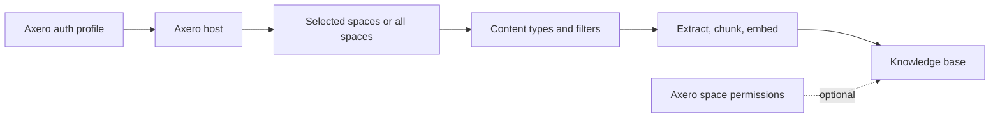

<Badge icon="arrow-left" color="gray">[Back to list of knowledge sources](/agent-platform/integrations/knowledge-sources)</Badge>

Use the Axero connector to index articles, blogs, CMS pages, wikis, forums, files, and announcements from an Axero tenant into a knowledge base. Connect with an Axero API Key or Bearer Token auth profile, choose the spaces and content to include, and review a proposal and dry run before activation.

## How the connector works

The connector reads content from the Axero spaces you select, applies your content and file settings, and adds supported content to the knowledge base. It can also fold comments into their parent content and apply Axero space permissions to search results.

<Accordion title="What happens at each stage">
  1. The connector uses the selected auth profile to call the Axero API at your tenant host URL.
  2. It loads spaces so you can choose specific spaces or include all spaces.
  3. It reads the enabled content types and applies the modified-date, comment, and file settings.
  4. If **Permission-aware ACL** is on, the connector reads space users and restricts search results to users with access. Content is withheld when permission evidence is missing.
</Accordion>

## Before you begin

Make sure that you have the following:

- An Axero tenant that the platform can reach over HTTPS. Include any context path in the host URL.
- An Axero API Key or Bearer Token and permission to read the content you want to index.
- For permission-aware sync, permission to read Axero space membership and user details. Axero must return active users with email addresses so the connector can resolve platform users.
- A knowledge base in your project, and permission to add a source to it.

## Step 1: Create an auth profile

Create an auth profile for the Axero credential. You can open the profile form from the connector setup flow or create a profile in project settings first.

<Steps>
  <Step title="Open the Axero connector">
    1. Go to **Knowledge Bases**, and then open your knowledge base.
    2. On **Overview**, under **Connect a data source**, select **All Sources**.
    3. Find **Axero**, select **Connect**, and then select **New auth profile**.
  </Step>
  <Step title="Enter the profile details">
    | Field | Description |
    | --- | --- |
    | **Auth Type** | Select **API Key** or **Bearer Token** to match the credential you have. |
    | **Profile Name** | Enter a name that identifies the Axero tenant and environment, for example `Axero - Production`. |
    | **Description** | Optional. Describe the purpose of the profile. |
    | **Usage Mode** | Keep **Preconfigured**. An admin provides credentials once, and users do not need to authorize. |
    | **Visible to project members** | Turn on to let project members use the profile. |
  </Step>
  <Step title="Configure the credential">
    For **API Key**, the profile sends the key in the `Rest-Api-Key` header. Paste the key into the secret field.

    For **Bearer Token**, keep the authorization prefix as `Bearer` and paste the token into the secret field.

    The secret is encrypted at rest and is not displayed after saving.
  </Step>
  <Step title="Save the profile">
    Select **Create Profile**. The connector returns to the setup flow.
  </Step>
</Steps>

## Step 2: Connect to Axero

Select the auth profile and enter the tenant host URL.

| Field | Description |
| --- | --- |
| **Axero auth profile** | Select the profile created in [Step 1](#step-1-create-an-auth-profile). |
| **Axero host URL** | Enter the full HTTPS URL for your tenant, for example `https://company.axerosolutions.com/axero`. Include a context path if your Axero instance uses one. |

After you enter the host URL and choose a profile, the connector loads spaces automatically. Use **Refresh spaces** to reload them.

## Step 3: Select spaces

Choose the space scope for the source.

| Scope | Description |
| --- | --- |
| **Selected spaces** | Index only the spaces you select. Search for a space, select it, and load additional results when needed. |
| **All spaces** | Include all spaces available to the Axero account. |

The selected-space scope is the default. Confirm the selected spaces before you generate the proposal; the source scope controls what content can be indexed.

## Step 4: Choose content and governance settings

### Content types

Choose which Axero content types to index. All seven types are enabled by default in the setup flow.

| Content type | Description |
| --- | --- |
| **Articles** | Axero articles. |
| **Blogs** | Axero blog posts. |
| **CMS pages** | Axero content-management pages. |
| **Wikis** | Axero wiki content. |
| **Forums** | Axero forum content. |
| **Files** | Files stored in Axero. |
| **Announcements** | Axero announcements. |

Use **Select all** or **Clear all** to change the selection quickly.

### Comments

Turn on **Fold comments into parent content** to include comment context in articles, blogs, wikis, and forums. Comments are included in the parent document; they are not indexed as separate documents. This setting is on by default.

### Files

Configure which Axero files the connector processes.

| Setting | Description | Default |
| --- | --- | --- |
| **File policy** | Choose **Standard document formats**, **Custom extensions**, or **Files disabled**. Custom extensions must be supported by the platform. | Standard document formats |
| **Custom extensions** | When **Custom extensions** is selected, enter comma-separated extensions. The standard set includes `bmp`, `csv`, `docx`, `htm`, `html`, `jpeg`, `jpg`, `json`, `markdown`, `md`, `pdf`, `png`, `pptx`, `tiff`, `txt`, `webp`, and `xlsx`. | Not applicable |
| **Max file size (MiB)** | Files larger than this size are skipped. | `50` |

### Modified date

Use **Modified on or after** to include content updated on or after the selected date. Leave it empty to include content regardless of its modification date.

### Permission-aware ACL

**Permission-aware ACL** is on by default. When enabled, the connector reads Axero space membership and applies it to search results. Make sure the Axero credential can read space users and that Axero returns active users with email addresses that match platform user identities.

If the permission API is unavailable, a space ID is missing, or access evidence cannot be resolved, the connector fails closed and withholds the affected content. Turn off **Permission-aware ACL** only when users who can search the knowledge base may retrieve the indexed Axero content regardless of Axero space membership.

## Step 5: Review and activate

Review the source proposal and run a dry run before activating the connector.

<Steps>
  <Step title="Generate a proposal">
    Select **Generate proposal**. Review the redacted proposal and confirm the Axero host, space scope, content types, and settings.
  </Step>
  <Step title="Run a dry run">
    Select **Run dry run** to validate the configuration and review the result before activation. Resolve access, scope, or file-policy issues before continuing.
  </Step>
  <Step title="Activate the source">
    When the proposal and dry-run result are acceptable, select **Approve & start**. The source is activated and the initial sync starts.
  </Step>
</Steps>

## Sync behavior

The connector uses content comparison to avoid reprocessing unchanged items. You can enable a recurring sync schedule in the source settings after activation.

- Schedule options include hourly, every 6 hours, every 12 hours, daily, weekly, monthly, one-time, and custom cron.
- In source settings, select **Save & sync** to save configuration changes and queue a full sync. When permission-aware ACL is enabled, this also queues a permission recrawl.
- Changes to space scope, content types, file policy, or the modified-date filter affect later syncs. Review the effective scope after changing these settings.

## Limits and considerations

- A sync cycle processes up to 10,000 listed items. For larger sources, narrow the selected spaces or split the content into separate sources.
- The default maximum file size is 50 MiB. Increase or lower it in the source settings to match your requirements.
- The connector indexes only the selected content types and files allowed by the file policy.
- With permission-aware ACL enabled, content is withheld when the connector cannot establish Axero space membership or resolve the users needed for access checks.

## Troubleshoot common issues

| Symptom | Solution |
| --- | --- |
| The auth profile list is empty. | Create an Axero profile with **New auth profile** and confirm **Visible to project members** is on. |
| The connector cannot load spaces. | Confirm the profile credential is valid, the host URL is the full HTTPS tenant URL including any context path, and the platform can reach the tenant. Select **Refresh spaces** after correcting the connection. |
| The proposal or dry run includes no content. | Check the space scope, content-type selection, and **Modified on or after** date. |
| Files are missing. | Confirm **Files** is selected, the file policy allows the extension, and the file is within the configured maximum size. |
| Users see no results with **Permission-aware ACL** on. | Confirm the credential can read space members and that Axero returns active user email addresses that match platform identities. Content remains hidden when access cannot be proven. |
| A sync does not include recent configuration changes. | Select **Save & sync** in source settings to save the changes and queue a full sync. |

## Related articles

- [Knowledge sources](/agent-platform/integrations/knowledge-sources)
- [Knowledge bases](/agent-platform/knowledge)
- [Auth profiles](/agent-platform/administration/integrations-settings#auth-profiles)
