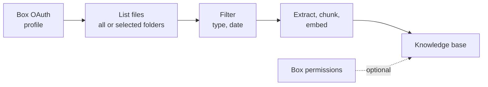

<Badge icon="arrow-left" color="gray">[Back to list of knowledge sources](/agent-platform/integrations/knowledge-sources)</Badge>

Use the Box connector to index files and folders from Box into a knowledge base. Agents then retrieve that content to ground their answers. The connector authenticates through a **Box OAuth** auth profile, and uses the same profile for file discovery, downloads, and permission crawls.

## How the connector works

The connector reads files from all or selected folders, keeps the ones that match your filters, and adds them to the knowledge base. It crawls Box permissions before content becomes searchable.

<Accordion title="What happens at each stage">
  1. The connector authenticates with the Box OAuth profile and lists files in the selected scope.
  2. It keeps files that match the file type and modified date filters.
  3. It extracts, chunks, and embeds the content of each file.
  4. If you keep **Enforce Box permissions** on, it crawls owner, user, and group grants and applies them to search results.
</Accordion>

## Before you begin

Make sure that you have the following:

- A Box account with access to the content to index.
- Permission in Box to create a custom app, or an enterprise admin who can approve one.
- A knowledge base in your project, and permission to add sources to it.

## Step 1: Prepare Box access

Create a custom app in Box so the connector can request access to your content. You need the client ID and client secret in Step 2.

1. In the Box Developer Console, create a **Custom App** with **User Authentication (OAuth 2.0)**.
2. In the app's **Configuration**, add the **Callback URL** from the auth profile form in [Step 2](#step-2-create-the-auth-profile) as a redirect URI.
3. Under **Application Scopes**, select **Read all files and folders stored in Box**.
4. Ask your Box enterprise admin to approve the app, if your enterprise requires it.
5. Copy the **Client ID** and **Client Secret**.

<Accordion title="Required scopes" icon="shield-check" id="required-scopes">
  The auth profile lists these Box scopes by default.

  | Scope            | Required when                                                              |
  |------------------|----------------------------------------------------------------------------|
  | `root_readonly`  | Always. Lists folders, reads files, and reads collaborations.              |
  | `root_readwrite` | Listed by default in the auth profile. The connector indexes content only. |

</Accordion>

## Step 2: Create the auth profile

The auth profile stores the app credentials from Step 1 and the token that the connector uses for each request. You can create the profile from the connector, so you don't need to leave the setup flow.

<Steps>
  <Step title="Open the Box connector">
    1. Go to **Knowledge Bases**, and then open your knowledge base.
    2. On **Overview**, under **Connect a data source**, select **Box**, and then select **Connect**.
    3. On the **Connect** step, select **New connection**. The new auth profile panel opens.
  </Step>
  <Step title="Enter the profile details">
    | Field | Description |
    | --- | --- |
    | **Auth Type** | Keep **OAuth 2.0 App (User Delegated)**. |
    | **Profile Name** | Enter a name that identifies the account and environment, for example `Box - Production`. |
    | **Description** | Optional. Describe the purpose of the profile. |
    | **Usage Mode** | Keep **Preconfigured**. An admin provides credentials once, and users don't need to authorize. |
    | **Visible to project members** | Turn on to let project members use the profile. |
  </Step>
  <Step title="Review the OAuth settings">
    The form fills in the Box endpoints and scopes. Keep these values.

    | Field | Description |
    | --- | --- |
    | **Authorization URL** | Keep `https://account.box.com/api/oauth2/authorize`. |
    | **Token URL** | Keep `https://api.box.com/oauth2/token`. |
    | **Scopes** | Keep `root_readonly` and `root_readwrite`. |
    | **Require PKCE** | Keep off. |
    | **Callback URL** | Read only. Copy this value into the Box app's redirect URIs. |
    | **Client ID** | Paste the client ID from Step 1. |
    | **Client Secret** | Paste the client secret from Step 1. The platform encrypts it and never displays it again. |
  </Step>
  <Step title="Save and authorize the profile">
    Select **Create Profile**, and then complete the Box authorization. The connector returns to the **Connect** step.
  </Step>
</Steps>

## Step 3: Configure the connector

Tell the connector which content to read and which files to keep. Each step below matches a step in the setup wizard.

<Steps>
  <Step title="Connect">
    | Field | Description |
    | --- | --- |
    | **Box connection** | Select the profile you created in [Step 2](#step-2-create-the-auth-profile). |
  </Step>
  <Step title="Scope">
    | Field | Description | Default |
    | --- | --- | --- |
    | **Folder scope** | Select **All files** to sync every file that the authorized account can access, or **Selected folders** to sync only the folders you choose. | **All files** |
    | **Box folders** | Available with **Selected folders**. Browse or search Box, and then select one or more folders as crawl roots. | None |
    | **Include subfolders** | Includes nested folders under the selected scope. | On |
    | **File types** | Select **All supported files**, **Documents**, **Spreadsheets**, **Presentations**, or **Custom**. | **All supported files** |
    | **Extensions** | Available with **Custom**. Enter comma-separated extensions, for example `pdf, docx, xlsx`. | Empty |
    | **Modified after** | Optional. Enter a date to index only files modified after it. | Empty |
  </Step>
  <Step title="Permissions">
    Optional. Keep **Enforce Box permissions** on to apply Box grants to search results. See [Permissions](#permissions).
  </Step>
</Steps>

## Step 4: Validate and activate

Test the configuration before the first full sync. Validation catches access and filter errors early, before you index any content.

<Steps>
  <Step title="Generate a proposal">
    Select **Generate proposal**. The server compiles the package and shows the permission posture in the **Proposal preview**.
  </Step>
  <Step title="Run a dry run">
    Select **Dry run**. The connector checks the configuration without indexing content. Fix any access or filter errors before you continue.
  </Step>
  <Step title="Review the field mapping">
    On **Field Mapping**, confirm how Box file attributes map to knowledge base fields.
  </Step>
  <Step title="Approve and sync">
    Select **Approve & sync**. The first sync starts and indexes all matching files.
  </Step>
</Steps>

<Tip>Start with **Selected folders** and one folder. Confirm the results in **Search & Test**, and then widen the scope.</Tip>

## Sync behavior

After the first sync, the connector processes new and changed files. You can also start a sync at any time from the source.

- A manual sync runs immediately, whatever the schedule.
- Changes to the folders, filters, or auth profile apply on the next sync.
- With **All files**, the scope grows as the authorized account gains access to more content.

## Permissions

By default, the connector keeps **Enforce Box permissions** on. It crawls owner, user, and group grants before content becomes searchable, and returns a file only to users who can open it in Box.

<Warning>If you turn off **Enforce Box permissions**, every user who can search the knowledge base can retrieve every indexed file.</Warning>

## Limits and considerations

Keep these limits in mind when you plan the scope of the connector.

- The connector indexes only content that the authorized Box account can access.
- The folder browser lists folders only after you select a Box connection.
- The connector indexes only the file types that the **File types** setting allows.

## Troubleshoot common issues

Most issues come from the Box app setup, app approval, or filters that exclude every file. Find your symptom in the table, and then apply the solution.

| Symptom | Solution |
| --- | --- |
| The auth profile list is empty. | Create a profile with **New connection**, complete the Box authorization, and confirm that **Visible to project members** is on. |
| Authorization fails with `redirect_uri_mismatch`. | Add the **Callback URL** from the auth profile form to the Box app's redirect URIs. |
| Authorization fails because the app isn't authorized. | Ask your Box enterprise admin to approve the custom app. |
| The folder browser shows no folders. | Select a **Box connection** first, and confirm that the authorized account can access the folders. |
| The dry run returns no files. | Check **Folder scope**, **Include subfolders**, **File types**, and **Modified after**. |
| Some files are missing after the sync. | Confirm that the authorized Box account can access the files, or collaborate the account on the folders. |
| Users see no results after activation. | Confirm that the users have access to the files in Box. **Enforce Box permissions** hides files they can't open. |

---

{{related}}

Learn more about auth profiles and Box app setup.

- [Auth profiles](/agent-platform/administration/integrations-settings#auth-profiles)
- [Setup with OAuth 2.0 (Box)](https://developer.box.com/guides/authentication/oauth2/oauth2-setup/)
- [Scopes (Box)](https://developer.box.com/guides/api-calls/permissions-and-errors/scopes/)
