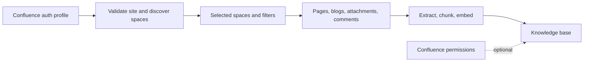

<Badge icon="arrow-left" color="gray">[Back to list of knowledge sources](/agent-platform/integrations/knowledge-sources)</Badge>

Use the Confluence Server connector to index pages, blog posts, attachments, and comments from a self-hosted Confluence site into a knowledge base. Create a Confluence auth profile, select the spaces and content to sync, and review a proposal before activating the source. Permission-aware ACL sync is available to restrict search results to content each user can access in Confluence.

## How the connector works

The connector connects to your Confluence Server REST API, discovers spaces, and reads the content that matches your selected spaces and filters. It creates knowledge-base documents from the selected objects and keeps them current through syncs.

<Accordion title="What happens at each stage">
  1. The connector uses the selected auth profile to validate the Confluence base URL and list spaces the account can access.
  2. The selected space keys define the source boundary. Date, ancestor, CQL, and include or exclude rules narrow the content within that boundary.
  3. The connector reads the enabled content types and their child resources, then indexes supported content in the knowledge base.
  4. If **Permission-aware ACL** is on, the connector syncs Confluence permissions and applies them to search results. Content is hidden when access cannot be established.
</Accordion>

## Before you begin

Make sure that you have the following:

- A Confluence Server site that the platform can reach over HTTP or HTTPS. If your site uses a context path, include it in the base URL.
- An active Confluence auth profile using **Bearer Token**, **Basic Auth**, or **OAuth 2.0 App (User Delegated)**.
- An account that can read the spaces and content you want to index. For permission-aware sync, the account also needs access to the Confluence permission, restriction, and group information the connector must read.
- A knowledge base in your project, and permission to add a source to it.

## Step 1: Create an auth profile

The auth profile stores the credentials the connector uses to access Confluence. You can create it from the connector setup flow or in project settings before you connect the source.

<Steps>
  <Step title="Open the auth profile form">
    1. Go to **Knowledge Bases**, and then open your knowledge base.
    2. On **Overview**, under **Connect a data source**, select **All Sources**.
    3. Find **Confluence Server**, select **Connect**, and then select **New auth profile**.
  </Step>
  <Step title="Enter the profile details">
    | Field | Description |
    | --- | --- |
    | **Auth Type** | Select **Bearer Token**, **Basic Auth**, or **OAuth 2.0 App (User Delegated)** to match the credential configured for your Confluence site. |
    | **Profile Name** | Enter a name that identifies the site and environment, for example `Confluence - Production`. |
    | **Description** | Optional. Describe the purpose of the profile. |
    | **Usage Mode** | Keep **Preconfigured**. An admin provides credentials once, and users do not need to authorize. |
    | **Visible to project members** | Turn on to let project members use the profile. |
    | **Confluence base URL** | Enter the full site URL, including any context path, with no trailing slash. Use the same base URL in the connector setup. |
  </Step>
  <Step title="Configure the credentials">
    In **Secrets** or the OAuth configuration fields, provide the credentials and endpoints required by the selected auth type. The form changes depending on the auth type. For OAuth, configure the provider's authorization and token endpoints, client credentials, scopes, and redirect URI as required by your Confluence OAuth application.

    Secrets are encrypted at rest and are not displayed after saving.
  </Step>
  <Step title="Save the profile">
    Select **Create Profile**. The connector returns to the setup flow.
  </Step>
</Steps>

## Step 2: Connect to Confluence Server

Use the auth profile and base URL to validate the site before selecting content.

| Field | Description |
| --- | --- |
| **Confluence auth profile** | Select the profile created in [Step 1](#step-1-create-an-auth-profile). The profile's auth type must match its credentials. |
| **Confluence base URL** | Enter the reachable Confluence site URL, including its context path if present. For example, `https://confluence.example.com/confluence`. |

1. Select **Validate connection** to check that the platform can reach Confluence and authenticate.
2. Select **Discover spaces** to load spaces available to the selected account.

If validation fails, check the URL, context path, network access from the platform, and the selected profile's credentials. Space discovery requires the profile to be able to list spaces.

## Step 3: Select spaces and configure filters

Space keys define the hard source boundary: only content from selected spaces is eligible for sync. Optional filters narrow the content within those spaces.

| Field | Description |
| --- | --- |
| **Space keys** | Enter comma-separated keys or select spaces from the discovered list. For example, `ENG, HR, OPS`. |
| **Discovered spaces** | Shows the spaces returned by discovery. Use **Select visible** or **Select all discovered** to select spaces, and **Clear** to remove the selection. |
| **Search spaces** | Find discovered spaces by key or name. Run discovery first to load the picker. |
| **Modified after / Modified before** | Optional date bounds for the content to sync. |
| **Ancestor page IDs** | Optional comma-separated page IDs. Limits sync to content under the specified ancestor pages. |
| **Advanced CQL** | Optional Confluence Query Language expression that further narrows the content read by the sync. |

### Advanced include and exclude rules

Use **Add rule** to describe content to include or exclude. Choose whether all rules or any rule must match. Rules are pushed down as CQL before sync.

Available fields include space key, ancestor, content type, created date, creator, ID, label, last modified date, parent, title, and user. Operators depend on the field and action; they include equality, text contains, date comparisons, and list matching. For list matching, enter comma-separated values. Exclusion rules support matching values, text, or lists.

Rules narrow the selected spaces; they do not expand the source beyond the selected space keys. Check **Proposal preview** and the dry-run results to confirm the effective scope before activation.

## Step 4: Choose content and permissions

### Objects and child resources

Choose which Confluence objects to sync. Pages, blog posts, attachments, and comments are enabled by default in the setup flow.

| Option | Description |
| --- | --- |
| **Pages** | Primary answer content, with hierarchy, space, ancestor, and version context. |
| **Blog posts** | Primary answer content from Confluence blogs. |
| **Attachments** | Files attached to selected pages and blog posts. Choose which formats to include. |
| **Include comments** | Collects comments from pages and blog posts as documents linked to their parent content. |

For **Attachment formats**, choose **Default supported**, **Standard**, or **Custom**. The standard set includes PDF, DOCX, TXT, and Markdown. Custom selection supports PDF, DOCX, PPTX, TXT, Markdown, HTML, PNG, JPG, TIFF, BMP, WebP, CSV, JSON, XLSX, and XLS.

### Permission-aware ACL

**Permission-aware ACL** is on by default. When enabled, the connector syncs Confluence space permissions, page restrictions, and group membership, then uses them to limit search results. Make sure the platform can resolve a searcher's identity to the corresponding Confluence user. If the connector cannot prove that a user can access content, it fails closed and does not return that content.

Turning off **Permission-aware ACL** means users who can search the knowledge base may retrieve indexed content regardless of Confluence permissions. Keep it on when indexed material should remain subject to Confluence access controls.

## Step 5: Review and activate

Generate a package proposal and run a bounded dry run before starting the first sync.

<Steps>
  <Step title="Generate a proposal">
    Select **Generate proposal**. Review the redacted proposal preview, including the selected spaces, content types, and effective filters.
  </Step>
  <Step title="Run a dry run">
    Select **Dry run** to check access and inspect a bounded sample without activating the source. Resolve authentication, scope, or extraction issues before continuing.
  </Step>
  <Step title="Activate the source">
    When the preview is acceptable, select **Approve & sync**. The source is activated and its initial sync starts.
  </Step>
</Steps>

## Sync behavior

The initial activation starts a sync for the selected source scope. Later syncs pick up content changes that match the saved configuration. You can change a source's settings after activation; review the source's sync status and permissions after changing its scope or ACL configuration.

- **Scheduled sync** is off by default. In source settings, you can schedule hourly, every 6 hours, every 12 hours, daily, weekly, monthly, one-time, or custom cron runs.
- Select **Save & sync** to save source settings and queue a full sync. When permission-aware ACL is enabled, this also queues a permission recrawl.
- Changes to the selected spaces, content types, or filters affect later syncs. Review the proposal or dry run after changing the scope.
- Permission-aware ACL has a separate permission sync schedule in the source settings. You can run it manually or schedule recurring permission syncs so search results reflect Confluence access changes.

## Limits and considerations

- Space discovery and content sampling are bounded. Discovery returns at most 250 spaces, and only the first 25 discovered spaces are profiled with content samples. The picker does not imply that additional spaces are inaccessible; enter a known space key directly when needed.
- The connector processes up to 10,000 listed items per cycle. Large sources may need multiple syncs or narrower space and filter scope.
- Attachment sync supports files up to 100 MB. Select only formats that users need to search.
- The Confluence account must be able to read the configured content. Content hidden from that account cannot be indexed.
- Permission-aware results depend on the platform resolving users and groups to Confluence identities. Unresolved or unproven access remains restricted.

## Troubleshoot common issues

| Symptom | Solution |
| --- | --- |
| The auth profile list is empty. | Create a Confluence profile with **New auth profile** and confirm **Visible to project members** is on. |
| **Validate connection** fails. | Confirm the auth type and credentials, use the full base URL including any context path, and check that the platform can reach the Confluence site. |
| Connection works but space discovery fails or returns no spaces. | Confirm that the account can access the Confluence REST API and list the required spaces. You can enter a known space key directly. |
| The proposal or dry run includes no content. | Confirm that space keys are correct and that the date, ancestor, CQL, and include or exclude rules do not filter out all content. Check that the required object types are enabled. |
| Attachments are missing. | Turn on **Attachments**, check the selected attachment formats, and confirm the files are within the supported size limit. |
| Users see no results with **Permission-aware ACL** on. | Confirm Confluence permission access and identity mapping for those users. The connector hides content when it cannot prove access. |
| Search results do not reflect a recent permission change. | Run the permission sync or refresh the source so the latest Confluence permissions are applied. |

## Related articles

- [Knowledge sources](/agent-platform/integrations/knowledge-sources)
- [Knowledge bases](/agent-platform/knowledge)
- [Auth profiles](/agent-platform/administration/integrations-settings#auth-profiles)
