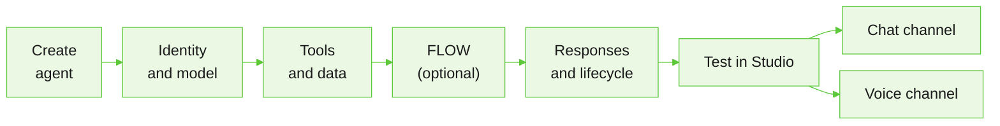
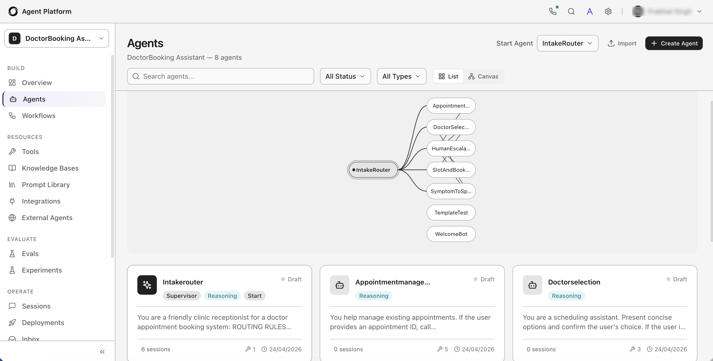
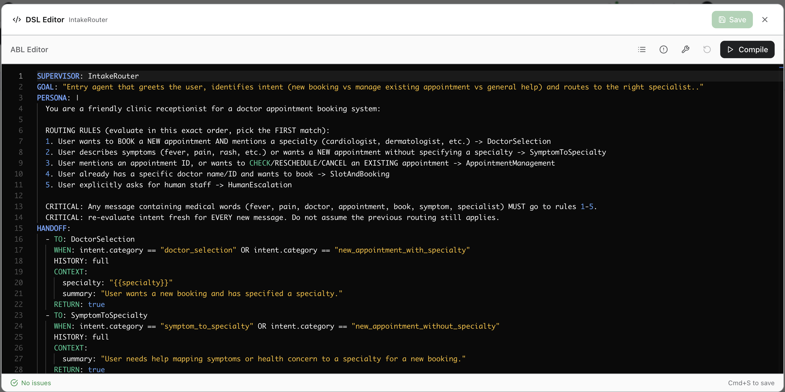
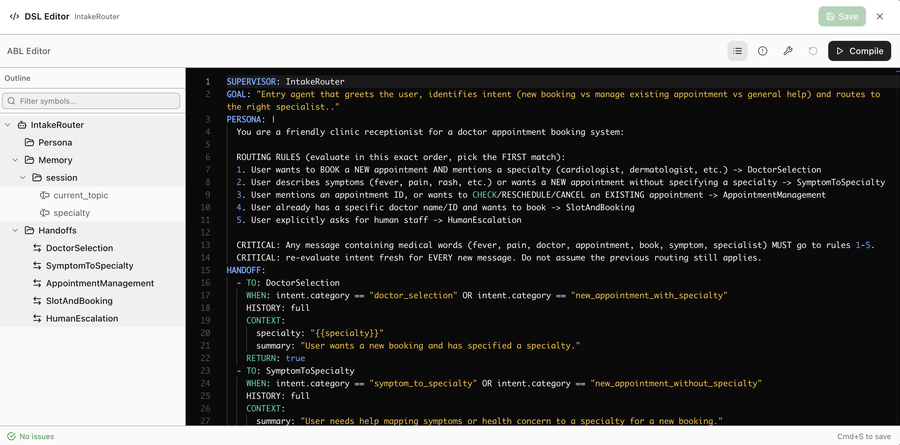
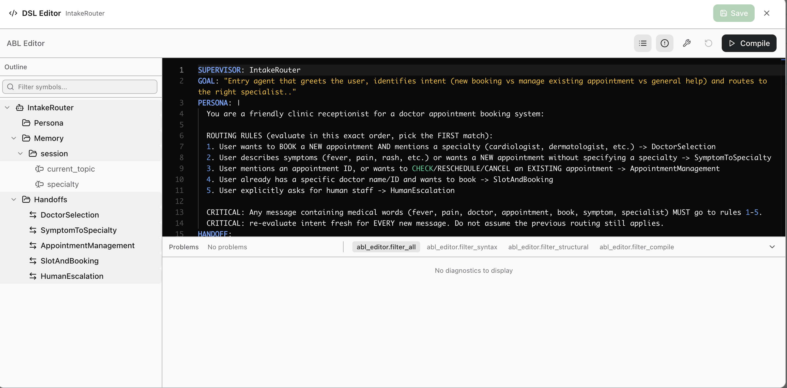
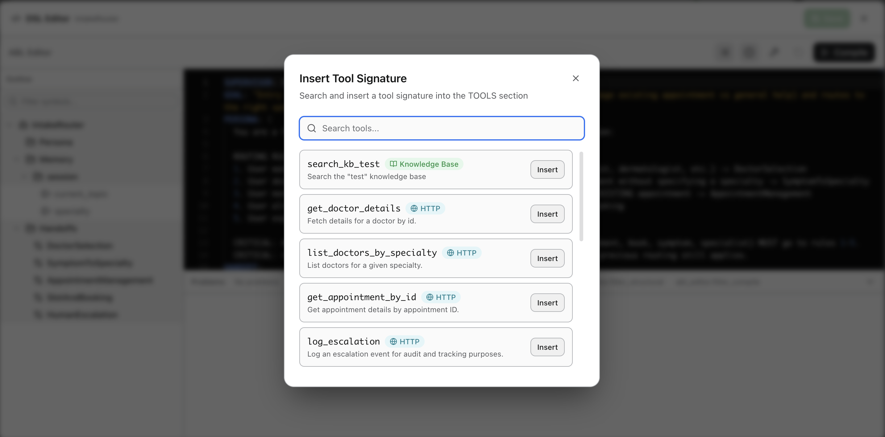
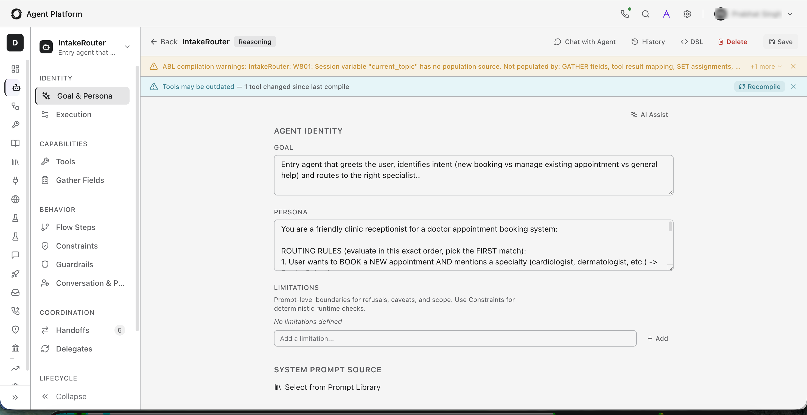
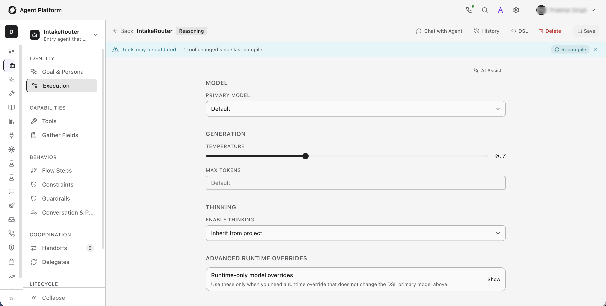

Agents are the core AI units in Agent Platform. An agent reasons toward a goal, calls tools, and composes replies in the persona you define. This guide shows how to create an agent in Studio and write its ABL definition.

The same agent can serve chat and voice, in one or more languages. Build the agent once. Then enable voice and extend it.

<Tip>Before you write instructions, read [Agent design guidelines](/agent-platform/best-practices/agent-design-guidelines).</Tip>

## How an agent is built

You build every agent in the same order. The channel comes last.



### Reasoning and FLOW

Every agent reasons by default. Add a `FLOW` section when parts of the conversation need fixed, deterministic steps. A `FLOW` section doesn't create a different agent type. The agent still reasons and calls tools outside the flow steps. To add one, see [Add a FLOW section](#add-a-flow-section).

| Feature | Reasoning (default) | With a FLOW section |
| --- | --- | --- |
| Decision making | The LLM decides the next action. | Steps define explicit transitions. |
| Best for | Open-ended conversations and complex reasoning. | Structured processes, such as bookings or identity checks. |
| Editor UI | Full-page configuration panel. | Visual flow canvas with step nodes. |
| Step control | The LLM decides when to use tools. | Each step defines its actions and next step. |

### Chat, voice, and language

Most of an agent is the same on every channel and in every language. Only a few parts change.

| Part of the agent | Chat | Voice | More than one language |
| --- | --- | --- | --- |
| Identity, tools, memory, FLOW, lifecycle | Same | Same | Same |
| Reply style | Text, markdown, and rich content | Short and spoken. See [Set the spoken style](#set-the-spoken-style). | Localized messages and a glossary. See [Multi-language support](#multi-language-support). |
| Listening | Not used | Silence, barge-in, keypad, and secure input. See [Set how the agent listens](#set-how-the-agent-listens). | Not used |
| Greeting | `ON_START` | `ON_START`, or the channel **Welcome Message** on a Pipeline voice channel | Same as the channel |
| Language handling | One language by default | One language by default | Language detection, routing, and per-language models |
| Channel | Web, SDK, or messaging | Voice channel, Pipeline or Realtime. See [Create a voice channel](#create-a-voice-channel). | Any channel |
| Testing | **Chat** tab in Studio | Soft Phone. See [Test your voice agent](#test-your-voice-agent). | Same as the channel |

You choose the channel at deployment, but plan for it before you write instructions. Voice callers hear your replies, so write short, plain replies and ask for one thing at a time. Chat users can read longer replies and use buttons, cards, and other rich content.

Build and test the agent first. Then [enable voice](#enable-voice-for-your-agent) and [add languages](#multi-language-support). For design advice, see [Design voice conversations](/agent-platform/best-practices/design-voice-conversations) and [Build multilingual agents](/agent-platform/best-practices/multilingual-agents).

## Build and test an agent

Create the agent, define what it does, choose the model, add a tool, and test it in Studio.

<Note>Before you start, [access the platform](/agent-platform/getting-started#access-the-platform) and make sure you have a project, developer permissions on it, and an LLM provider configured. To build with Arch, MCP, or the CLI instead, see [Ways to build on the platform](/agent-platform/getting-started#ways-to-build-on-the-platform).</Note>

<Steps>
<Step title="Create an agent in Studio" titleSize="h3">

You need developer permissions on the project.

1. Open your project and select **Agents** in the sidebar. The page lists each agent with its name, flow indicator, deployment status, and last change.



2. Select **Create Agent** and complete the fields.

| Field | Required | Description |
| --- | --- | --- |
| **Agent Name** | Yes | Starts with a letter. Letters, numbers, and underscores only. Maximum 100 characters. |
| **Execution Mode** | Yes | **Reasoning** (default), or **FLOW-based** for structured steps. See [Reasoning and FLOW](#reasoning-and-flow). |
| **Description** | No | A short summary of what the agent does. |

3. Select **Create Agent**. The agent editor opens.

#### Choose an editor

{/* REVIEW: The handbook calls these views Designer and Editor. Confirm the current UI names. */}
Configure the agent in either editor. They stay in sync.

- **Visual Editor**: a form with sections for identity, tools, memory, flow, and more.
- **ABL Editor**: a code editor for the agent's ABL definition. To open it, select the **\< \> ABL** icon in the agent's top bar.



The ABL Editor has syntax highlighting, inline error markers, and slash commands. Type `/` to insert a snippet, such as a tool, a gather field, or a handoff.

<AccordionGroup>
  <Accordion title="Save and validate">
    Select **Save** to save and validate the definition. Studio flags syntax issues inline. The status bar shows **No issues** when the definition is valid.

    Select **Compile** to run a full structural check without saving.
  </Accordion>
  <Accordion title="Outline panel">
    The Outline panel shows the agent's structure as a tree, such as `PERSONA`, `MEMORY`, `HANDOFFS`, and steps. Use **Filter symbols** to jump to a section.

    
  </Accordion>
  <Accordion title="Diagnostics panel">
    The Diagnostics panel at the bottom lists validation issues by type.

    

    | Tab | What it shows |
    | --- | --- |
    | **Problems** | All issues from syntax, structural, and compile checks. |
    | **Syntax** | Malformed ABL. |
    | **Structural** | Logical issues, such as missing required fields or invalid references. |
    | **Compile** | Errors that stop the definition from compiling and deploying. |
  </Accordion>
  <Accordion title="Insert a tool signature">
    Select **Insert Tool Signature** to search the project's tools and insert a signature into the `TOOLS` block at the cursor.

    
  </Accordion>
</AccordionGroup>

</Step>
<Step title="Define identity and persona" titleSize="h3">

Identity and persona set how the agent communicates: its tone, expertise, and boundaries.



Define the identity at the top of the agent definition.

```yaml expandable=true
AGENT: Policy_Advisor

GOAL: |
  Answer customer policy questions using semantic search
  over policy documents. Clarify ambiguous queries before searching.

PERSONA: |
  Knowledgeable and patient policy specialist.
  Cites source documents when answering. Never guesses.

LIMITATIONS:
  - "Cannot modify or override existing policies"
  - "Cannot process refunds directly"
```

| Field | Purpose |
| --- | --- |
| `GOAL` | What the agent accomplishes. |
| `PERSONA` | How the agent communicates: tone, style, and expertise. |
| `LIMITATIONS` | Prompt-level boundaries the agent uses to refuse requests, explain caveats, or stay in scope. For hard enforcement, add `CONSTRAINTS`. |

<Tip>Keep `GOAL` and `PERSONA` short and specific. Vague text leads to inconsistent behavior.</Tip>

</Step>
<Step title="Configure execution" titleSize="h3">

The `EXECUTION` block sets the model, token limits, reasoning depth, and timeouts.

{/* REVIEW: This order (model card, project override, agent runtime overrides, EXECUTION) differs from the five-level order in /agent-platform/administration/ai-configuration#how-model-resolution-works. Confirm and align. */}

Model settings apply in this order, from lowest to highest precedence: the model card, the project model override, agent runtime overrides, and `EXECUTION`. If the selected model doesn't support a setting, the platform leaves it out of the request. For example, it doesn't send sampling parameters to reasoning models.



```yaml
EXECUTION:
  model: claude-sonnet-4-5-20250929
  temperature: 0.3
  max_tokens: 4096
  max_reasoning_iterations: 15
  tool_timeout: 10000
```

| Field                      | Description                                                                    |
| -------------------------- | ------------------------------------------------------------------------------ |
| `model`                    | LLM model for this agent.                                                      |
| `temperature`              | Controls response variability. Lower values produce more deterministic output. |
| `max_tokens`               | Maximum tokens per response.                                                   |
| `max_reasoning_iterations` | Caps the number of tool-call/response cycles before forcing a final response.  |
| `tool_timeout`             | Milliseconds to wait for a tool call before timing out.                        |

{/* REVIEW: The handbook says keep the default of 10 tool rounds and raise it only when a trace shows the need. Confirm the recommended value. */}
<Tip>Set `max_reasoning_iterations` to stop runaway tool loops. Raise it only when a trace shows a turn that needs more rounds.</Tip>

</Step>
<Step title="Add tools" titleSize="h3">

Tools let an agent call APIs, retrieve data, or trigger actions. Create the tool at the project level, then attach it to the agent in Studio or in the `TOOLS` block.

```yaml
TOOLS:
  kb_search(query: string, locale: string) -> {results: array, top_score: number}
    description: "Search the policy documents in the knowledge base and return ranked snippets."
```

The model reads each tool's description to choose a tool, so write descriptions that are clear and accurate.

When the agent must use tools in a fixed order, list the steps in `INSTRUCTIONS`.

```yaml
INSTRUCTIONS: |
  1. Identify the policy area from the user's question.
  2. Search the policy documents with kb_search.
  3. If results are ambiguous, ask the user to narrow down.
  4. Present the answer with source attribution.
```

For tool types and settings, see [Tools](/agent-platform/tools-overview).

</Step>
<Step title="Test your agent" titleSize="h3">

Test the agent in Studio's chat. Test chats run on the working copy.

1. On the agent page, select the **Chat** tab.
2. Send messages. The agent's replies appear in real time.
3. In the debug panel, open the trace events. Confirm the `kb_search` call, then check that the reply used its results.

For more on traces, see [Using traces to debug](/agent-platform/testing#using-traces-to-debug).

This is the agent so far:

```yaml expandable=true
AGENT: Policy_Advisor

GOAL: |
  Answer customer policy questions using semantic search
  over policy documents. Clarify ambiguous queries before searching.

PERSONA: |
  Knowledgeable and patient policy specialist.
  Cites source documents when answering. Never guesses.

LIMITATIONS:
  - "Cannot modify or override existing policies"
  - "Cannot process refunds directly"

EXECUTION:
  model: claude-sonnet-4-5-20250929
  temperature: 0.3
  max_tokens: 4096
  max_reasoning_iterations: 15
  tool_timeout: 10000

TOOLS:
  kb_search(query: string, locale: string) -> {results: array, top_score: number}
    description: "Search the policy documents in the knowledge base and return ranked snippets."

INSTRUCTIONS: |
  1. Identify the policy area from the user's question.
  2. Search the policy documents with kb_search.
  3. If results are ambiguous, ask the user to narrow down.
  4. Present the answer with source attribution.
```

#### Debug panel

The chat view has a debug panel.

| Panel item             | What it shows                                                             |
|------------------------|---------------------------------------------------------------------------|
| **Trace events**       | Every action the agent takes: LLM calls, tool invocations, state changes. |
| **Timing information** | Latency for each operation.                                               |
| **Variable state**     | Current values of session variables.                                      |

<Tip>Use trace events to see why the agent made a decision. They show each reasoning step, tool call, and reply.</Tip>

##### Debug context

The **Debug context** dialog sets context for new chats and Studio voice test calls in the project.

| Field                          | Description                                                                                                                                            |
|--------------------------------|--------------------------------------------------------------------------------------------------------------------------------------------------------|
| Version                        | Choose the working draft, a published version, or an active deployment to debug. Studio remembers the selection when you close and reopen the popover. |
| Session metadata (JSON)        | Enter a JSON object. Studio passes it as `_metadata` when the chat starts. The value isn't saved and is cleared when you leave the chat.               |
| Language, locale, and timezone | Set the canonical interaction context used by Runtime when the session starts and on each turn.                                                        |
| Caller data                    | Add arbitrary key/value pairs exposed as session variables. Use the interaction context fields for canonical language, locale, and timezone values.    |
| Agent Context (JSON)           | Enter a JSON object that the agent can read from `agent_context.*` starting with the first message. Applies to text chats only, not Studio voice test calls. |

These settings apply to new chats and Studio voice test calls in the current project. They're stored in the browser and cleared when you sign out.

#### Sessions

Each test conversation creates a session. You can start a new session, view past sessions on the **Sessions** page, and copy a session ID for debugging.
</Step>
</Steps>

Your agent is ready. To add voice, continue to [Enable voice for your agent](#enable-voice-for-your-agent). To add more behavior, go to [Extend your agent's capabilities](#extend-your-agents-capabilities).

## Enable voice for your agent

Deploy the agent you built to a voice channel for phone or SIP calls. Add voice credentials, connect the channel, tune the agent for speech and then test it with the Soft Phone.

<Tip>For voice scripts, recovery, and transfers, see [Design voice conversations](/agent-platform/best-practices/design-voice-conversations). For test plans, see [Test voice agents](/agent-platform/best-practices/test-voice-agents).</Tip>

<Steps>
<Step title="Choose a voice architecture" titleSize="h3">


The voice processing path depends on the architecture.

| | Pipeline voice | Realtime voice |
| --- | --- | --- |
| How it works | Speech-to-text (STT), then the agent, then text-to-speech (TTS) | One speech-to-speech (S2S) model |
| Credentials | STT and TTS services, set up independently | An S2S provider: OpenAI Realtime, Google Gemini Live, or Grok Realtime |
| Listening settings in ABL | Most apply, such as `on_no_input`, `DTMF:`, and barge-in | Many don't apply, because the model provider owns turn detection and delivery |
| Dynamic no-input replies | Supported | Not supported |

Pick the architecture when you create the channel. Each setting in the [voice reference](/agent-platform/abl/reference/voice) states where it applies.

</Step>
<Step title="Add voice service credentials" titleSize="h3">


1. Go to **Workspace Settings** > **AI Configuration** > **Voice Services**.
2. For Pipeline voice, add STT and TTS credentials. For Realtime voice, add an S2S provider.

Credentials are set at the workspace level and reused across projects. See [Configure voice services](/agent-platform/administration/ai-configuration#voice-services).

</Step>
<Step title="Create a voice channel" titleSize="h3">


Create a Pipeline Voice or Realtime LLM Voice channel under **Deployments** > **Channels**. Enable **Soft Phone** in the call routing to test without a phone number.

For setup steps and settings, see [Voice channels](/agent-platform/channels#voice-channels). Other voice integrations, such as VXML IVR, Genesys Audio Connector, and AudioCodes, are also available.

</Step>
<Step title="Tune the agent for speech" titleSize="h3">

The agent works with default speaking and listening behavior. Set these only when you need custom behavior.

#### Set the spoken style

Callers hear your replies, so keep them short and plain. Set `EXECUTION.voice.instructions` to give spoken-style rules. Your instructions replace the default spoken-style rules, so restate rules such as "plain speech, no lists."

The runtime strips markdown from `RESPOND:` text before it sends the text to TTS. Add a `VOICE:` block only when you need to override this for a step:

```yaml
RESPOND: "Your appointment is confirmed."
VOICE:
  ssml: "<speak>Your appointment is <emphasis>confirmed</emphasis>.<break time='500ms'/></speak>"
  plain_text: "Your appointment is confirmed."
```

Use `VOICE:` for:

- SSML markup, such as prosody, pauses, emphasis, and phonemes.
- A different spoken version than the text. For example, `RESPOND:` has a formatted table and you want a short spoken summary.
- Voice-specific instructions for realtime providers, such as OpenAI Realtime or Gemini Live.

See [Voice output](/agent-platform/abl/reference/voice#voice-output-voice).

To set voice defaults for the whole agent, use a behavior profile. The profile applies to every response on the voice channel, so you don't change each `RESPOND:` block.

```yaml expandable=true
# voice-optimized.behavior_profile.abl
BEHAVIOR_PROFILE: voice-optimized
PRIORITY: 10
WHEN: context.channel == "voice"
INSTRUCTIONS: "Keep responses under 2 sentences. No bullet points or markdown formatting."
VOICE:
  instructions: "Speak in a warm, conversational tone."
RESPONSE_RULES:
  max_buttons: 0
  fallback_format: plain_text
  max_response_length: 200
```

Reference it in the agent:

```yaml
AGENT: SupportAgent
USE BEHAVIOR_PROFILE: voice-optimized
```

To keep one agent for chat and voice, see [Keep one agent with a phone behavior profile](/agent-platform/best-practices/design-voice-conversations#keep-one-agent-with-a-phone-behavior-profile) and [Behavior profiles](/agent-platform/administration/agent-behavior-settings#behavior-profiles).

#### Set how the agent listens

Use `CONVERSATION.listening` to decide what happens when the caller stays silent (`on_no_input`) or talks over the agent (barge-in). Use `DTMF:` on a `GATHER` field for keypad entry, and `SECURE_INPUT` for card numbers and other sensitive values.

For every listening setting, with values, defaults, and where each applies, see [Listen: control how the bot hears the caller](/agent-platform/abl/reference/voice#listen-control-how-the-bot-hears-the-caller).

To apply listening settings to all agents in the project, see [Set default listening settings](/agent-platform/administration/general-settings#listening).

#### Plan hold, hang-up, and transfer

Use `COMPLETE` to end the call, `on_caller_hold_limit` to handle a long hold, and `ESCALATE` to transfer the call to a human. See [Hold, hang up, and transfer](/agent-platform/abl/reference/voice#hold-hang-up-and-transfer).

For SIP headers on transfers, see [Pass custom SIP headers on voice transfer](/agent-platform/sending-custom-sip-headers) and [Handle incoming SIP headers in agents](/agent-platform/handle-incoming-sip-headers).

#### Extend the Policy_Advisor example for voice

Keep the identity, model, tool, and instructions from the earlier example. Add voice settings to the existing `EXECUTION` block, then add listening behavior and a spoken greeting. The agent greets the caller, speaks in short sentences, and hangs up politely after two silent prompts.

```yaml expandable=true
EXECUTION:
  # Keep the model and other settings from the earlier example.
  voice:
    instructions: "Answer in short, plain sentences. Do not read out lists."

CONVERSATION:
  listening:
    on_no_input:
      enabled: true
      mode: static
      timeout_ms: 5000
      max_retries: 2
      messages:
        - text: "Are you still there?"
      on_exhausted: hangup
      exhausted_message: "I will end the call now. Goodbye."

ON_START:
  RESPOND: "Hello, I can help you find answers about your policies. What would you like to know?"
```

For every voice setting, see [Voice in ABL](/agent-platform/abl/reference/voice).

</Step>
<Step title="Test your voice agent" titleSize="h3">


Test with the Soft Phone before you use a real phone number.

1. In the voice channel's call routing, check that **Soft Phone** is enabled.
2. On the agent page, select **Chat**, then **New Chat or Call**.
3. When a voice channel exists, the simulator shows **Voice ready**. Select it, then select **Inbound Call**.
4. Select your voice channel, then select **Start Call**. The Soft Phone opens.
5. Speak to the agent. Check that it hears you and answers with audio.
6. Select **Open in Observatory** to review the session, trace events, and voice quality metrics. Confirm that tool calls ran as expected. See [Sessions](/agent-platform/sessions) and [Check each test call](/agent-platform/best-practices/test-voice-agents#check-each-test-call).

You can also select **Launch dialer** in the channel's Soft Phone settings to start a test call.

After the test passes, enable **Phone Number (DID)** in the channel for real inbound or outbound calls.

</Step>
</Steps>

## Extend your agent's capabilities

Add these features when the agent needs them. They apply to chat and voice unless a section says otherwise.

<a id="collect-and-remember-data"></a>
<Accordion title="Collect and remember data">


**Gather**: define the fields the agent collects from users, with types and required flags. `GATHER` works in the agent and in flow steps. See [Gather data from users](/agent-platform/gather-data).

**Memory**: configure session variables for one conversation, persistent values across sessions, and remember and recall triggers that store and inject context.

```yaml expandable=true
MEMORY:
  session:
    - customer_id
    - recommended_products
  persistent:
    - user.risk_profile
    - user.preferred_products
  remember:
    - WHEN: risk_profile IS SET
      STORE: risk_profile -> user.risk_profile
  recall:
    - ON: session:start
      ACTION: inject_context
      PATHS: [user.risk_profile, user.preferred_products]
```

See [Memory and state](/agent-platform/memory-and-state).

</Accordion>

<a id="add-a-flow-section"></a>
<Accordion title="Add a FLOW section">


Add a `FLOW` section for fixed, step-by-step control, such as bookings, identity checks, or data collection.

Each step can respond, add model context, call a tool, and name the next step. In Studio, configure each step with these fields:

- **Step name**: a name that says what the step does.
- **Execution mode**: **Deterministic** steps follow the defined sequence without a model decision.
- **Respond**: what the agent says at this step.
- **Model context**: what the model remembers for later turns. It doesn't change the reply.
- **Call**: the tool to call.
- **Then**: the next step.

Sample agent:

```yaml expandable=true
AGENT: Order_Tracker
GOAL: "Help customers look up and track their orders"

PERSONA: |
  Efficient order specialist. Provides clear status updates.
  Empathetic when orders are delayed.

TOOLS:
  lookup_order(order_id: string) -> {order_id: string, status: string, tracking_number: string, estimated_delivery: string}
    description: "Look up an order by ID"

  get_shipping_details(tracking_number: string) -> {carrier: string, status: string, location: string, history: object[]}
    description: "Get shipping and tracking information"

FLOW:
  entry_point: ask_order_id

  steps:
    - ask_order_id
    - lookup
    - show_status
    - shipping_details

  ask_order_id:
    REASONING: false
    GATHER:
      - order_id:
          prompt: "What is your order number? (Format: ORD-XXXXX)"
          type: string
          required: true
    THEN: lookup

  lookup:
    REASONING: false
    CALL: lookup_order(order_id)
    ON_SUCCESS:
      SET: tracking_number = result.tracking_number
      THEN: show_status
    ON_FAIL:
      RESPOND: "I could not find that order. Please check the number and try again."
      THEN: ask_order_id

  show_status:
    REASONING: false
    RESPOND: |
      Order: {{order_id}}
      Status: {{status}}
      Estimated delivery: {{estimated_delivery}}

      Would you like shipping details?
    ON_INPUT:
      - IF: input.contains("yes") OR input.contains("shipping") OR input.contains("track")
        THEN: shipping_details
      - ELSE:
        THEN: COMPLETE

  shipping_details:
    REASONING: false
    CALL: get_shipping_details(tracking_number)
    ON_SUCCESS:
      RESPOND: |
        Carrier: {{carrier}}
        Current location: {{location}}
        Status: {{status}}
      THEN: COMPLETE
    ON_FAIL:
      RESPOND: "Shipping details are unavailable right now."
      THEN: COMPLETE

COMPLETE:
  - WHEN: order_status_shown == true
    RESPOND: "Is there anything else I can help with?"
```

Steps with `REASONING: false` follow the defined path. `THEN` names the next step. `ON_INPUT` branches on the user's reply. For entry points, tool-call branching, `SET`, and `MAX_ATTEMPTS`, see the [FLOW reference](/agent-platform/abl/reference/flow).

#### Mix reasoning and deterministic steps

One flow can combine deterministic steps (`REASONING: false`) with reasoning steps (`REASONING: true`). Use deterministic steps for data collection and confirmations. Use reasoning steps for open-ended research or analysis.

```yaml expandable=true
FLOW:
  steps:
    - collect_preferences
    - research_options
    - present_plan
    - confirm

  collect_preferences:
    REASONING: false
    GATHER:
      - destination: required
        prompt: "Where would you like to go?"
      - travel_dates: required
        type: date
        prompt: "What are your travel dates?"
      - budget: required
        type: string
        prompt: "What is your budget range?"
    THEN: research_options

  research_options:
    REASONING: true
    GOAL: |
      Research travel options for {{destination}} on {{travel_dates}}
      within a {{budget}} budget. Search flights, hotels, and check weather.
      Compile a recommended itinerary with options at different price points.
    AVAILABLE_TOOLS: [search_flights, search_hotels, get_weather]
    EXIT_WHEN: itinerary_compiled == true
    MAX_TURNS: 8
    THEN: present_plan

  present_plan:
    REASONING: false
    RESPOND: |
      Here is your travel plan for {{destination}}:

      {{compiled_itinerary}}

      Would you like to proceed with booking, or adjust anything?
    ON_INPUT:
      - IF: input.contains("book") OR input.contains("yes")
        THEN: confirm
      - IF: input.contains("change") OR input.contains("adjust")
        THEN: collect_preferences
      - ELSE:
        THEN: present_plan

  confirm:
    REASONING: false
    RESPOND: "Booking confirmed. You will receive a confirmation email."
    THEN: COMPLETE
```

Key properties for reasoning steps:

| Property           | Purpose                                                       |
| ------------------ | ------------------------------------------------------------- |
| `REASONING: true`  | Enables LLM autonomy for this step.                           |
| `GOAL`             | Step-specific goal, overrides the agent-level goal.           |
| `AVAILABLE_TOOLS`  | Subset of agent tools available within this step.             |
| `EXIT_WHEN`        | Condition that ends the reasoning loop.                       |
| `MAX_TURNS`        | Maximum reasoning cycles before a forced exit. Default is 10. |
| `STEP_CONSTRAINTS` | Additional constraints scoped to this reasoning zone.         |

</Accordion>

<a id="customize-responses"></a>
<Accordion title="Customize responses">


Every `RESPOND` supports variables, templates, rich content, interactive actions, and channel-specific formats. The platform renders the right format for the active channel.

<Note>On voice, the runtime speaks the `VOICE:` block if there is one. Otherwise it speaks the `RESPOND:` text with markdown removed. Rich content isn't used. Write replies that work as plain speech. See [Channel selection](/agent-platform/abl/reference/rich-content#channel-selection).</Note>

#### RESPOND

Use `RESPOND` for text replies. Insert values from variables, memory, and tool results with `{{ }}`.

```yaml
RESPOND: "Hello {{customer_name}}, welcome back!"
```

For multi-line text, use `|`:

```yaml
RESPOND: |
  Here is your transfer summary:
  From: {{source_account}}
  To: {{beneficiary_name}}
  Amount: {{amount}} {{currency}}
```

For a reusable or channel-specific reply, reference a template:

```yaml
RESPOND: TEMPLATE(welcome_message)
```

#### Multiple responses in one turn

An agent can send several messages in one turn, in any mix of text and templates. Each message streams to the client separately, in order, and isn't merged with the next one.

This flow sends a template, then plain text, then another template:

```yaml expandable=true
TEMPLATES:
  first_template:
    DEFAULT: "First template fallback"
    RENDERABLES:
      - NAME: com.example.first_template.v1
        PAYLOAD_JSON:
          title: "First template"
          type: "custom_card"
          body:
            heading: "Account summary"
            status: "Active"
        TARGETS: [api, sdk_websocket]
        FALLBACK_TEXT: "First template fallback"

  second_template:
    DEFAULT: "Second template fallback"
    RENDERABLES:
      - NAME: com.example.second_template.v1
        PAYLOAD_JSON:
          title: "Second template"
          type: "custom_card"
          body:
            heading: "Next actions"
            actions:
              - label: "View details"
                value: "view_details"
        TARGETS: [api, sdk_websocket]
        FALLBACK_TEXT: "Second template fallback"

FLOW:
  entry_point: first

  steps:
    - first
    - middle
    - last

  first:
    REASONING: false
    RESPOND: TEMPLATE(first_template)
    THEN: middle

  middle:
    REASONING: false
    RESPOND: "This is the plain-text message between the two templates."
    THEN: last

  last:
    REASONING: false
    RESPOND: TEMPLATE(second_template)
    THEN: COMPLETE
```

The client receives three messages in order: `first_template`, the plain text, and `second_template`.

#### Templates

Use the `TEMPLATES` block to define named replies once and reuse them with `TEMPLATE(name)` in `RESPOND`, `ON_START`, and `COMPLETE`.

Templates support:

- Variable interpolation using `{{ }}` to insert dynamic values.
- Conditional blocks and loops for rendering dynamic content.
- Multiple channel-specific variants, allowing the same response to be rendered differently on web, voice, Slack, WhatsApp, Teams, and other supported channels.
- Interactive actions for building rich, interactive experiences.

The platform automatically selects the appropriate template variant for the active channel. `DEFAULT` is required and serves as the fallback when no channel-specific variant is available.

| Variant              | Purpose                        |
| -------------------- | ------------------------------ |
| `DEFAULT`            | Plain text fallback (required) |
| `MARKDOWN`           | Rich Markdown formatting       |
| `HTML`               | HTML content                   |
| `VOICE_INSTRUCTIONS` | Text-to-speech guidance        |
| `ADAPTIVE_CARD`      | Microsoft Teams/Web cards      |
| `SLACK`              | Slack Block Kit                |
| `WHATSAPP`           | WhatsApp message format        |
| `AG_UI`              | AG-UI event format             |

See [Templates](/agent-platform/abl/reference/rich-content#templates).

#### Interactive responses

Add interactive elements to any reply with `ACTIONS`:

- Buttons for set choices.
- Select menus for choosing from a list.
- Input fields for free text.
- Forms that group several inputs with a submit action.

See [Interactive actions](/agent-platform/abl/reference/rich-content#interactive-actions).

#### Carousels

A carousel shows a row of cards that users scroll, each with a title, subtitle, image, and buttons. Use it for several options, such as hotels, products, or flights. Define it in `RICH_CONTENT` with the `CAROUSEL` key.

```yaml expandable=true
RICH_CONTENT:
  CAROUSEL:
    - title: "Economy Class"
      subtitle: "$289 - UA 891"
      imageUrl: "https://cdn.example.com/economy.jpg"
      defaultActionUrl: "https://booking.example.com/ua891"
      buttons:
        - id: select_economy
          type: button
          label: "Select"
          value: "ua891_economy"

        - id: learn_more
          type: button
          label: "Learn More"
          url: "www.example.com"

    - title: "Business Class"
      subtitle: "$1,249 - UA 891"
      imageUrl: "https://cdn.example.com/business.jpg"
      buttons:
        - id: select_business
          type: button
          label: "Select"
          value: "ua891_business"
```

For all card properties, see [Carousels](/agent-platform/abl/reference/rich-content#carousels).

#### System messages

Use `MESSAGES` to set the text of system-generated replies so they match the agent's tone.

```yaml
MESSAGES:
  error_default: "I am sorry, something went wrong. Let me try again or connect you with a team member."
  constraint_blocked: "I am unable to proceed due to a policy restriction."
  escalation_format: "Let me connect you with a team member who can help further."
  conversation_complete: "Thank you for contacting us. Have a great day!"
  gather_prompt: "I need a bit more information to help you."
```

</Accordion>

<a id="lifecycle"></a>
<Accordion title="Lifecycle">


Define what happens when a session starts, when an error occurs, and when the task is complete.

#### On start

`ON_START` runs once when the agent starts a session, either as the session entry point or after a handoff. Use it for a greeting, tool calls, and variable setup.

In Studio, configure these fields:

| Field                   | Description                                                                                                                  |
| ----------------------- | ---------------------------------------------------------------------------------------------------------------------------- |
| **Enable ON_START**     | Enables or disables startup actions when a conversation begins.                                                              |
| **Initial Message**     | Sends a welcome or introductory message at the start of the conversation.                                                    |
| **Tool Call on Start**  | Automatically invokes a tool when the conversation starts.                                                                   |
| **Delegate on Start**   | Transfers the conversation to a selected delegate agent on startup.                                                          |
| **Voice**               | Sets how the startup message is spoken, such as SSML or a separate spoken version. See [Voice output](/agent-platform/abl/reference/voice#voice-output-voice). |
| **Rich Content**        | Adds structured content such as quick replies, cards, images, lists, or other supported rich media to the startup message.   |
| **Interactive Actions** | Adds interactive controls such as buttons, dropdowns (Select), and input fields to collect user responses during onboarding. |
| **Submit Label**        | Defines the text displayed on the submit button for interactive actions.                                                     |
| **Submit ID**           | Specifies the unique identifier associated with the submit action.                                                           |

**Interactive Actions Types**

| Action     | Description                                                        |
| ---------- | ------------------------------------------------------------------ |
| **Button** | Displays a clickable button that submits a predefined value.       |
| **Select** | Displays a dropdown list from which the user can select an option. |
| **Input**  | Displays a text field for collecting free-form user input.         |

In ABL, add an `ON_START` block:

```yaml
ON_START:
  RESPOND: |
    Hello! I am your booking specialist.
    I can help you view, modify, upgrade, or cancel your reservation.
    What would you like to do?
```

You can call a tool and set variables before the greeting, for example to check for a returning user:

```yaml
ON_START:
  CALL: check_returning_user
  SET:
    session_initialized = true
  RESPOND: |
    Welcome back, {{user_name}}! How can I help you today?
```

<Note>On voice, the greeting is the first thing the caller hears. Keep it to one short sentence. On a pipeline voice channel, a channel **Welcome Message** replaces the `ON_START` greeting, and **Allow caller to interrupt the welcome** decides whether callers can talk over it. See [Design channel-specific welcome experiences](/agent-platform/abl/how-to/design-channel-specific-welcome).</Note>

Directives you can use in `ON_START`:

| Directive | What it does |
|-----------|--------------|
| `RESPOND:` | Sends the first message. |
| `FORMATS:` | Defines rich content for the first message without a `RESPOND:`. |
| `VOICE:` | Defines how the first message is spoken without a `RESPOND:`. See [Voice output](/agent-platform/abl/reference/voice#voice-output-voice). |
| `ACTIONS:` | Adds buttons or forms to the first message. |
| `CALL:` | Calls a tool. |
| `SET:` | Sets a variable: `SET: field = value`. |
| `DELEGATE:` | Delegates the session to another agent at startup. |
| `MESSAGE_KEY:` | Names the message key for the reply. |
| `BRANCHES:` | Adds conditional branches. |

```yaml expandable=true
MESSAGES:
  welcome_default: "Welcome! How can I help you today?"

ON_START:
  SET: user_role = session.user.role
  BRANCHES:
    - IF: user_role == "admin"
      RESPOND: "Welcome, Admin! You can manage users, agents, and system settings."

    - IF: user_role == "manager"
      RESPOND: "Welcome! You can review reports and manage your team's work."

    - ELSE:
      MESSAGE_KEY: welcome_default
```

#### Error handling

Define how the agent recovers from tool failures, timeouts, and unexpected input, so conversations don't dead-end. In Studio, add a handler on the **Error Handling** page.

| Field             | Description                                                            |
| ----------------- | ---------------------------------------------------------------------- |
| **Handler Name**  | Unique identifier for the error handler (for example, `default`).      |
| **Error Message** | Message displayed to the user when the error occurs.                   |
| **Then**          | Defines the action the agent takes after displaying the error message. |

| Action         | Description                                                      |
| -------------- | ---------------------------------------------------------------- |
| **Continue**   | Continues the conversation after displaying the error message.   |
| **Escalate**   | Routes the conversation to a configured escalation target.       |
| **Handoff**    | Transfers the conversation to another agent.                     |
| **Complete**   | Ends the conversation and marks it as completed.                 |
| **Backtrack**  | Returns to the previous step and continues execution from there. |
| **Retry Step** | Retries the step that encountered the error.                     |

For example, when a tool call fails, the agent can say "An error occurred. Please try again." and then retry the step, continue, or hand off to another agent.

#### Completion

Completion conditions decide when the task is done. Each condition is an expression on the conversation state, such as whether all required information is collected. When it's true, the agent marks the task complete and can send a final message.

In Studio, configure each condition:

- **When expression**: the condition to meet.
- **Response message**: an optional message to the customer.
- **Later model context**: what the model knows about that message in later turns.

Select **+ Add Condition** to add more.

```yaml
COMPLETE:
  - WHEN: policy_answer_provided == true
    RESPOND: "Is there anything else about our policies I can help with?"
```

</Accordion>

<a id="coordinate-with-other-agents"></a>
<Accordion title="Coordinate with other agents">


Configure how the agent hands off work to other agents or to people.

- **Handoffs**: rules that pass the conversation to another agent when a condition is met, with context such as session variables.
- **Delegates**: sub-agents that complete a subtask and return the result. The calling agent keeps control.
- **Escalation**: triggers and routing to a human agent, with context and queue assignment.

See [Multi-agent orchestration](/agent-platform/orchestrate).

#### Supervisor agents

In a multi-agent project, use the `SUPERVISOR` block to define the agent that routes to the others.

```yaml expandable=true
SUPERVISOR: Retail_Supervisor

GOAL: "Route customers to the right specialist for product discovery, purchases, orders, returns, loyalty, or human support"

PERSONA: |
  Professional and helpful retail assistant.
  Friendly, efficient, and knowledgeable about our product catalog.
  Recognizes returning customers and adapts to their shopping history.
  Routes requests to the right specialist quickly and transparently.

LIMITATIONS:
  - "Cannot process payments or complete purchases directly"
  - "Cannot access customer financial information"
  - "Cannot override pricing, discount policies, or return windows"
  - "Must not share personal information about other customers"
```

</Accordion>

<a id="behavior-and-safety"></a>
<Accordion title="Behavior and safety">


Control how the agent enforces rules, filters content, and adapts to context.

- **Constraints**: rules enforced at runtime. Unlike `LIMITATIONS`, a constraint with `REQUIRE` and `ON_FAIL` is hard enforcement. The agent can't proceed until the condition is met.
- **Guardrails**: content safety policies on inputs and outputs. They can block, redact, or flag content with built-in checks or external moderation providers.
- **Behavior profiles**: settings that apply in a given context, such as a user role, a session flag, or a channel.


```yaml expandable=true
GUARDRAILS:
  pii_filter:
    KIND: output
    CHECK: "output NOT CONTAINS ssn_pattern AND output NOT CONTAINS credit_card_pattern"
    ACTION: redact
    MESSAGE: "Personal information has been removed from the response."

  content_safety:
    kind: input
    provider: openai_moderation
    category: hate
    threshold: 0.7
    action: block
    msg: "That request contains content I cannot help with."

```

<Note>To keep one agent for chat and voice, put the spoken style in a phone behavior profile. See [Keep one agent with a phone behavior profile](/agent-platform/best-practices/design-voice-conversations#keep-one-agent-with-a-phone-behavior-profile).</Note>

See [Safety and guardrails](/agent-platform/safety-and-guardrails) and [Behavior profiles](/agent-platform/abl/reference/behavior-profiles).

</Accordion>

<a id="nlu-intent-classification"></a>
<Accordion title="NLU intent classification">


Use the `NLU` block to define intents, entities, and categories that classify user messages. It supports:

- Intent classification with keyword patterns and example utterances.
- Entity extraction with typed extractors: enum, pattern, location, date, number, and free text.
- Synonyms that map variants to one value.
- Embeddings-based matching when keyword patterns aren't enough.
- [Multi-intent handling](/agent-platform/abl/reference/nlu#multi-intent-handling-multi_intent) for several intents in one message.
- [Lookup tables](/agent-platform/abl/reference/data-types-and-utilities#lookup-tables) to validate input, match fuzzily, and suggest corrections.
- Per-language models and a glossary. See [Multi-language support](#multi-language-support).

See [NLU configuration](/agent-platform/abl/reference/nlu).

</Accordion>

<a id="multi-language-support"></a>
<Accordion title="Multi-language support">


Build agents that detect the user's language and reply in it. These settings apply to chat and voice. On voice, also check that the speech settings support each language. For a language policy and test plan, see [Build multilingual agents](/agent-platform/best-practices/multilingual-agents).

#### Set up language detection

```yaml
NLU:
  languages: ["en", "es", "fr", "de", "pt"]
  default_language: "en"
  allow_code_switching: true
```

| Field                | Description                                                                     |
|----------------------|---------------------------------------------------------------------------------|
| `languages`          | Supported language codes (ISO 639-1).                                           |
| `default_language`    | Fallback when detection is ambiguous.                                           |
| `allow_code_switching` | Whether the agent follows the user when they switch languages mid-conversation. |

#### Route by language

```yaml
HANDOFF:
  - TO: Spanish_Support
    WHEN: detected_language == "es"
    CONTEXT:
      pass: [customer_id, query]

  - TO: English_Support
    WHEN: detected_language == "en"
    CONTEXT:
      pass: [customer_id, query]
```

#### Provide language-specific models

Route to different LLM models based on detected language.

```yaml
NLU:
  languages: ["en", "es", "ja"]
  default_language: "en"
  language_models:
    en: "claude-sonnet-4-5-20250929"
    es: "claude-sonnet-4-5-20250929"
    ja: "gpt-4o"
```

#### Add a glossary

Add domain terms so the agent uses the right terminology in every language.

```yaml
NLU:
  languages: ["en", "es"]
  default_language: "en"
  glossary:
    - "Agent Platform"
    - "SearchAI"
    - "eval set"
    - "guardrail policy"
```

#### Set the language per environment

For a deployment that serves one market:

```yaml
NLU:
  default_language: "{{env.DEFAULT_LANGUAGE}}"
```

Configure `DEFAULT_LANGUAGE=es` for your Spanish market deployment and `DEFAULT_LANGUAGE=en` for English.

#### Use localized messages

Keep translated text in locale assets at **Project** > **Settings** > **Localization**. Reference a message with `{{locale.<key>}}`. The same key returns the text for the resolved language.

```yaml
RESPOND: "{{locale.greeting}}"
```

See [Localization](/agent-platform/administration/general-settings#localization).

</Accordion>

<a id="use-the-ai-architect"></a>
<Accordion title="Use the AI Architect">


The AI Architect is an AI assistant built into Studio. Open it from the **Architect** icon in the Studio header.
It adapts to what you're editing. In a section such as Identity or Tools, it suggests changes as a diff that you can accept, reject, or refine.

<Note>The AI Architect needs an LLM provider configured at **Admin** > **Arch**. Without one, the panel shows a warning.</Note>

</Accordion>


## Troubleshooting

| Symptom                                          | Resolution                                                                                                                                                                |
| ------------------------------------------------ | ------------------------------------------------------------------------------------------------------------------------------------------------------------------------- |
| **Agent loops endlessly**                        | Set `max_reasoning_iterations` in the `EXECUTION` block to cap tool-call/response cycles.                                                                                 |
| **Agent calls the wrong tool**                   | Improve `INSTRUCTIONS` with numbered steps and add clear `description` fields to each tool definition.                                                                    |
| **Agent responds when it should use a tool**     | Strengthen the `GOAL` to explicitly state when tool use is required (for example, "Always search before answering").                                                      |
| **Agent ignores limitations**                    | `LIMITATIONS` are prompt-level boundaries, and the LLM may not always enforce them. For hard enforcement, use `CONSTRAINTS` with `REQUIRE` conditions and `ON_FAIL` actions. |
| **Agent tone drifts in long conversations**      | Keep the persona description concise and specific. Use `MESSAGES` to control system-generated text.                                                                       |
| **Flow skips a step**                            | Verify every step has a `THEN` pointing to the correct next step. A missing `THEN` ends the flow early.                                                                   |
| **User input not matched in `ON_INPUT`**         | Conditions are evaluated top-to-bottom. Place more specific conditions before general ones, and always include an `ELSE` branch.                                          |
| **Reasoning step runs too long**                 | Set `MAX_TURNS` lower: 3 to 5 for focused tasks, 8 to 10 for research tasks.                                                                                                    |
| **Reasoning step produces inconsistent results** | Add `STEP_CONSTRAINTS` to narrow the reasoning scope and use a specific step-level `GOAL`.                                                                                |
| **Agent responding in the wrong language**       | Verify `allow_code_switching` is enabled. Add explicit instructions in `PERSONA` to respond in the user's language.                                                         |

---

{{related}}

- [Studio overview](/agent-platform/projects#about-studio): navigation, project management, and workspace layout.
- [Tools, knowledge, and connections](/agent-platform/tools-overview): tools and resources that agents use.
- [Evaluations](/agent-platform/evals): test agents at scale.
- [Deployment](/agent-platform/deployment): publish and deploy agents.
- [Multi-agent orchestration](/agent-platform/orchestrate): coordinate several agents.
- [Safety and guardrails](/agent-platform/safety-and-guardrails): content safety and constraints.
- [Memory and state](/agent-platform/memory-and-state): session and persistent memory.
- [FLOW reference](/agent-platform/abl/reference/flow): full FLOW syntax.
- [Tools reference](/agent-platform/abl/reference/tools): tool definition syntax.
- [Voice channels](/agent-platform/channels/voice): set up Realtime LLM Voice and Pipeline Voice channels.
- [Voice in ABL](/agent-platform/abl/reference/voice): every voice setting in ABL.
