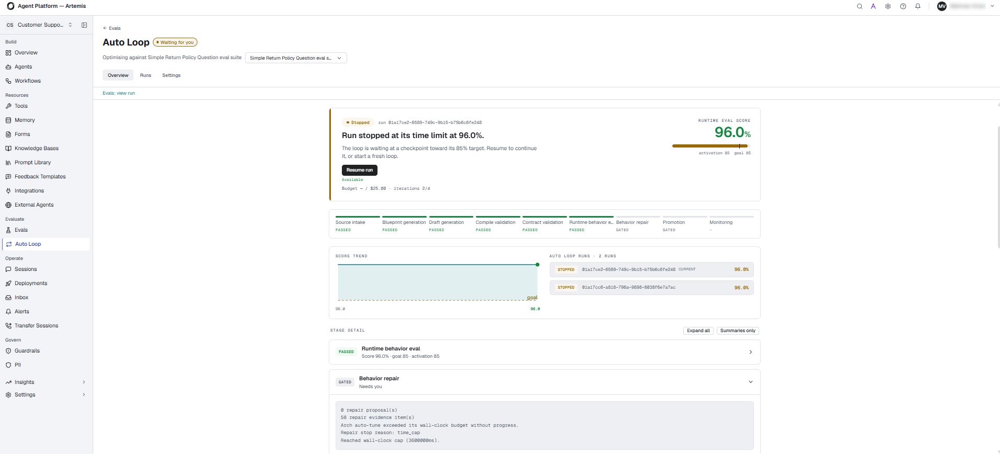
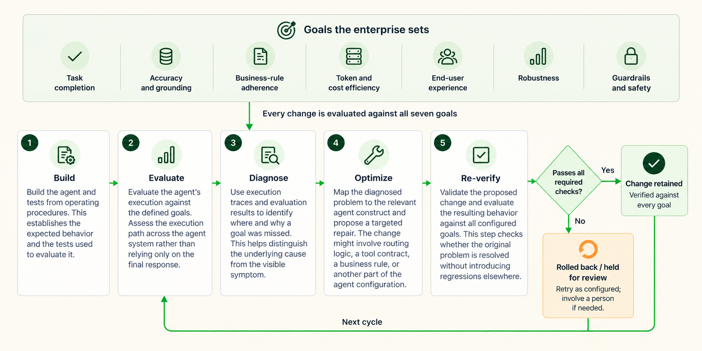
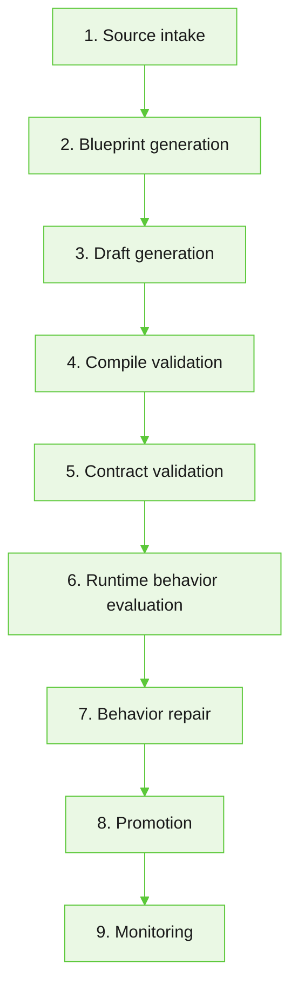

Autoloop is the optimization engine of the platform. It improves AI agent behavior against business-defined goals, from initial development through production.

It uses an iterative process to diagnose root causes, apply targeted repairs, and validate changes against configured goals before retaining them. This helps teams improve agent behavior while reducing regressions as their systems evolve.

| Concept | Description |
|---|---|
| **Goal-driven optimization** | Teams define what an agent must achieve. Autoloop evaluates the agent against these goals, identifies the causes of failures, proposes targeted changes, and validates the results. |
| **Evidence-based repairs** | Unlike a manual optimization process that relies on reviewing failures and repeatedly adjusting prompts, Autoloop uses execution evidence to identify the part of the agent responsible for a problem. It applies targeted repairs and evaluates the resulting behavior against all configured goals to help prevent regressions. |
| **Controlled, continuous improvement** | Autoloop combines deterministic checks and repairs with model-based judgment where needed. It supports agent improvement before deployment and during production. Changes are retained only when they pass the required validation checks and meet applicable approval requirements. |

### Where Autoloop helps

Autoloop helps teams identify and address issues that affect agent reliability, behavior, and readiness.

- **Project health:** Identifies compilation and validation errors, missing tool definitions, invalid handoff targets, and disconnected flows.
- **Agent behavior:** Helps investigate cases where an agent skips required information, claims actions that did not occur, or has unclear completion rules.
- **Quality and testing:** Helps diagnose evaluation failures, tool-call errors, and scenarios that do not produce the expected outcome.
- **Release readiness:** Helps verify that proposed repairs pass the relevant checks before they are considered complete.

### What Autoloop optimizes

Autoloop evaluates agent behavior across seven goal dimensions. These goals define the criteria used to assess whether the agent meets business requirements.

| Goal | Description |
|---|---|
| Task completion | Evaluates whether the agent completes the user's intended task and hands off to a person when appropriate. |
| Accuracy and grounding | Evaluates whether responses are accurate and supported by enterprise data. |
| Business-rule adherence | Evaluates whether the agent follows business policies, eligibility requirements, and operational limits. |
| Token and cost efficiency | Evaluates resource efficiency, including unnecessary model calls, token usage, and associated costs, while preserving the expected outcome. |
| End-user experience | Evaluates the interaction, including unnecessary turns, repetition, and latency across channels such as chat and voice. |
| Robustness | Evaluates consistency across different phrasings, languages, channels, and edge cases. |
| Guardrails and safety | Evaluates whether the agent protects data and avoids unsafe responses or actions that violate policies. |

Autoloop evaluates proposed changes against all configured goals. A change that improves one dimension must not introduce a regression in another. For example, reducing token usage must not prevent the agent from completing a task or weaken a required safety check.

### How Autoloop works

Autoloop follows an iterative optimization cycle. It evaluates agent behavior, diagnoses issues, proposes targeted changes, and verifies the results. If a change does not pass the required checks, Autoloop uses the results to guide further diagnosis and improvement.

The following diagram shows how Autoloop uses execution evidence to diagnose failures, apply targeted repairs, and validate the results.

### How Autoloop identifies and repairs problems

Autoloop uses execution evidence and the agent's underlying structure to identify the cause of a failure and target the relevant part of the agent for repair.

#### Execution traces

Autoloop uses execution traces and evaluation results to identify the causes of agent failures. These traces can capture handoffs, state changes, tool calls, and context, helping explain where an agent's behavior diverged from its intended goal.

Examining the execution path can reveal issues that are not apparent from the final conversation. For example, an agent might produce a plausible response even though it skipped a required verification step.

#### Agent Blueprint Language (ABL)

Agents built on Artemis use Agent Blueprint Language (ABL) and are compiled. Execution steps can be mapped to the constructs responsible for the agent's behavior.

Autoloop uses this mapping to target the relevant construct instead of broadly rewriting a prompt. Depending on the issue, a proposed repair may affect routing logic, a tool contract, a business rule, or another agent construct.

#### Readiness checks and validation

Autoloop uses a sequence of checks to assess agent readiness and validate changes. These checks include compilation, contract completeness, simulation, robustness, and behavior validation.

Each stage helps identify issues that may need to be addressed before the agent can progress. Passing one stage does not necessarily mean that all subsequent stages have passed.

Autoloop uses validation results to determine whether a proposed change meets the required criteria. If a check fails, further diagnosis or changes may be required before the process can continue.

### Choose an operating mode

Autoloop supports three operating modes that determine how proposed changes are handled.

| Mode | Behavior |
|---|---|
| Autopilot | Automatically applies changes that pass the required validation gates. |
| Copilot | Presents changes for human approval before they are applied, according to the applicable approval rules. |
| Advisor | Recommends changes and provides supporting evidence without applying them. |

Choose a mode based on the level of automation and human oversight required by your team.

### Autoloop lifecycle

The Autoloop interface displays the following stages in the optimization lifecycle.

Each stage has a status indicating its progress or whether attention is required. The progression depends on the run state and applicable validation or approval requirements. Passing one stage does not necessarily mean that all subsequent stages have passed.

### Monitor runs and review diagnostics

The Autoloop interface provides run history, behavior scores, stage statuses, and diagnostic information.

Use these details to understand how a run progressed, identify a failed or blocked stage, and investigate the evidence behind a failure. Review the diagnostic information before deciding whether to retry, make a correction, or seek further assistance.

A behavior score provides evidence of progress against a target. It does not replace the required validation and promotion checks.

### Example: Repairing a customer support agent that fails to answer a question

Consider a customer support agent that must answer a customer's question about an order. The agent provides an incorrect response because it uses the wrong order status. As a result, the customer does not receive the information they need.

The final conversation alone might not explain why the response was incorrect. Autoloop uses execution evidence to investigate the failure.

1. **Evaluate the interaction.** Autoloop evaluates the agent's execution against relevant goals, including task completion, accuracy and grounding, and end-user experience.
2. **Examine the execution trace.** Autoloop uses the execution trace to help identify where the incorrect order status was retrieved or used.
3. **Diagnose the cause.** The execution trace helps determine whether the issue originated in the tool call, the data returned, or the agent's handling of the result.
4. **Propose a targeted repair.** Autoloop proposes a change to the relevant part of the agent, such as the tool configuration or the logic used to interpret the order status.
5. **Validate the change.** Autoloop evaluates the updated agent against all configured goals. A change that corrects the response but introduces another error or violates a business rule does not meet the required criteria.
6. **Handle the change according to the selected mode.** In Autopilot mode, changes that pass the required checks can be retained automatically. In Copilot mode, changes require the applicable human approval. In Advisor mode, Autoloop provides recommendations and supporting evidence without applying the changes.

Autoloop evaluates the updated agent against all configured goals to ensure that the repair resolves the original issue without introducing regressions.

### Understand the limits of Autoloop

Autoloop optimizes agent behavior against the goals, evidence, and tests available to it. Requirements that have not been defined or tested may not be evaluated reliably.

Some issues require changes beyond the agent's existing configuration. For example, a repair may depend on a missing integration, additional data, credentials, or a business-policy decision. Autoloop can identify and report these blockers, but a person may need to resolve them.

Successful validation indicates that the checks and scenarios that were run have passed. It does not guarantee that every possible production interaction will behave as expected.

