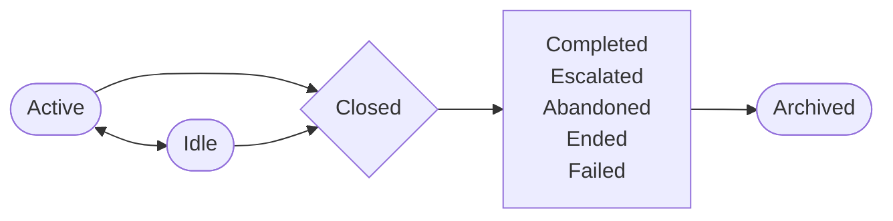

A session is one conversation between a user and the agents in your project. The session starts when the user sends the first message or places the call. It stays open until the agent completes, the user leaves, a timeout fires, or a transfer ends it. When the user moves from a supervisor to a specialist agent and back, the platform keeps the whole exchange in one session.

Use the **Sessions** page to find out what happened in a conversation: what the user said, what each agent decided, which tools and models the agents called, how long each step took, and, for voice, how the call sounded.

## Session structure

Each session has the same three levels, and the session page follows them:

- **Turn:** each time the user speaks or types, the agents respond in one turn.
- **Step:** inside a turn, the agents run steps, such as routing decisions, model calls, tool calls, memory updates, guardrail checks, and the final response.
- **Event:** each step writes one or more trace events that record its timing, inputs, and outputs. The session page builds every view from these events.

To investigate, move down these levels: find the session, find the turn that went wrong, then find the step inside that turn.

## Investigate a session

Most investigations start with a report, such as "the agent asked for my number twice" or "the call went quiet for ten seconds." Follow these steps to trace the report to its cause.

<Steps>
  <Step title="Find the session">
    Go to **Operate** > **Sessions**. Search for the session ID if you have it. If you know only the user, filter by **Caller phone number** for voice or by **channelUID** for digital channels. For more options, see [Find a session](#find-a-session).
  </Step>
  <Step title="Read the conversation">
    Select the session ID. On the **Timeline** tab, read the conversation and find the message where the problem started. That message tells you which turn to open.
  </Step>
  <Step title="Show only the problems">
    In the trace toolbar, select the issue count to hide every step that ran without issues. You can also press **N** to jump to the next error or warning. A failed tool call or a guardrail block often explains the problem.
  </Step>
  <Step title="Inspect the step">
    Select the step, and then press **Enter** to open the inspector. If the agent said something unexpected, open the model call before the reply and select **Request** to see exactly what the model received.
  </Step>
  <Step title="Check timing and audio">
    If the user reported slowness, switch the trace to **Latency** and find the longest step. If the user reported an audio problem, play the recording from that message and open **Voice Quality**.
  </Step>
  <Step title="Save the evidence">
    Select **Export JSON** to save the session for a support ticket or offline analysis. For details, see [Export a session](#export-a-session).
  </Step>
</Steps>

## Find a session

The sessions list opens on **Conversations** and shows sessions from the last seven days in all environments. Select **Traces** to list individual trace runs instead, such as evaluation or workflow runs.

<Frame caption="Sessions list with the channelUID column turned on">
  
</Frame>

If you have a session ID or an agent name, enter it in the search box. Otherwise, set the date range and environment, and then select **More filters**. Expand the case that matches your task:

<AccordionGroup>
  <Accordion title="A customer complains about a call">
    Filter by **Caller phone number** to list every session from that caller, and then sort by **Created** to find the call.
  </Accordion>
  <Accordion title="A customer complains on a digital channel">
    Filter by **channelUID**. This field holds the user's identifier on the channel, such as an email address or a phone number with the country code.
  </Accordion>
  <Accordion title="Escalations increase">
    Set **Status** to **Escalated** and **Channel Type** to **Voice** to list the calls that went to a human.
  </Accordion>
  <Accordion title="Test sessions skew production numbers">
    Set **Source** to **User initiated** to leave out evaluations, synthetic runs, and debug sessions.
  </Accordion>
</AccordionGroup>

The list shows six columns by default. To add **channelUID**, **Channel Type**, **Trace Events**, **Duration**, or **Messages**, select **Columns**. To go back to the default columns, select **Reset to default**. The platform remembers your choice.

<AccordionGroup>
  <Accordion title="Column reference">
    | Column | Shows |
    | --- | --- |
    | **Session** | The session ID, in the format `s-<uuid>`. Select the copy icon to copy the ID without opening the session. |
    | **channelUID** | The user's identifier on the channel. The platform encrypts this value at rest. |
    | **Agent** | The agent that started the session |
    | **Status** | The current [status](#session-lifecycle) |
    | **Channel** | The channel, such as **Pipeline Voice**, **Voice**, or **Web Debug** |
    | **Channel Type** | The channel category, such as **Voice** or **Messaging** |
    | **Environment** | The environment, such as `working-copy` |
    | **Trace Events**, **Duration**, **Messages** | The size and length of the session |
    | **Created** | The date and time the session started |
  </Accordion>
  <Accordion title="Filter reference">
    | Filter | Values |
    | --- | --- |
    | **channelUID** | An email address, a phone number with the country code, or another channel identifier |
    | **Agent** | The agents in the project |
    | **Status** | **Active**, **Completed**, **Failed**, **Abandoned**, **Escalated**, **Ended**, **Idle**, **Archived** |
    | **Source** | **User initiated**, **Workflow**, **Eval**, **Synthetic**, **Debug**, **Demo Insights** |
    | **Channel Type** | **Messaging**, **Voice**, **SDK**, **Webhook**, **Protocols**, **Workflow** |
    | **Channel** | The channels that have sessions in the selected range |
    | **Caller phone number** | A caller's phone number |
  </Accordion>
</AccordionGroup>

## Session page layout

Select a session ID to open the session page. The header and tabs stay at the top while you scroll, so you can act on the session from anywhere on the page.

<Frame caption="Session page">
  
</Frame>

1. **Header:** shows the session's status, error and warning count, length, message count, and trace event count. When the status and the disposition differ, the header shows both, such as `escalated · transferred`.
2. **Header actions:** open **Details**, move to the previous or next session, select **Refresh snapshot** to follow a live call, select **Export JSON**, or open the keyboard shortcuts.
3. **Tabs:** each tab answers one question. See [Session page tabs](#session-page-tabs).
4. **Conversation pane:** shows what the user and each agent said, in order.
5. **Trace views:** switch the trace between **Steps**, **Events**, and **Latency**.
6. **Trace:** lists every turn and the steps inside it.

<Note>
  **History · coverage unverified** in the header means the page can't confirm that it loaded every recorded event. The page shows accurate data, but the data might be incomplete. Select **Refresh snapshot**, or load older and newer ranges from the trace.
</Note>

### Session page tabs

| Tab | Answers |
| --- | --- |
| **Timeline** | What happened in the conversation? |
| **Performance** | How fast did it run, and what did it cost? |
| **Summary** | How did the session end? |
| **Voice Quality** | How did the call sound? |
| **Data** | What did the agent store? |
| **Historical source** | Which agent definition ran? |

### Export a session

Export a session to share it with someone outside the project, attach it to a support ticket, analyze it with your own tools, or keep it after the retention period ends.

<Steps>
  <Step title="Start the export">
    In the header, select **Export JSON**. The button shows a spinner while the platform collects the events. A long call can take several seconds.
  </Step>
  <Step title="Save the file">
    When the page shows **Export prepared**, your browser downloads `debug-trace-<session-id>-<timestamp>.json`.
  </Step>
</Steps>

<Warning>
  The export includes the full conversation text without masking, including personal data that users typed or said, such as phone numbers. Handle the file as you handle any other customer record.
</Warning>

<Accordion title="What the export file contains">
  | Section | Contains |
  | --- | --- |
  | `session` | The tenant, project, session, and deployment identifiers |
  | `trace` | Every recorded event, with its payload |
  | `conversation` | Every message in the session |
  | `investigation` | Whether the export is complete, or whether the platform truncated the trace or transcript |

  A three-minute voice call produces a file of several megabytes.
</Accordion>

## Timeline tab

The **Timeline** tab shows the conversation and the trace side by side, so you can read a message and review the work behind it in one view. To give either pane more room, drag the divider.

### Read the conversation

The conversation pane lists messages in order and labels each one with its speaker: **User**, **Assistant**, or the agent that answered, such as a specialist that the supervisor handed off to. A change of agent name in the middle of a conversation often shows where a handoff went wrong.

To act on a message, hover over it:

- Select **Inspect message** to open its recorded details.
- Select **Play from here** to hear that moment of a voice call.

<Accordion title="Conversation pane controls">
  - Select the search icon to find a phrase in the loaded messages.
  - Select the more icon to load **Older messages** or **Newer messages**, select **Refresh messages**, or turn on **Follow loaded messages** to follow a live session.
</Accordion>

### Read the trace

The trace shows the work that the agents did for each message. Choose the view that fits your question:

<Tabs>
  <Tab title="Steps: review each turn">
    Start here. The trace opens with **Setup and greeting**, then one row for each turn, then **Session events**, such as the end of the call.

    Each turn row shows when the turn ran, which agents took part, such as `Supervisor → Identity_Agent`, how long the turn took, and how many steps it ran. A turn that took 22 seconds stands out when the other turns took 5.

    Expand a turn to see its steps. The trace folds repeated steps into one row, such as **Routing & checks ×10**, so the important steps stay visible. For a long turn, select **Show more steps** to load the rest.
  </Tab>
  <Tab title="Events: check the sequence">
    Lists every recorded event in time order, with its category, timestamp, and issue status. Use this view when order matters, for example, to check whether a tool result arrived before the agent answered.
  </Tab>
  <Tab title="Latency: find slow steps">
    Lists every event with its duration. Use this view when a user reports a slow agent. Scan the durations for a step that took seconds instead of milliseconds. A slow step is often a model call, a tool call, or a wait for speech.
  </Tab>
</Tabs>

A long session can hold thousands of events. Use the toolbar to narrow them.

<AccordionGroup>
  <Accordion title="Show only issues">
    The issue count shows the errors and warnings in the loaded range. Select it to hide every step that ran without issues. Select the down arrow to move to the next issue.
  </Accordion>
  <Accordion title="Search the trace">
    **Search loaded trace headers** finds steps by name. **Search loaded evidence** searches the recorded content instead. Use it when you know a value, such as an order number, but not the step that used it.
  </Accordion>
  <Accordion title="Filter the trace">
    Select **Filter** to show or hide steps by event family, recorded category, or issue severity. For example, turn off **Plumbing** and **Runtime** to hide system rows.

    | Section | Options |
    | --- | --- |
    | **Event families** | **Audio**, **Conversation**, **Flow**, **Guardrails**, **Memory**, **Model**, **Plumbing**, **Routing**, **Runtime**, **Tools** |
    | **Recorded categories** | `agent`, `flow`, `llm`, `message`, `session`, `system`, `tool`, `voice` |
    | **Issue severity** | **All issues**, **Errors**, **Warnings** |
  </Accordion>
  <Accordion title="Load more of a long trace">
    When a trace is too long to load at once, select the more icon, and then select **Older range** or **Newer range**.
  </Accordion>
</AccordionGroup>

### Inspect a step

The inspector shows everything that the platform recorded for one step or message. To open it, select a row and press **Enter**, or select **Inspect message** on a message. To move to a neighboring row without closing the inspector, select the arrows at the top.

The inspector shows different tabs for different steps. Expand a tab to learn what it shows:

<AccordionGroup>
  <Accordion title="Summary">
    Shows when the step ran, how long it took, its turn and agent, whether it recorded an issue, and the key details for that type of step. For a call-connected event, for example, the key details include the call IDs and speech providers.
  </Accordion>
  <Accordion title="Request and Response (model calls only)">
    **Request** shows the model, provider, provider options, and model parameters. Select **View recorded value** to open the full request. **Response** shows the model's reply.

    Together, these tabs answer the most common question in an investigation: did the model receive bad input, or did it handle good input badly?
  </Accordion>
  <Accordion title="Payload">
    Shows the step's recorded data in a JSON viewer.
  </Accordion>
  <Accordion title="Events">
    Lists the steps related to this step in the loaded trace page.
  </Accordion>
  <Accordion title="Raw">
    Shows the event exactly as the platform stored it. Include it when you report a bug.
  </Accordion>
</AccordionGroup>

<Tip>
  Before you change an agent's ABL because of an unexpected reply, open the model call's **Request**. A missing memory value or a shortened conversation history explains many unexpected replies, and those problems need a different fix than the prompt.
</Tip>

### Listen to the recording

For a voice session with recording turned on, the **Recording** panel appears above the conversation. Listen to the call to settle questions that the trace can't answer, such as whether the caller paused, talked over the agent, or spoke unclearly.

<Frame caption="Recording panel with the waveform loaded">
  
</Frame>

<Steps>
  <Step title="Load the recording">
    Select **Load recording**. The panel draws a waveform for each recorded channel and measures the silences.
  </Step>
  <Step title="Go to the moment that matters">
    Select **Play from here** on the message, or select the headphone icon on a trace row. You can also select a row, and then select **Play from selection**.
  </Step>
  <Step title="Control playback">
    Select **Play**. Skip back or forward 10 seconds, change the speed, or drag **Recording position**. To see short pauses, use **Zoom**.
  </Step>
  <Step title="Save a copy">
    Select **Download recording**.
  </Step>
</Steps>

The waveform shows two recorded channels, but the recording doesn't identify which speaker uses which channel. Listen to the first few seconds to tell them apart.

<AccordionGroup>
  <Accordion title="Skip long silences">
    - **Compress measured silence in the display** shortens silences in the waveform. Playback still uses the real elapsed time.
    - **Skip measured silence during playback** skips verified silent ranges and still plays all speech.
  </Accordion>
  <Accordion title="Recording states">
    The badge next to **Recording** shows whether you can play the call.

    | State | Meaning |
    | --- | --- |
    | **Checking for a recording** | The page is looking for a recording of this call. |
    | **Pending**, **Fetching** | The platform is collecting and processing the audio. This usually takes a few minutes, and up to 15 minutes for long calls. Select **Refresh recording** to check again. |
    | **Ready** | You can play and download the recording. |
    | **Failed** | The platform couldn't collect or process the audio. The panel shows the reason, such as `media_not_available`. |
    | **Deleted** | The retention period ended, and the platform removed the audio. The entry stays so that you know a recording existed. |

    The panel also shows the **Call ID** and **System call ID**, which your telephony provider needs when you report a call problem.
  </Accordion>
  <Accordion title="Requirements and retention">
    To play or download a recording, you need both of the following:

    - Call recording turned on for the project. See [Recording settings](/agent-platform/administration/agent-behavior-settings#recording).
    - The **View Recordings** permission. Every system role has this permission by default.

    The platform keeps each recording until its **Retention** date, and then deletes the audio and sets the state to **Deleted**. Because deletion runs on a schedule, a recording can stay available for up to an hour after that date. A project admin or owner can change the retention period in [Recording settings](/agent-platform/administration/agent-behavior-settings#recording).
  </Accordion>
  <Accordion title="Compliance">
    The platform doesn't play a "this call is recorded" notice. If your region requires consent or notice, add it to the agent's opening prompt.

    The platform stores recordings in the storage that your workspace uses. To keep audio in a specific region, use your own storage account.
  </Accordion>
  <Accordion title="Turn off recording">
    - **One project:** in the project's **Settings** > **Recording**, turn off **Enable call recording**. The platform stops recording new calls, and existing recordings stay playable.
    - **Whole workspace:** turn off the workspace **Call Recording** switch. Every project hides its recording settings and audio, and the platform deletes nothing.
    - **Remove the feature:** contact the support team.
  </Accordion>
</AccordionGroup>

## Performance tab

Open the **Performance** tab when you need to know why a session ran slowly or cost more than expected.

<Tabs>
  <Tab title="Overview">
    Shows the session totals: trace events, LLM calls, tool calls, total tokens, and duration. An execution tree below the totals lists every step with its agent and duration.

    Far more LLM calls than turns can mean that an agent is looping or retrying.
  </Tab>
  <Tab title="Model and tool exchanges">
    Lists every model and tool call with the model or tool name, agent, tokens in and out, cost, duration, and time. The header shows the call counts, total tokens, and recorded cost for the session.

    Sort by duration to find the slowest call, or by tokens to find the most expensive one. Then select **Inspect** to open the call in the inspector. A single call with tens of thousands of input tokens often means that the agent passed a large knowledge or tool result into the prompt.
  </Tab>
  <Tab title="Logs">
    Shows the latest 256 runtime log lines. Select **Errors** or **Warnings** when the trace shows a problem without its details. **Clear local logs** clears the view and doesn't delete any logs.
  </Tab>
</Tabs>

## Summary tab

The **Summary** tab shows how the session ended. **Details** in the header shows the same facts without leaving your current tab. Expand a question to see the facts that answer it:

<AccordionGroup>
  <Accordion title="How long did the session last?">
    - **Duration:** the full length of the session.
    - **Engaged time:** only the time the user actively took part. A long duration with little engaged time means the session stayed open while it waited for the user.
    - **Segments:** the number of separate periods of activity. Segments matter on channels such as WhatsApp, where a user can return hours later.
    - **Started**, **Finished**, **Last activity**, **First interaction**, **Last interaction**, and **Finalized:** the timestamps for each milestone.
  </Accordion>
  <Accordion title="Who handled the session?">
    - **Final agent:** the agent that handled the session last.
    - **Escalated to a human:** whether a person took over.
    - **Deployment:** the deployment the session ran on. **None recorded** means the working copy.
  </Accordion>
  <Accordion title="Why did the session end?">
    **Persisted disposition** shows the reason, such as `completed`, `timeout`, or `transferred`. See [Dispositions](#dispositions).
  </Accordion>
  <Accordion title="Which settings affect sessions?">
    **Current project diagnostics** shows the project's guardrail status and these timeout settings:

    - **Browser idle:** how long Studio stays signed in without activity.
    - **Access token TTL:** how long a Studio access token lasts.
    - **Runtime idle:** how long a runtime session waits for a user message.
    - **Runtime max age:** the longest a runtime session can last.

    These values show the current settings, which might differ from the settings during the session. Check them when sessions end sooner than you expect.
  </Accordion>
</AccordionGroup>

## Voice Quality tab

The **Voice Quality** tab appears for voice sessions. The tab reads the call's voice evidence in batches, so the cards fill in as it loads. If loading stops early, select **Continue reading** or **Read again**.

<Frame caption="Call Overview card">
  
</Frame>

Start from what the caller reported, and then read the cards for that problem:

<Tabs>
  <Tab title="The agent was slow">
    1. In **Call Overview**, check **Avg E2E**, the average time between the caller finishing and the caller hearing the answer.
    2. In **Turn latency**, find the slow turns. The card shows end-to-end latency in green under 800 ms, amber under 1,500 ms, and red above that.
    3. In **Call Activity**, compare **Processing** with **Dead Air**. High processing time means that models and tools took long, so open the **Performance** tab. High dead air means gaps where nothing happened, so review the turn detection and speech timeout settings.
  </Tab>
  <Tab title="The caller kept interrupting">
    1. In **Call Overview**, check **Barge-ins**. A high count usually means that agent responses run too long or start too late.
    2. In **TTS Quality**, check **Avg TTS first audio**. Slow first audio adds delay to every turn.
  </Tab>
  <Tab title="The call sounded bad">
    1. In **TTS Quality**, check the combined, proxy, and network MOS scores for the agent's voice.
    2. In **Network Quality (MOS)**, check inbound and outbound network quality. Low network scores point to the line, not the agent. This card needs Homer data, which some calls don't have.
  </Tab>
  <Tab title="The call dropped">
    1. In **Call Termination**, check which party ended the call.
    2. In **Call Overview**, check **Call Phase** to see where the conversation stood.
    3. On **SIP Ladder**, select **Reveal** to see the SIP messages. Share the IDs from **Call details** with your telephony provider.
  </Tab>
</Tabs>

<Accordion title="Card reference">
  | Card | Shows |
  | --- | --- |
  | **Call details** | Call SID, call ID, SBC call ID, caller, called number, direction, originating IP, account and application SIDs, gateway trace ID, and voice gateway |
  | **Voice configuration** | STT provider, TTS provider, TTS voice, and gateway connection time |
  | **Turn latency** | Stage latencies for each turn |
  | **Call Overview** | Duration, turns, caller, disconnect, average end-to-end latency, barge-ins, DTMF input, containment, and call phase |
  | **Network Quality (MOS)** | Inbound and outbound network quality |
  | **TTS Quality** | Combined, proxy, and network MOS, average time to first byte, and average time to first audio |
  | **Call Activity** | Agent speech, user speech, processing, and dead air, with a silence breakdown |
  | **Call Termination** | The party that ended the call |
  | **SIP Ladder** | The SIP message flow |
</Accordion>

## Data tab

Open the **Data** tab when the conversation looks right but the outcome is wrong. For example, the agent asked for an order number, the user gave it, and the next step still failed. The tab shows what the agent actually stored. It reads the saved session record, not the agent editor.

Start with **Raw sections**, which shows the **Session state**, **Gather**, and **Context** values that the agent held. To save the masked data as JSON, select **Download full value**. To reload the data, select **Refresh recorded data**.

<Accordion title="Other Data views">
  | View | Shows |
  | --- | --- |
  | **Gather overview** | The fields the agent collected and the fields it still needs |
  | **Phase** | The conversation phase, such as `complete` |
  | **Flow** | The flow progress |
  | **Constraints** | The constraint results |
  | **Session memory** | The memory values |
  | **Full state** | Every recorded value at once |
</Accordion>

## Historical source tab

Agents change after deployment. When a session behaved differently from the agent you see today, use the **Historical source** tab to review the definition that ran.

<Steps>
  <Step title="Choose the agent">
    Select an agent. The list includes the entry agent and every agent on the loaded trace page, including handoff targets.
  </Step>
  <Step title="Choose the source">
    Select **Recorded source** for the definition that ran during the session, or **Current draft** for the agent as it is now. Switch between them to find the change.
  </Step>
  <Step title="Read the definition">
    Select **DSL** for the ABL source, **Compiled IR** for the compiled version, or **Recorded test context** for the test conditions.
  </Step>
</Steps>

<Note>
  The platform doesn't record a source for sessions that ran the working copy. Deploy a version so that each session keeps the definition it ran.
</Note>

## Keyboard shortcuts

Press **?** on the session page to see every shortcut. Shortcuts act on the focused pane, so the arrow keys move through rows in the trace and seek through audio in the recording.

The most useful shortcuts:

- **N** or **Shift+N**: go to the next or previous issue.
- **Enter**: inspect the focused row. Then use **[** or **]** to move between rows while the inspector stays open.
- **/**: search the focused pane. **Esc** closes whatever is open.
- **Space**: play or pause the recording.

<Accordion title="All shortcuts">
  | Pane | Action | Key |
  | --- | --- | --- |
  | Trace | Focus the previous or next row | **↑** or **↓** |
  | Trace | Focus the first or last row | **Home** or **End** |
  | Trace | Expand or collapse a row | **→** or **←** |
  | Trace | Toggle the focused group | **E** |
  | Trace | Expand or collapse all groups | **Shift+E** or **Shift+C** |
  | Search | Go to the next or previous search result | **Enter** or **Shift+Enter** |
  | Recording | Seek back or forward 10 seconds | **←** or **→** |

  To turn off single-letter shortcuts, clear **Enable optional character shortcuts** in the shortcuts dialog.
</Accordion>

## Session lifecycle

A session's status shows where the session is in its life. While the conversation runs, the session switches between **Active**, when an agent is working, and **Idle**, when the agent waits for the user. When the session closes, it takes one final status. After the retention period, the platform archives it.



| Final status | Meaning |
| --- | --- |
| **Completed** | The agent finished by calling `COMPLETE`. Design your agents for this outcome. |
| **Escalated** | A human or another system took over. |
| **Abandoned** | The user left during an idle period, or the agent side dropped the conversation. |
| **Ended** | The user ended the session, or a timeout closed it. |
| **Failed** | A fatal error or a guardrail violation ended the session. |

The API and the export use lowercase values, such as `completed`.

## Session closure

When a session closes, the platform saves any pending conversation data, records the final status and disposition, publishes a completion event for downstream services, and releases the session's resources. It also finalizes billing and reporting. The platform bills by session, and it uses each session's duration and engaged time to calculate metrics such as containment, resolution, and abandonment rates.

### Dispositions

The disposition records why the session ended. The platform derives the final status from the disposition.

<Accordion title="Disposition reference">
  | Disposition | Meaning | Status |
  | --- | --- | --- |
  | `completed` | The conversation reached its natural end. | `completed` |
  | `abandoned` | The user walked away. | `abandoned` |
  | `agent_hangup` | The agent side dropped the conversation. | `abandoned` |
  | `transferred` | A human or another system took over. | `escalated` |
  | `failed` | A system failure ended the conversation. | `abandoned` |
  | `timeout` | The platform closed the session after inactivity. | `ended` |
  | `unengaged` | The session opened, but the user never engaged. | `ended` |
</Accordion>

### How a session closes

A session closes in one of three ways. Select the one you want to learn about:

<Tabs>
  <Tab title="The agent completes">
    Design most sessions to end this way. Define completion conditions in the agent's `COMPLETE` block. When a condition matches, the agent sends its final response and closes the session as `completed`.

    ```abl
    COMPLETE:
      WHEN: issue_resolved == true
        RESPOND: "Glad I could help. Have a great day!"

      WHEN: intent contains "bye"
        RESPOND: "Thanks for contacting us. Goodbye!"
    ```

    - The platform checks the conditions in order and applies the first match.
    - In a multi-agent setup, put the `COMPLETE` block in the agent that owns the conversation, such as the supervisor or a dedicated closing agent. A `COMPLETE` block in a child agent that returns to its parent ends only the child's work.
    - To end an interaction without closing the session, set `TERMINAL: false`. The user's next message then starts a new interaction in the same session. See [COMPLETE](/agent-platform/abl/reference/multi-agent-and-supervisor#complete).
  </Tab>
  <Tab title="A timeout fires">
    When the user stops responding, the platform closes the session at whichever limit it reaches first:

    - **Idle timeout:** the longest time a user can stay inactive.
    - **Maximum session age:** the longest time a session can last, regardless of activity.

    Default limits vary by plan. A timeout records the `timeout` disposition and the `ended` status. The platform records the end time as the moment the session went quiet, not the moment it detected the timeout, so duration reports stay accurate.

    <Accordion title="Asynchronous and SDK channels">
      On asynchronous channels such as WhatsApp, SMS, and email, a user can reply hours later. The platform keeps the session open through long gaps and tracks each period of activity as a segment instead of splitting the conversation.

      SDK channels also record why the session closed in `terminal_source`: `sdk_idle_timeout` for inactivity, or `sdk_end_session` when the application or user ended the session. Query these values in the [Analytics explorer](/agent-platform/analytics-insights/analytics-explorer#query) to separate abandoned SDK sessions from completed ones.
    </Accordion>
  </Tab>
  <Tab title="A transfer ends">
    A transfer to a human or an external system sets the disposition to `transferred` and the status to `escalated`. The routing's **Post-Agent Action** decides what happens next:

    - **Return to bot:** the session stays open. The platform writes the transfer details to the session, sets the status back to `active`, and the bot takes over again when the human finishes.
    - **End Conversation:** the session closes, and the platform sets the disposition from the end reason that the contact center sends.

    <Accordion title="End reason reference">
      | End reason | Disposition | Status |
      | --- | --- | --- |
      | `transferred` | `transferred` | `escalated` |
      | `completed`, `agent_completed`, `conversation_complete` | `completed` | `completed` |
      | `abandoned`, `user_left`, `user_exit` | `abandoned` | `abandoned` |
      | `agent_hangup` | `agent_hangup` | `abandoned` |
      | `failed`, `error` | `failed` | `abandoned` |
      | Missing or unrecognized | `completed` | `completed` |
    </Accordion>
  </Tab>
</Tabs>