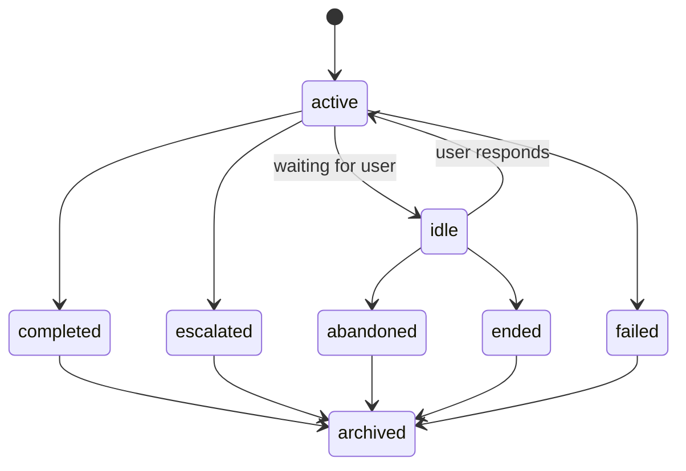

A session is one conversation between a user and the agents in your project. It starts when the user sends the first message or places the call, and it stays open until the agent completes, the user leaves, a timeout fires, or a transfer ends it. If the user moves from a supervisor to a specialist agent and back, all of it stays in one session.

The **Sessions** page is where you go when you need to know what actually happened in a conversation: what the user said, what each agent decided, which tools and models it called, how long each step took, and, for voice, how the call sounded.

## How a session is organized

Every session breaks down the same way, and the detail page follows this structure:

- **Turns.** Each time the user speaks or types, the agents respond in a turn. A five-question conversation has about five turns.
- **Steps.** Inside a turn, the agents run steps: routing decisions, model calls, tool calls, memory updates, guardrail checks, and the final response.
- **Events.** Every step writes one or more trace events with its timing, inputs, and outputs. These events are the evidence behind everything the page shows.

When you investigate, you move down this structure: find the session, find the turn that went wrong, then find the step inside that turn.

## Investigate a session

Most investigations start with a report like "the agent asked for my number twice" or "the call went quiet for ten seconds." This workflow gets you from that report to the cause.

<Steps>
  <Step title="Find the session">
    Go to **Operate** > **Sessions**. If you have the session ID, search for it. If you only know who the user was, filter by **Caller phone number** for voice or **channelUID** for digital channels. See [Find a session](#find-a-session).
  </Step>
  <Step title="Read the conversation first">
    Select the session ID. Before you look at the trace, read the conversation on the **Timeline** tab and find the exact message where things went wrong. This tells you which turn to open.
  </Step>
  <Step title="Let the page find the problems">
    Select the issue count in the trace toolbar to hide every step that ran cleanly, or press **N** to jump from one error or warning to the next. A failed tool call or a guardrail block is usually the fastest explanation.
  </Step>
  <Step title="Open the step that matters">
    Select the step and press **Enter** to open the inspector. If the agent said something unexpected, open the model call before it and select **Request**. You see exactly what the model received, including the prompt and conversation history.
  </Step>
  <Step title="Check time and sound for voice calls">
    If the complaint is about slowness, switch the trace to **Latency** to see which step took longest. If it's about audio, play the recording from that message and open **Voice Quality**.
  </Step>
  <Step title="Keep the evidence">
    Select **Export JSON** to save the session for a support ticket or offline analysis. See [Export a session](#export-a-session).
  </Step>
</Steps>

## Find a session

The sessions list opens on **Conversations** for the last seven days across all environments. Select **Traces** instead when you want individual trace runs, for example to review evaluation or workflow runs that aren't user conversations.

<Frame caption="Sessions list with the channelUID column turned on">
  
</Frame>

Use the search box when you already have an ID or agent name. For everything else, combine the date range, environment, and **More filters** to narrow the list:

- **A customer complaint about a call:** filter by **Caller phone number** to see every session from that caller, then sort by **Created**.
- **A complaint on a digital channel:** filter by **channelUID**, which holds the user's identifier on that channel, such as an email address or phone number with country code.
- **A spike in escalations:** filter **Status** to **Escalated** and **Channel Type** to **Voice** to see which calls went to a human.
- **Testing noise in production numbers:** filter **Source** to **User initiated** to leave out evals, synthetic runs, and debug sessions.

Six columns show by default. Turn on **channelUID**, **Channel Type**, **Trace Events**, **Duration**, or **Messages** from **Columns** when you need them, and select **Reset to default** to go back. The platform remembers your column choice.

<AccordionGroup>
  <Accordion title="Column reference">
    | Column | Shows |
    | --- | --- |
    | **Session** | Session ID, in the format `s-<uuid>`. Select the copy icon to copy it without opening the session. |
    | **channelUID** | The user's identifier on the channel. The platform encrypts it at rest. |
    | **Agent** | The agent the session started with |
    | **Status** | The current [status](#session-statuses) |
    | **Channel** | The channel the session ran on, such as **Pipeline Voice**, **Voice**, or **Web Debug** |
    | **Channel Type** | The channel category, such as **Voice** or **Messaging** |
    | **Environment** | The environment the session ran in, such as `working-copy` |
    | **Trace Events**, **Duration**, **Messages** | Size and length of the session |
    | **Created** | When the session started |
  </Accordion>
  <Accordion title="Filter reference">
    | Filter | Values |
    | --- | --- |
    | **channelUID** | Email address, phone number with country code, or another channel identifier |
    | **Agent** | Agents in the project |
    | **Status** | **Active**, **Completed**, **Failed**, **Abandoned**, **Escalated**, **Ended**, **Idle**, **Archived** |
    | **Source** | **User initiated**, **Workflow**, **Eval**, **Synthetic**, **Debug**, **Demo Insights** |
    | **Channel Type** | **Messaging**, **Voice**, **SDK**, **Webhook**, **Protocols**, **Workflow** |
    | **Channel** | Channels that have sessions in the selected range |
    | **Caller phone number** | A caller's phone number |
  </Accordion>
</AccordionGroup>

## Read the session page

Select a session ID to open it. The header and tabs stay fixed while you scroll, so you always know which session you're in and can act on it from anywhere on the page.

<Frame caption="Session detail page">
  
</Frame>

1. **Header.** Tells you, at a glance, whether this session is worth your time: its status, how many errors and warnings it has, how long it ran, and how many messages and trace events it holds. When the status and the disposition differ, the header shows both, such as `escalated · transferred`.
2. **Header actions.** Open **Details** for the session facts, step to the previous or next session in the list, select **Refresh snapshot** to follow a call that's still running, select **Export JSON**, or open the keyboard shortcuts.
3. **Tabs.** Each tab answers a different question. **Timeline** shows what happened, **Performance** shows what it cost and how fast it ran, **Summary** shows why it ended, **Voice Quality** shows how the call sounded, **Data** shows what the agent stored, and **Historical source** shows which agent definition ran.
4. **Conversation pane.** What the user and each agent said, in order.
5. **Trace views.** Switch the trace between **Steps**, **Events**, and **Latency**.
6. **Trace.** Every turn, and every step inside it.

<Note>
  If the header shows **History · coverage unverified**, the page couldn't confirm that every recorded event loaded. What you see is accurate, but it might not be complete. Select **Refresh snapshot**, or load older and newer ranges from the trace.
</Note>

### Export a session

Export a session when you need to share it with someone who can't open the project, attach evidence to a support ticket, analyze it with your own tools, or keep it longer than the retention period.

<Steps>
  <Step title="Start the export">
    In the header, select **Export JSON**. A spinner shows while the platform collects every event, which can take several seconds for a long call.
  </Step>
  <Step title="Save the file">
    When the page shows **Export prepared**, your browser downloads `debug-trace-<session-id>-<timestamp>.json`.
  </Step>
</Steps>

The file holds four sections: `session` with the tenant, project, session, and deployment identifiers; `trace` with every recorded event and its payload; `conversation` with every message; and `investigation`, which tells you whether the export is complete or was truncated. A three-minute voice call produces a file of several megabytes.

<Warning>
  The export holds the full conversation text without masking, including personal data that users typed or said, such as phone numbers. Treat the file like any other customer record.
</Warning>

## Follow the conversation on the Timeline tab

The **Timeline** tab puts the conversation and the trace side by side, so you can read a message and see the work behind it in the same view. Drag the divider between them to give either side more room.

### Read the conversation

Messages appear in order with the speaker's name: **User**, **Assistant**, or the agent that answered, such as a specialist the supervisor handed off to. Seeing the agent name change mid-conversation is often the first clue that a handoff happened at the wrong time.

Hover over a message to **Inspect message**, which opens its recorded details, or **Play from here** to hear that moment of a voice call. For long conversations, select the search icon to find a phrase, or use the more icon to load older or newer messages, refresh them, or follow new messages as a live session continues.

### Read the trace

The trace shows the work the agents did for each message. Pick the view that fits your question:

<Tabs>
  <Tab title="Steps: what happened">
    The default view, and the best place to start. The trace opens with **Setup and greeting**, then one row per turn, then **Session events** such as the call ending.

    Each turn row reads like a sentence: when it ran, which agents took part (for example `Supervisor → Identity_Agent`), how long it took, and how many steps it ran. A turn that took 22 seconds when the others took 5 stands out immediately.

    Expand a turn to see its steps. Repeated steps fold into one row, such as **Routing & checks ×10**, so the important ones stay visible. Long turns load in pages; select **Show more steps** for the rest.
  </Tab>
  <Tab title="Events: in what order">
    A flat list of every recorded event in time order, with its category, timestamp, and issue status. Use it when the order matters, for example to check whether a tool result arrived before or after the agent answered.
  </Tab>
  <Tab title="Latency: where the time went">
    The same events with their durations. Use it when a user says the agent was slow: scan the duration column for the step that took seconds instead of milliseconds. It's usually a model call, a slow tool, or a long wait for speech.
  </Tab>
</Tabs>

A long session can have thousands of events, so the toolbar helps you narrow them:

- **Issue count** shows the errors and warnings in the loaded range. Select it to hide everything that ran cleanly, and select the down arrow to move from one issue to the next.
- **Search loaded trace headers** finds steps by name. **Search loaded evidence** looks inside the recorded content instead, which helps when you know a value, such as an order number, but not the step that used it.
- **Filter** shows or hides steps by family, such as **Model**, **Tools**, or **Guardrails**, by recorded category, or by severity. For example, turn off **Plumbing** and **Runtime** to cut down the system rows.
- The more icon loads an older or newer range when the trace is too long to load at once.

### Inspect a step

The inspector shows everything recorded for one step or message. Select a row and press **Enter**, or select **Inspect message** on a message. Use the arrows at the top of the inspector to step through neighboring rows without closing it.

Start with **Summary**, which shows when the step ran, how long it took, which turn and agent it belonged to, whether it recorded an issue, and the key details for that kind of step. For a call-connected event, for example, that includes the call IDs and the speech providers.

For a model call, two more tabs appear. **Request** shows the model, provider, provider options, and parameters, and **View recorded value** opens the full request. **Response** shows the model's reply. Together they answer the most common question in an investigation: did the model get bad input, or did it handle good input badly?

**Payload** shows the step's recorded data in a JSON viewer, **Events** lists related steps, and **Raw** shows the event exactly as stored, which is useful when you report a bug.

<Tip>
  Before you change an agent's ABL because of a surprising reply, open the model call's **Request**. A missing memory value or a cut-off conversation history explains many surprises, and those need a different fix than the prompt.
</Tip>

### Listen to the recording

For voice sessions with recording turned on, the **Recording** panel sits above the conversation. Listening is often the only way to settle questions such as whether the caller paused, talked over the agent, or was misheard.

<Frame caption="Recording panel with the waveform loaded">
  
</Frame>

<Steps>
  <Step title="Load the recording">
    Select **Load recording**. The panel draws a waveform for each recorded channel and measures the silences.
  </Step>
  <Step title="Go to the moment that matters">
    Rather than playing from the start, select **Play from here** on the message in question, or the headphone icon on a trace row. You can also select a row and then **Play from selection**.
  </Step>
  <Step title="Control playback">
    Select **Play**, skip back or forward 10 seconds, change the speed, or drag **Recording position**. Use **Zoom** to see short pauses in the waveform.
  </Step>
  <Step title="Keep a copy">
    Select **Download recording** to save the audio.
  </Step>
</Steps>

Long calls often have long silences. **Compress measured silence in the display** shortens them in the waveform without changing playback, and **Skip measured silence during playback** jumps over verified silent ranges while still playing all speech.

The waveform shows two recorded channels, but the recording doesn't say which speaker is on which channel. Listen to the first few seconds to tell them apart.

<AccordionGroup>
  <Accordion title="Recording states">
    The badge next to **Recording** tells you whether you can play the call yet.

    - **Checking for a recording**: the page is looking for a recording for this call.
    - **Pending** and **Fetching**: the call ended, and the platform is collecting and processing the audio. This usually takes a few minutes, and up to 15 minutes for long calls. Select **Refresh recording** to check again.
    - **Ready**: you can play and download the recording.
    - **Failed**: the platform couldn't collect or process the audio. The panel shows the reason, such as `media_not_available`.
    - **Deleted**: the retention period ended and the audio is gone. The entry stays so you know a recording existed.

    The panel also shows the **Call ID** and **System call ID**, which you need when you raise a call with your telephony provider, plus the recording's length, size, creation time, and **Retention** date.
  </Accordion>
  <Accordion title="Requirements and retention">
    You can play or download a recording only when call recording is on for the project and you have the **View Recordings** permission, which every system role has by default. See [Recording settings](/agent-platform/administration/agent-behavior-settings#recording).

    The platform keeps a recording until its **Retention** date, then deletes the audio and marks it **Deleted**. Deletion runs on a schedule, so a recording can stay available for up to an hour after that date. A project admin or owner can change the retention period in [Recording settings](/agent-platform/administration/agent-behavior-settings#recording).
  </Accordion>
  <Accordion title="Compliance">
    The platform doesn't play a "this call is recorded" notice. If your region requires consent or notice, add it to the agent's opening prompt.

    Recordings go to the storage configured for your workspace. To keep audio in a specific region, use your own storage account.
  </Accordion>
  <Accordion title="Turn recording off">
    To stop recording new calls in one project, turn off **Enable call recording** in the project's **Settings** > **Recording**. Existing recordings stay playable.

    To hide recording across the workspace, turn off the workspace **Call Recording** switch. Every project hides its recording settings and audio, but nothing is deleted. To remove the feature completely, contact the support team.
  </Accordion>
</AccordionGroup>

## Check speed and cost on the Performance tab

Open **Performance** when the question is "why was this slow?" or "why did this cost so much?"

<Tabs>
  <Tab title="Overview">
    Shows the totals for the session (trace events, LLM calls, tool calls, total tokens, and duration) and an execution tree of every step with its agent and duration. A session with far more LLM calls than turns can mean an agent is looping or retrying.
  </Tab>
  <Tab title="Model and tool exchanges">
    Lists every model and tool call in one table, with the model or tool, agent, tokens in and out, cost, duration, and time. The header totals the calls, tokens, and the session's recorded cost. Sort by duration to find the slow call, or by tokens to find the expensive one, then select **Inspect** to open it.

    A single call with tens of thousands of input tokens often points to a large knowledge or tool result being passed into the prompt.
  </Tab>
  <Tab title="Logs">
    Shows the latest 256 runtime log lines. Filter to **Errors** or **Warnings** when the trace shows a problem but not its detail. Select **Clear local logs** to clear the view; it doesn't delete anything.
  </Tab>
</Tabs>

## Understand how the session ended on the Summary tab

The **Summary** tab explains the session's outcome. **Details** in the header shows the same facts without leaving the tab you're on.

The facts answer three questions:

- **How long did it last, and how engaged was the user?** **Duration** is the full session length, while **Engaged time** counts only the time the user actively took part. A long duration with little engaged time means the session sat open waiting. **Segments** counts separate periods of activity, which matters on channels such as WhatsApp where a user can come back hours later.
- **Who handled it?** **Final agent** is the agent that handled the session last, and **Escalated to a human** shows whether it went to a person. **Deployment** shows the deployment it ran on; **None recorded** means the working copy.
- **Why did it end?** **Persisted disposition** records the reason, such as `completed`, `timeout`, or `transferred`. See [Dispositions](#dispositions).

Below the facts, **Current project diagnostics** shows the project's guardrail status and timeout settings: how long Studio stays signed in without activity, how long an access token lasts, how long a runtime session waits for a user message, and the maximum age of a runtime session. These are today's settings, not necessarily the ones in effect during the session. Check them when sessions end sooner than you expect.

## Diagnose call quality on the Voice Quality tab

**Voice Quality** appears for voice sessions. It reads the call's voice evidence in batches, so the cards fill in as it loads. If loading stops early, select **Continue reading** or **Read again**.

<Frame caption="Call Overview card">
  
</Frame>

Start from what the caller experienced, and let that decide which card to read:

<Tabs>
  <Tab title="The agent was slow">
    Check **Avg E2E** in **Call Overview**, the average time from the caller finishing to hearing the answer. Then open **Turn latency** to find the slow turns. End-to-end latency is green under 800 ms, amber under 1,500 ms, and red above.

    **Call Activity** splits the call's silence into **Processing**, time spent waiting on models and tools, and **Dead Air**, gaps where nothing was happening. High processing time sends you to the **Performance** tab. High dead air points to turn detection or speech timeout settings.
  </Tab>
  <Tab title="The caller kept interrupting">
    Check **Barge-ins** in **Call Overview**. A high count usually means agent responses run too long or start too late, and callers talk over them. Compare with **Avg TTS first audio** in **TTS Quality**: slow first audio adds to every turn.
  </Tab>
  <Tab title="The call sounded bad">
    Check **TTS Quality** for the combined, proxy, and network MOS scores of the agent's voice, and **Network Quality (MOS)** for inbound and outbound network quality. Low network scores point to the line, not the agent. Network scores need Homer data, which isn't available for every call.
  </Tab>
  <Tab title="The call dropped">
    Check **Call Termination** for who ended the call, and **Call Phase** in **Call Overview** for where the conversation was when it ended. Select **Reveal** on **SIP Ladder** to see the SIP messages, and share the IDs from **Call details** with your telephony provider.
  </Tab>
</Tabs>

<Accordion title="Card reference">
  | Card | Shows |
  | --- | --- |
  | **Call details** | Call SID, call ID, SBC call ID, caller, called number, direction, originating IP, account and application SIDs, gateway trace ID, and voice gateway |
  | **Voice configuration** | STT provider, TTS provider, TTS voice, and gateway connection time |
  | **Turn latency** | Stage latencies for each turn |
  | **Call Overview** | Duration, turns, caller, disconnect, average end-to-end latency, barge-ins, DTMF input, containment, and call phase |
  | **Network Quality (MOS)** | Inbound and outbound network quality |
  | **TTS Quality** | Combined, proxy, and network MOS, average time to first byte, and average time to first audio |
  | **Call Activity** | Agent speech, user speech, processing, and dead air, with a silence breakdown |
  | **Call Termination** | Who ended the call |
  | **SIP Ladder** | The SIP message flow |
</Accordion>

## See what the agent stored on the Data tab

Open **Data** when the conversation looks right but the outcome is wrong, for example when the agent asked for an order number, the user gave it, and the next step still failed. The tab shows what the agent actually stored, read from the saved session record rather than from the agent editor.

**Raw sections** is the quickest place to look: **Session state**, **Gather**, and **Context** show the values the agent held. The other tabs focus on one kind of data: **Gather overview** shows which fields the agent collected and which it's still missing, **Phase** shows where the conversation was, **Flow** and **Constraints** show flow progress and constraint results, **Session memory** shows memory values, and **Full state** shows everything at once.

Select **Download full value** to save the masked data as JSON, or **Refresh recorded data** to reload it.

## Compare agent versions on the Historical source tab

Agents change. When a session behaved differently from what the agent does today, the **Historical source** tab shows the definition that actually ran.

<Steps>
  <Step title="Choose the agent">
    Select an agent. The list includes the entry agent and every agent recorded on the loaded trace page, so a handoff target is there too.
  </Step>
  <Step title="Choose what to compare">
    Select **Recorded source** for the definition that ran during the session, or **Current draft** for the agent as it is now. Switch between them to spot the change.
  </Step>
  <Step title="Read the definition">
    Select **DSL** for the ABL source, **Compiled IR** for the compiled version, or **Recorded test context** for the test conditions.
  </Step>
</Steps>

<Note>
  Sessions that ran the working copy have no recorded source. Deploy a version so that each session keeps the definition it ran.
</Note>

## Work faster with keyboard shortcuts

Press **?** on the session page to see every shortcut. Shortcuts act on the focused pane, so the same arrow keys move through trace rows in the trace and seek through audio in the recording. The ones you'll use most:

- **N** and **Shift+N** jump to the next or previous issue.
- **Enter** inspects the focused row, and **[** and **]** step through rows while the inspector stays open.
- **/** searches the focused pane, and **Esc** closes whatever is open.
- **Space** plays or pauses the recording.

<Accordion title="All shortcuts">
  | Pane | Action | Key |
  | --- | --- | --- |
  | Trace | Focus the previous or next row | **↑** or **↓** |
  | Trace | Focus the first or last row | **Home** or **End** |
  | Trace | Expand or collapse a row | **→** or **←** |
  | Trace | Toggle the focused group | **E** |
  | Trace | Expand or collapse all groups | **Shift+E** or **Shift+C** |
  | Search | Go to the next or previous hit | **Enter** or **Shift+Enter** |
  | Recording | Seek back or forward 10 seconds | **←** or **→** |

  To turn off single-letter shortcuts, clear **Enable optional character shortcuts** in the shortcuts dialog.
</Accordion>

## Session statuses

A session's status tells you where it is in its life. While a conversation is running, it moves between **Active**, when an agent is working, and **Idle**, when the agent is waiting for the user. When it closes, it settles into one final status, and after the retention period it becomes **Archived**.



- **Completed**: the agent finished by calling `COMPLETE`. This is the outcome you design for.
- **Escalated**: the session went to a human or another system.
- **Abandoned**: the user left during an idle period, or the agent side dropped the conversation.
- **Ended**: the user ended the session, or a timeout closed it.
- **Failed**: a fatal error or a guardrail violation ended it.

The API and exports use the lowercase values, such as `completed`.

## Session closure

Closing a session is more than marking it done. The platform saves any pending conversation data, records the final status and disposition, publishes a completion event for downstream services, and releases the session's resources. It also finalizes billing and reporting: a session is the billable unit, and its duration and engaged time feed metrics such as containment, resolution, and abandonment rates. That's why the reason a session ended matters.

### Dispositions

The disposition records why the session ended, and the platform derives the final status from it.

| Disposition | Meaning | Status |
| --- | --- | --- |
| `completed` | The conversation reached its natural end. | `completed` |
| `abandoned` | The user walked away. | `abandoned` |
| `agent_hangup` | The agent side dropped the conversation. | `abandoned` |
| `transferred` | The conversation went to a human or another system. | `escalated` |
| `failed` | A system failure ended the conversation. | `abandoned` |
| `timeout` | The platform closed the session after inactivity. | `ended` |
| `unengaged` | The session opened, but the user never engaged. | `ended` |

### How a session closes

A session closes in one of three ways. Choose the one you want to understand:

<Tabs>
  <Tab title="The agent completes">
    Most sessions should end this way. Define completion conditions in the agent's `COMPLETE` block. When a condition matches, the agent sends its final response and closes the session as `completed`.

    ```abl
    COMPLETE:
      WHEN: issue_resolved == true
        RESPOND: "Glad I could help. Have a great day!"

      WHEN: intent contains "bye"
        RESPOND: "Thanks for contacting us. Goodbye!"
    ```

    The platform checks conditions in order and applies the first match. In a multi-agent setup, put the `COMPLETE` block in the agent that owns the conversation, such as the supervisor or a dedicated closing agent. A `COMPLETE` in a child agent that returns to its parent ends only the child's work, not the conversation.

    To end an interaction without closing the session, set `TERMINAL: false`. The user's next message then starts a new interaction in the same session. See [COMPLETE](/agent-platform/abl/reference/multi-agent-and-supervisor#complete).
  </Tab>
  <Tab title="A timeout fires">
    When the user goes quiet, the platform closes the session at whichever limit it reaches first: the **idle timeout**, the longest a user can stay inactive, or the **maximum session age**, the longest a session can last regardless of activity. Default limits vary by plan.

    A timeout records the `timeout` disposition and `ended` status. The recorded end time is when the session went quiet, not when the platform noticed, so duration reports stay accurate.

    Asynchronous channels such as WhatsApp, SMS, and email work differently. A user can reply hours later, so the session stays open through long gaps, and the platform tracks each burst of activity as a segment instead of splitting the conversation.

    SDK channels also record why the session closed in `terminal_source`: `sdk_idle_timeout` for inactivity, or `sdk_end_session` when the application or user ended it. Query these in the [Analytics explorer](/agent-platform/analytics-insights/analytics-explorer#query) to tell abandoned SDK sessions from completed ones.
  </Tab>
  <Tab title="A transfer ends">
    A transfer to a human or an external system sets the disposition to `transferred` and the status to `escalated`. What happens next depends on the routing's **Post-Agent Action**.

    With **Return to bot**, the session stays open. The platform writes the transfer details to the session, sets the status back to `active`, and the bot takes over again when the human is done.

    With **End Conversation**, the session closes, and the disposition follows the end reason the contact center sends:

    | End reason | Disposition | Status |
    | --- | --- | --- |
    | `transferred` | `transferred` | `escalated` |
    | `completed`, `agent_completed`, `conversation_complete` | `completed` | `completed` |
    | `abandoned`, `user_left`, `user_exit` | `abandoned` | `abandoned` |
    | `agent_hangup` | `agent_hangup` | `abandoned` |
    | `failed`, `error` | `failed` | `abandoned` |
    | Missing or unrecognized | `completed` | `completed` |
  </Tab>
</Tabs>