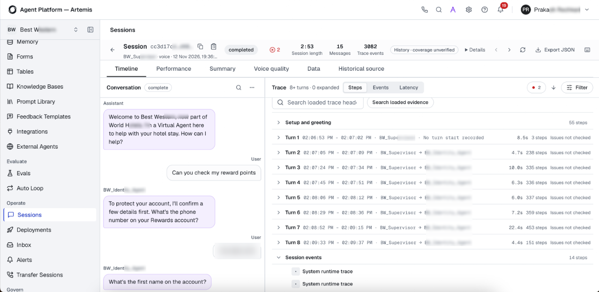
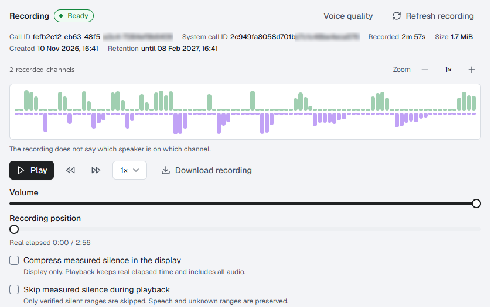
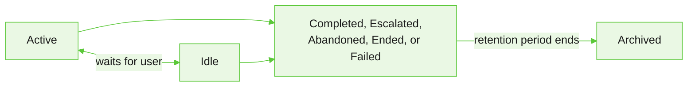

A session is one conversation between a user and the agents in your project. Use the **Sessions** page to find out what happened in a conversation: what the user said, what each agent decided, which tools and models the agents called, how long each step took, and, for voice, how the call sounded.

## Session identity and lifecycle

Every session has a unique ID in the format `s-<uuid>` and belongs to one tenant and one project. The platform binds each session to the agent configuration of the environment it runs in.

- **Creation:** the platform creates a session when a user starts a conversation on any channel: the first message in a messaging app or the Web SDK, the start of a voice call, or the first request from an API or SDK client. On SDK and API channels, your application decides when a new session starts. The Web SDK raises a `sessionStart` event with the new session ID. See [Web SDK](/agent-platform/sdk/web-sdk).
- **Continuation:** while a session is open, every new message from the same user joins it, so the agents keep the full history and state. On asynchronous channels, such as WhatsApp, SMS, and email, the session stays open through long gaps, and the platform tracks each period of activity as a segment.
- **Handoff:** when a supervisor hands off to a specialist agent, the session and its ID stay the same. The platform opens a thread for the specialist inside the session and returns to the parent thread when the specialist finishes. See [Session hierarchy in multi-agent systems](/agent-platform/concepts#session-hierarchy-in-multi-agent-systems).
- **Closure:** the session closes when the agent completes, the user leaves, a timeout fires, or a transfer ends the conversation. The idle timeout and the maximum session age come from your tenant configuration, and Studio has no setting for them. The **Summary** tab shows the values that apply. See [Session closure](#session-closure).
- **Archival:** after the retention period ends, the platform moves the session to cold storage and sets its status to **Archived**. Your deployment configuration sets the retention period. You can still open archived sessions on the **Sessions** page.

## What a session includes

A session holds everything the agents need to continue the conversation, and everything you need to investigate it later:

- **Conversation history:** every user message, agent reply, and tool call, in order. The agents receive this history on each turn.
- **Session state:** the variables that the agents collect, such as gathered field values, tool results, and `SET` values. See [Session memory](/agent-platform/memory-and-state#session-memory).
- **Context:** values that the channel passes in, such as metadata, language, and locale, and values that one agent passes to another during a handoff.
- **Threads:** the stack of agents that took part, created by handoffs.
- **Trace events:** a record of every step that the agents ran, with its timing, inputs, and outputs.
- **Metrics:** messages, tokens, cost, and duration.
- **Recording:** the call audio, for voice sessions with recording turned on.

## Session structure

Every session breaks down the same way, and the detail page follows this structure:

- **Turns.** Each time the user speaks or types, the agents respond in a turn. A five-question conversation has about five turns.
- **Steps.** Inside a turn, the agents run steps: routing decisions, model calls, tool calls, memory updates, guardrail checks, and the final response.
- **Events.** Every step writes one or more trace events with its timing, inputs, and outputs. The session page builds every view from these events.

To investigate, move down this structure: find the session, find the turn that went wrong, and then find the step inside that turn.

## Investigate a session

Most investigations start with a report like "the agent asked for my number twice" or "the call went quiet for ten seconds." Follow these steps to trace the report to its cause.

<Steps>
  <Step title="Find the session">
    Go to **Operate** > **Sessions**. If you have the session ID, search for it. If you know only the user, filter by **Caller phone number** for voice or **Channel UID** for digital channels. See [Find a session](#find-a-session).
  </Step>
  <Step title="Read the conversation first">
    Select the session ID. Before you look at the trace, read the conversation on the **Timeline** tab and find the message where the problem started. That message tells you which turn to open.
  </Step>
  <Step title="Let the page find the problems">
    Select the issue count in the trace toolbar to hide every step that ran without issues, or press **N** to jump to the next error or warning. A failed tool call or a guardrail block often explains the problem.
  </Step>
  <Step title="Open the step that matters">
    Select the step and press **Enter** to open the inspector. If the agent said something unexpected, open the model call before the reply and select **Request** to see what the model received.
  </Step>
  <Step title="Check time and sound for voice calls">
    For a slow agent, switch the trace to **Latency** and find the longest step. For an audio problem, play the recording from that message and open **Voice Quality**.
  </Step>
  <Step title="Keep the evidence">
    Select **Export JSON** to save the session for a support ticket or offline analysis. See [Export a session](#export-a-session).
  </Step>
</Steps>

## Find a session

The sessions list opens on **Conversations** for the last seven days across all environments. Select **Traces** to list individual trace runs instead, such as evaluation or workflow runs.

<Frame caption="Sessions list with the Channel UID column turned on">
  
</Frame>

Use the search box when you already have an ID or agent name. For everything else, combine the date range, environment, and **More filters** to narrow the list:

- **A customer complains about a call:** filter by **Caller phone number** to list every session from that caller, and then sort by **Created**.
- **A customer complains on a digital channel:** filter by **Channel UID**, the user's identifier on the channel, such as an email address or a phone number with the country code.
- **Escalations increase:** set **Status** to **Escalated** and **Channel Type** to **Voice** to list the calls that went to a human.
- **Test sessions skew production numbers:** set **Source** to **User initiated** to leave out evaluations, synthetic runs, and debug sessions.

The list shows six columns by default. To add **Channel UID**, **Channel Type**, **Trace Events**, **Duration**, or **Messages**, select **Columns**. To go back to the default columns, select **Reset to default**.

<AccordionGroup>
  <Accordion title="Column reference">
    | Column | Shows |
    | --- | --- |
    | **Session** | Session ID, in the format `s-<uuid>`. Select the copy icon to copy it without opening the session. |
    | **Channel UID** | The user's identifier on the channel. The platform encrypts it at rest. |
    | **Agent** | The agent the session started with |
    | **Status** | The current [status](#session-statuses) |
    | **Channel** | The channel the session ran on, such as **Pipeline Voice**, **Voice**, or **Web Debug** |
    | **Channel Type** | The channel category, such as **Voice** or **Messaging** |
    | **Environment** | The environment the session ran in, such as `working-copy` |
    | **Trace Events**, **Duration**, **Messages** | Size and length of the session |
    | **Created** | When the session started |
  </Accordion>
  <Accordion title="Filter reference">
    | Filter | Values |
    | --- | --- |
    | **Channel UID** | Email address, phone number with country code, or another channel identifier |
    | **Agent** | Agents in the project |
    | **Status** | **Active**, **Completed**, **Failed**, **Abandoned**, **Escalated**, **Ended**, **Idle**, **Archived** |
    | **Source** | **User initiated**, **Workflow**, **Eval**, **Synthetic**, **Debug**, **Demo Insights** |
    | **Channel Type** | **Messaging**, **Voice**, **SDK**, **Webhook**, **Protocols**, **Workflow** |
    | **Channel** | Channels that have sessions in the selected range |
    | **Caller phone number** | A caller's phone number |
  </Accordion>
</AccordionGroup>

## Read the session page

Select a session ID to open it. The header and tabs stay at the top while you scroll.

<Frame caption="Session detail page">
  
</Frame>

1. **Header.** Shows the session's status, error and warning count, length, message count, and trace event count. When the status and the disposition differ, the header shows both, such as `escalated · transferred`.
2. **Header actions.** Open **Details** for the session facts, step to the previous or next session in the list, select **Refresh snapshot** to follow a call that's still running, select **Export JSON**, or open the keyboard shortcuts.
3. **Tabs.** Each tab answers a different question. **Timeline** shows what happened, **Performance** shows what it cost and how fast it ran, **Summary** shows why it ended, **Voice Quality** shows how the call sounded, **Data** shows what the agent stored, and **Historical source** shows which agent definition ran.
4. **Conversation pane.** What the user and each agent said, in order.
5. **Trace views.** Switch the trace between **Steps**, **Events**, and **Latency**.
6. **Trace.** Every turn, and every step inside it.

<Note>
  The page works from a snapshot of the session. If the page shows **This session snapshot expired**, select **Refresh snapshot**. If the header shows **History · coverage unverified**, the page can't confirm that it loaded every recorded event. Refresh the snapshot, or load older and newer ranges from the trace.
</Note>

### Export a session

To save a session for a support ticket or offline analysis, select **Export JSON** in the header. Your browser downloads `debug-trace-<session-id>-<timestamp>.json`, which holds the session identifiers, every trace event, every message, and a completeness check.

<Note>
  The export applies the same protection as the session page. The platform always masks credentials and secrets, and it redacts personal data according to the project's [PII protection](/agent-platform/pii-protection) settings.
</Note>

## Follow the conversation on the Timeline tab

The **Timeline** tab shows the conversation and the trace side by side, so you can read a message and review the work behind it in one view. To give either pane more room, drag the divider.

### Read the conversation

Bar, line, and pie charts in agent responses render the same way they do in the Web SDK widget. The conversation pane labels each message with its speaker: **User**, **Assistant**, or the agent that answered, such as a specialist that the supervisor handed off to. A change of agent name shows where a handoff happened.

Hover over a message and select **Inspect message** to open its recorded details, or **Play from here** to hear that moment of a voice call. To find a phrase, select the search icon. To load older or newer messages, refresh them, or follow a live session, select the more icon.

### Copy the conversation

To share a conversation in a support ticket or a review, select the more icon in the conversation pane, then **Copy conversation**. The page copies the whole conversation to your clipboard as plain text and confirms whether the copy succeeded.

| Part | What it contains |
| --- | --- |
| **Header** | The agent, the channel, and the session timestamp. |
| **Messages** | One line per message, in the format `[time] Speaker: text`. Messages from a human agent show **Live agent** as the speaker. |
| **Rich content** | Lists, tables, buttons, and carousels appear as plain text. |
| **Personal data** | Redaction markers stay in place, so the copy reveals nothing that the page hides. |

The copy holds up to 10,000 messages. To keep the full record, including the trace, use [Export JSON](#export-a-session).

### Read the trace

The trace shows the work that the agents did for each message. Choose the view that fits your question:

<Tabs>
  <Tab title="Steps: review each turn">
    Start here. The trace opens with **Setup and greeting**, then one row for each turn, then **Session events**, such as the end of the call.

    Each turn row shows when the turn ran, which agents took part, such as `Supervisor → Identity_Agent`, how long it took, and how many steps it ran. Every timing bar uses one shared time scale, so a longer bar always means a longer turn or step. Compare bar lengths to find the slow part of a session.

    Expand a turn to see its steps. The trace folds repeated steps into one row, such as **Routing & checks ×10**. For a long turn, select **Show more steps**.
  </Tab>
  <Tab title="Events: check the sequence">
    Lists every recorded event in time order, with its category, timestamp, and issue status. Use this view when order matters, for example, to check whether a tool result arrived before the agent answered.
  </Tab>
  <Tab title="Latency: find slow steps">
    Lists every event with its duration. Use this view when a user reports a slow agent. Scan for a step that took seconds instead of milliseconds, such as a model call, a tool call, or a wait for speech.
  </Tab>
</Tabs>

A long session can hold thousands of events. Use the toolbar to narrow them:

- **Issue count** shows the errors and warnings in the loaded range. Select it to hide every step that ran without issues, and select the down arrow to go to the next issue.
- **Search loaded trace headers** finds steps by name. **Search loaded evidence** searches the recorded content instead. Use it when you know a value, such as an order number, but not the step that used it.
- **Filter** shows or hides steps by family, such as **Model**, **Tools**, or **Guardrails**, by recorded category, or by severity. For example, turn off **Plumbing** and **Runtime** to hide system rows.
- The more icon loads an **Older range** or **Newer range** when the trace is too long to load at once.

### Inspect a step

The inspector shows everything that the platform recorded for one step or message. Select a row and press **Enter**, or select **Inspect message** on a message. To move to a neighboring row without closing the inspector, select the arrows at the top.

Start with **Summary**, which shows when the step ran, how long it took, which turn and agent it belonged to, whether it recorded an issue, and the key details for that kind of step. For a call-connected event, for example, the key details include the call IDs and speech providers.

For a model call, two more tabs appear. **Request** shows the model, provider, provider options, and model parameters. For a large request, the tab shows **Download full value** instead, which saves the complete request as JSON, including the system prompt, messages, and tools. **Response** shows the model's reply and any tool calls that the model made. Together, these tabs tell you whether the model received bad input or handled good input badly.

**Payload** shows the step's recorded data in a JSON viewer, **Events** lists related steps, and **Raw** shows the event exactly as the platform stored it. Include **Raw** when you report a bug.

<Tip>
  Before you change an agent's ABL because of an unexpected reply, open the model call's **Request**. A missing memory value or a shortened conversation history explains many unexpected replies, and those problems need a different fix than the prompt.
</Tip>

### Listen to the recording

For voice sessions with recording turned on, the **Recording** panel appears above the conversation. Listen to the call to settle questions that the trace can't answer, such as whether the caller paused, talked over the agent, or spoke unclearly.

<Frame caption="Recording panel with the waveform loaded">
  
</Frame>

<Steps>
  <Step title="Load the recording">
    Select **Load recording**. The panel draws a waveform for each recorded channel and measures the silences.
  </Step>
  <Step title="Go to the moment that matters">
    Select **Play from here** on the message, or the headphone icon on a trace row. You can also select a row, and then select **Play from selection**.
  </Step>
  <Step title="Control playback">
    Select **Play**. Skip back or forward 10 seconds, change the speed, or drag **Recording position**. To see short pauses, use **Zoom**.
  </Step>
  <Step title="Keep a copy">
    Select **Download recording** to save the audio.
  </Step>
</Steps>

For long calls, **Compress measured silence in the display** shortens silences in the waveform without changing playback, and **Skip measured silence during playback** skips verified silent ranges while it still plays all speech.

The waveform shows two recorded channels, but the recording doesn't identify which speaker uses which channel. Listen to the first few seconds to tell them apart.

<AccordionGroup>
  <Accordion title="Recording states">
    The badge next to **Recording** shows whether you can play the call.

    | State | Meaning |
    | --- | --- |
    | **Checking for a recording** | The page is looking for a recording of the call. |
    | **Ready** | You can play and download the recording. |
    | **Failed** | The platform can't provide the audio. The panel shows the reason. |

    | Reason | What to do |
    | --- | --- |
    | `call_in_progress`, `media_in_progress` | The call is still running, or the platform is still processing the audio. Processing can take up to 15 minutes. Select **Refresh recording** to check again. |
    | `media_not_available` | The voice gateway didn't provide audio for the call. |
    | `retention_expired`, `deleted` | The platform removed the audio after the retention period. |
    | `auth_failed`, `storage_write_failed`, `media_object_missing` | The platform couldn't store or read the audio. Contact the support team with the session ID. |

    The panel also shows the **Call ID** and **System call ID**, which your telephony provider needs when you report a call problem.
  </Accordion>
  <Accordion title="Requirements and retention">
    You can play or download a recording only when call recording is on for the project and you have the **View Recordings** permission, which every system role has by default. See [Call recording](/agent-platform/administration/workspace-account#call-recording).

    The platform keeps a recording until its **Retention** date, and then deletes the audio. Because deletion runs on a schedule, a recording can stay available for up to an hour after that date. A project admin or owner can change the retention period in the project's **Settings** > **Recording**.
  </Accordion>
  <Accordion title="Compliance">
    The platform doesn't play a "this call is recorded" notice. If your region requires consent or notice, add it to the agent's opening prompt.

    The platform stores recordings in the storage that your workspace uses. To keep audio in a specific region, use your own storage account.
  </Accordion>
  <Accordion title="Turn recording off">
    To stop recording new calls in one project, turn off **Enable call recording** in the project's **Settings** > **Recording**. Existing recordings stay playable.

    To hide recording across the workspace, turn off the workspace **Call Recording** switch. Every project hides its recording settings and audio, and the platform deletes nothing. To remove the feature completely, contact the support team.
  </Accordion>
</AccordionGroup>

## Check speed and cost on the Performance tab

Open **Performance** when the question is "why was this slow?" or "why did this cost so much?"

<Tabs>
  <Tab title="Overview">
    Shows the totals for the session (trace events, LLM calls, tool calls, total tokens, and duration) and an execution tree of every step with its agent and duration. Far more LLM calls than turns can mean that an agent is looping or retrying.
  </Tab>
  <Tab title="Model and tool exchanges">
    Lists every model and tool call in one table, with the model or tool, agent, tokens in and out, cost, duration, and time. The header totals the calls, tokens, and the session's recorded cost. Sort by duration to find the slow call, or by tokens to find the expensive one, then select **Inspect** to open it.

    A single call with tens of thousands of input tokens often means that the agent passed a large knowledge or tool result into the prompt.
  </Tab>
  <Tab title="Logs">
    Shows the latest 256 runtime log lines. Filter to **Errors** or **Warnings** when the trace shows a problem but not its detail. **Clear local logs** clears the view and doesn't delete any logs.
  </Tab>
</Tabs>

## Understand how the session ended on the Summary tab

The **Summary** tab explains the session's outcome. **Details** in the header shows the same facts without leaving the tab you're on.

The facts answer three questions:

- **How long did it last, and how engaged was the user?** **Duration** is the full session length, while **Engaged time** counts only the time the user actively took part. A long duration with little engaged time means the session stayed open while it waited for the user. **Segments** counts separate periods of activity, which matters on channels such as WhatsApp where a user can come back hours later.
- **Who handled it?** **Final agent** is the agent that handled the session last, and **Escalated to a human** shows whether it went to a person. **Deployment** shows the deployment it ran on; **None recorded** means the working copy.
- **Why did it end?** **Persisted disposition** records the reason, such as `completed`, `timeout`, or `transferred`. See [Dispositions](#dispositions).

Below the facts, **Current project diagnostics** shows the project's guardrail status and timeout settings: how long Studio stays signed in without activity, how long an access token lasts, how long a runtime session waits for a user message, and the maximum age of a runtime session. These values show the current settings, which might differ from the settings during the session. Studio has no setting for the runtime timeouts; they come from your tenant configuration. Check them when sessions end sooner than you expect.

## Diagnose call quality on the Voice Quality tab

**Voice Quality** appears for voice sessions. It reads the call's voice evidence in batches, so the cards fill in as it loads. If loading stops early, select **Continue reading** or **Read again**.

<Frame caption="Call Overview card">
  
</Frame>

Start from what the caller experienced, and let that decide which card to read:

<Tabs>
  <Tab title="The agent was slow">
    Check **Avg E2E** in **Call Overview**, the average time from the caller finishing to hearing the answer. Then open **Turn latency** to find the slow turns. End-to-end latency is green under 800 ms, amber under 1,500 ms, and red above.

    **Call Activity** splits the call's silence into **Processing**, the time spent on models and tools, and **Dead Air**, the gaps where nothing happened. High processing time sends you to the **Performance** tab. High dead air points to turn detection or speech timeout settings.
  </Tab>
  <Tab title="The caller kept interrupting">
    Check **Barge-ins** in **Call Overview**. A high count usually means agent responses run too long or start too late, and callers talk over them. Compare with **Avg TTS first audio** in **TTS Quality**: slow first audio adds to every turn.
  </Tab>
  <Tab title="The call sounded bad">
    Check **TTS Quality** for the combined, proxy, and network MOS scores of the agent's voice, and **Network Quality (MOS)** for inbound and outbound network quality. Low network scores point to the line, not the agent. Network scores need Homer data, which some calls don't have.
  </Tab>
  <Tab title="The call dropped">
    Check **Call Termination** for who ended the call, and **Call Phase** in **Call Overview** for where the conversation was when it ended. Select **Reveal** on **SIP Ladder** to see the SIP messages, and share the IDs from **Call details** with your telephony provider.
  </Tab>
</Tabs>

<Accordion title="Card reference">
  | Card | Shows |
  | --- | --- |
  | **Call details** | Call SID, call ID, SBC call ID, caller, called number, direction, originating IP, account and application SIDs, gateway trace ID, and voice gateway |
  | **Voice configuration** | STT provider, TTS provider, TTS voice, and gateway connection time |
  | **Turn latency** | Stage latencies for each turn |
  | **Call Overview** | Duration, turns, caller, disconnect, average end-to-end latency, barge-ins, DTMF input, containment, and call phase |
  | **Network Quality (MOS)** | Inbound and outbound network quality |
  | **TTS Quality** | Combined, proxy, and network MOS, average time to first byte, and average time to first audio |
  | **Call Activity** | Agent speech, user speech, processing, and dead air, with a silence breakdown |
  | **Call Termination** | Who ended the call |
  | **SIP Ladder** | The SIP message flow |
</Accordion>

## See what the agent stored on the Data tab

Open **Data** when the conversation looks right but the outcome is wrong, for example when the agent asked for an order number, the user gave it, and the next step still failed. The tab shows what the agent actually stored. It reads the saved session record, not the agent editor. The record includes the turn that escalated, so after a handoff to a person the tab shows the values the agent set in that turn, such as a transfer reason.

**Raw sections** is the quickest place to look: **Session state**, **Gather**, and **Context** show the values the agent held. The other tabs focus on one kind of data: **Gather overview** shows which fields the agent collected and which it's still missing, **Phase** shows where the conversation was, **Flow** and **Constraints** show flow progress and constraint results, **Session memory** shows memory values, and **Full state** shows everything at once.

Select **Download full value** to save the masked data as JSON, or **Refresh recorded data** to reload it.

## Compare agent versions on the Historical source tab

Agents change. When a session behaved differently from the agent you see today, use the **Historical source** tab to review the definition that ran.

<Steps>
  <Step title="Choose the agent">
    Select an agent. The list includes the entry agent and every agent recorded on the loaded trace page, so a handoff target is there too.
  </Step>
  <Step title="Choose what to compare">
    Select **Recorded source** for the definition that ran during the session, or **Current draft** for the agent as it is now. Switch between them to spot the change.
  </Step>
  <Step title="Read the definition">
    Select **DSL** for the ABL source, **Compiled IR** for the compiled version, or **Recorded test context** for the test conditions.
  </Step>
</Steps>

<Note>
  The platform doesn't record a source for sessions that ran the working copy. Deploy a version so that each session keeps the definition it ran.
</Note>

## Work faster with keyboard shortcuts

Press **?** on the session page to see every shortcut. Shortcuts act on the focused pane, so the same arrow keys move through trace rows in the trace and seek through audio in the recording. The ones you'll use most:

- **N** and **Shift+N** jump to the next or previous issue.
- **Enter** inspects the focused row, and **[** and **]** step through rows while the inspector stays open.
- **/** searches the focused pane, and **Esc** closes whatever is open.
- **Space** plays or pauses the recording.

<Accordion title="All shortcuts">
  | Pane | Action | Key |
  | --- | --- | --- |
  | Trace | Focus the previous or next row | **↑** or **↓** |
  | Trace | Focus the first or last row | **Home** or **End** |
  | Trace | Expand or collapse a row | **→** or **←** |
  | Trace | Toggle the focused group | **E** |
  | Trace | Expand or collapse all groups, including folded turn groups | **Shift+E** or **Shift+C** |
  | Search | Go to the next or previous hit | **Enter** or **Shift+Enter** |
  | Recording | Seek back or forward 10 seconds | **←** or **→** |

  To turn off single-letter shortcuts, clear **Enable optional character shortcuts** in the shortcuts dialog.
</Accordion>

## Access sessions through the API

Use the public APIs to pull session data into your own reports, data warehouse, or monitoring tools.

<CardGroup cols={2}>
  <Card title="List session summaries" href="/agent-platform/api-reference/analytics-list-session-summaries">
    One row per session, with channel, outcome, messages, tokens, and cost.
  </Card>
  <Card title="List conversation messages" href="/agent-platform/api-reference/analytics-list-conversation-messages">
    Messages in time order, with the project's PII policy applied.
  </Card>
  <Card title="List traces" href="/agent-platform/api-reference/analytics-list-traces">
    Trace events for sessions.
  </Card>
  <Card title="List LLM calls" href="/agent-platform/api-reference/analytics-list-llm-calls">
    Model calls with tokens and cost.
  </Card>
  <Card title="Fetch calls per session" href="/agent-platform/api-reference/recording-fetch-calls-per-session">
    Call recordings for a session.
  </Card>
</CardGroup>

## Session statuses

A session's status shows where the session is in its life. While the conversation runs, the session switches between **Active**, when an agent is working, and **Idle**, when the agent waits for the user. When the session closes, it takes one final status. After the retention period that your deployment configuration sets, the platform archives it.



- **Completed**: the agent finished by calling `COMPLETE`. This is the outcome you design for.
- **Escalated**: a human or another system took over.
- **Abandoned**: the user left during an idle period, or the agent side dropped the conversation.
- **Ended**: the user ended the session, or a timeout closed it.
- **Failed**: a fatal error or a guardrail violation ended it.

The API and exports use the lowercase values, such as `completed`.

## Session closure

When a session closes, the platform saves any pending conversation data, records the final status and disposition, publishes a completion event for downstream services, and releases the session's resources. It also finalizes billing and reporting. The platform bills by session, and uses each session's duration and engaged time for metrics such as containment, resolution, and abandonment rates.

### Dispositions

The disposition records why the session ended, and the platform derives the final status from it.

| Disposition | Meaning | Status |
| --- | --- | --- |
| `completed` | The conversation reached its natural end. | `completed` |
| `abandoned` | The user walked away. | `abandoned` |
| `agent_hangup` | The agent side dropped the conversation. | `abandoned` |
| `transferred` | The conversation went to a human or another system. | `escalated` |
| `failed` | A system failure ended the conversation. | `abandoned` |
| `timeout` | The platform closed the session after inactivity. | `ended` |
| `unengaged` | The session opened, but the user never engaged. | `ended` |

### How a session closes

A session closes in one of three ways:

<Tabs>
  <Tab title="The agent completes">
    Design most sessions to end this way. Define completion conditions in the agent's `COMPLETE` block. When a condition matches, the agent sends its final response and closes the session as `completed`.

    ```abl
    COMPLETE:
      WHEN: issue_resolved == true
        RESPOND: "Glad I could help. Have a great day!"

      WHEN: intent contains "bye"
        RESPOND: "Thanks for contacting us. Goodbye!"
    ```

    The platform checks conditions in order and applies the first match. In a multi-agent setup, put the `COMPLETE` block in the agent that owns the conversation, such as the supervisor or a dedicated closing agent. A `COMPLETE` in a child agent that returns to its parent ends only the child's work, not the conversation.

    To end an interaction without closing the session, set `TERMINAL: false`. The user's next message then starts a new interaction in the same session. See [COMPLETE](/agent-platform/abl/reference/multi-agent-and-supervisor#complete).
  </Tab>
  <Tab title="A timeout fires">
    When the user stops responding, the platform closes the session at whichever limit it reaches first: the **idle timeout**, the longest a user can stay inactive, or the **maximum session age**, the longest a session can last regardless of activity. Your tenant configuration sets both limits.

    A timeout records the `timeout` disposition and `ended` status. The platform records the end time as the moment the session went quiet, not the moment it detected the timeout, so duration reports stay accurate.

    Asynchronous channels such as WhatsApp, SMS, and email work differently. A user can reply hours later, so the session stays open through long gaps, and the platform tracks each period of activity as a segment instead of splitting the conversation.

    SDK channels also record why the session closed in `terminal_source`: `sdk_idle_timeout` for inactivity, or `sdk_end_session` when the application or user ended it. Query these in the [Analytics explorer](/agent-platform/analytics-insights/analytics-explorer#query) to tell abandoned SDK sessions from completed ones.
  </Tab>
  <Tab title="A transfer ends">
    A transfer to a human or an external system sets the disposition to `transferred` and the status to `escalated`. What happens next depends on the routing's **Post-Agent Action**.

    With **Return to bot**, the session stays open. The platform writes the transfer details to the session, sets the status back to `active`, and the bot takes over again when the human finishes.

    With **End Conversation**, the session closes, and the platform sets the disposition from the end reason that the contact center sends:

    | End reason | Disposition | Status |
    | --- | --- | --- |
    | `transferred` | `transferred` | `escalated` |
    | `completed`, `agent_completed`, `conversation_complete` | `completed` | `completed` |
    | `abandoned`, `user_left`, `user_exit` | `abandoned` | `abandoned` |
    | `agent_hangup` | `agent_hangup` | `abandoned` |
    | `failed`, `error` | `failed` | `abandoned` |
    | Missing or unrecognized | `completed` | `completed` |
  </Tab>
</Tabs>