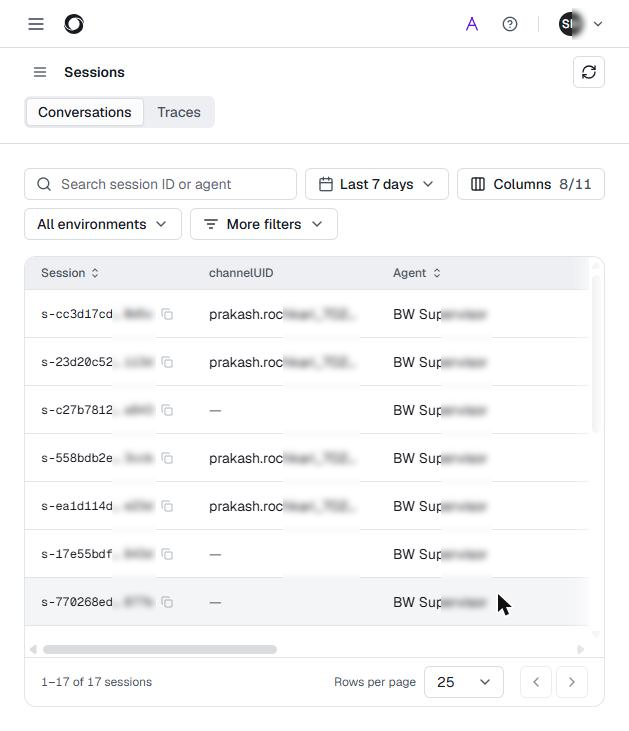

A session is one conversation between a user and the agents in your project. Use the **Sessions** page to find a conversation and see what happened in it: what the user said, what each agent decided, which tools and models the agents called, how long each step took, and, for voice, how the call sounded.

## Session identity and lifecycle

Every session has a unique ID in the format `s-<uuid>`, and belongs to one tenant and one project. The platform binds each session to the agent configuration of the environment it runs in.

- **Creation:** the platform creates a session when a user starts a conversation on any channel: the first message in a messaging app or the Web SDK, the start of a voice call, or the first request from an API or SDK client. On SDK and API channels, your application decides when a new session starts. The Web SDK raises a `sessionStart` event with the new session ID. See [Web SDK](/agent-platform/sdk/web-sdk).
- **Continuation:** while a session is open, every new message from the same user joins it, so the agents keep the full history and state. On asynchronous channels, such as WhatsApp, SMS, and email, the session stays open through long gaps, and the platform tracks each period of activity as a segment.
- **Handoff:** when a supervisor hands off to a specialist agent, the session and its ID stay the same. The platform opens a thread for the specialist inside the session and returns to the parent thread when the specialist finishes. See [Session hierarchy in multi-agent systems](/agent-platform/concepts#session-hierarchy-in-multi-agent-systems).
- **Closure:** the session closes when the agent completes, the user leaves, a timeout fires, or a transfer ends the conversation. The idle timeout and the maximum session age come from your tenant configuration; Studio has no setting for them. The **Summary** tab shows the values that apply. See [Session closure](#session-closure).
- **Archival:** after the retention period ends, the platform moves the session to cold storage and sets its status to **Archived**. Your deployment configuration sets the retention period. You can still open archived sessions on the **Sessions** page.

## What a session includes

A session holds everything the agents need to continue the conversation, and everything you need to investigate it later:

- **Conversation history:** every user message, agent reply, and tool call, in order. The agents receive this history on each turn.
- **Session state:** the variables that the agents collect during the conversation, such as gathered field values, tool results, and `SET` values. See [Session memory](/agent-platform/memory-and-state#session-memory).
- **Context:** values that the channel passes in, such as metadata, language, and locale, and the values that one agent passes to another during a handoff.
- **Threads:** the stack of agents that took part, created by handoffs.
- **Trace events:** a record of every step that the agents ran, with its timing, inputs, and outputs.
- **Metrics:** messages, tokens, cost, and duration.
- **Recording:** the call audio, for voice sessions with recording turned on.

To investigate a session, move down three levels: find the **turn** that went wrong, where a turn is one user message and the agents' response, then find the **step** inside that turn, and then read the step's **events**.

## Investigate a session

Most investigations start with a report, such as "the agent asked for my number twice" or "the call went quiet for ten seconds." Follow these steps to trace the report to its cause.

<Steps>
  <Step title="Find the session">
    Go to **Operate** > **Sessions**. Search for the session ID, or filter by **Caller phone number** for voice or **Channel UID** for digital channels. See [Find a session](#find-a-session).
  </Step>
  <Step title="Read the conversation">
    Select the session ID. On the **Timeline** tab, find the message where the problem started. That message tells you which turn to open.
  </Step>
  <Step title="Show only the problems">
    In the trace toolbar, select the issue count to hide steps that ran without issues, or press **N** to jump to the next error or warning.
  </Step>
  <Step title="Inspect the step">
    Select the step, and then press **Enter**. If the agent said something unexpected, open the model call before the reply and select **Request** to see what the model received.
  </Step>
  <Step title="Check timing and audio">
    For a slow agent, switch the trace to **Latency**. For an audio problem, play the recording from that message and open **Voice Quality**.
  </Step>
</Steps>

## Find a session

The sessions list opens on **Conversations** and shows sessions from the last seven days in all environments. Select **Traces** to list individual trace runs, such as evaluation or workflow runs.

<Frame caption="Sessions list with the Channel UID column turned on">
  
</Frame>

Search by session ID or agent name, or set the date range and environment and select **More filters**. Common cases:

- **A customer complains about a call:** filter by **Caller phone number**, and then sort by **Created**.
- **A customer complains on a digital channel:** filter by **Channel UID**, the user's identifier on the channel, such as an email address or a phone number with the country code.
- **Escalations increase:** set **Status** to **Escalated** and **Channel Type** to **Voice**.
- **Test sessions skew production numbers:** set **Source** to **User initiated** to leave out evaluations, synthetic runs, and debug sessions.

To show more columns, select **Columns**. To restore the six default columns, select **Reset to default**.

<AccordionGroup>
  <Accordion title="Column reference">
    | Column | Shows |
    | --- | --- |
    | **Session** | The session ID. Select the copy icon to copy it. |
    | **Channel UID** | The user's identifier on the channel. The platform encrypts this value at rest. |
    | **Agent** | The agent that started the session |
    | **Status** | The current status |
    | **Channel** | The channel, such as **Pipeline Voice**, **Voice**, or **Web Debug** |
    | **Channel Type** | The channel category, such as **Voice** or **Messaging** |
    | **Environment** | The environment, such as `working-copy` |
    | **Trace Events**, **Duration**, **Messages** | The size and length of the session |
    | **Created** | The date and time the session started |
  </Accordion>
  <Accordion title="Filter reference">
    | Filter | Values |
    | --- | --- |
    | **Channel UID** | An email address, a phone number with the country code, or another channel identifier |
    | **Agent** | The agents in the project |
    | **Status** | **Active**, **Completed**, **Failed**, **Abandoned**, **Escalated**, **Ended**, **Idle**, **Archived** |
    | **Source** | **User initiated**, **Workflow**, **Eval**, **Synthetic**, **Debug**, **Demo Insights** |
    | **Channel Type** | **Messaging**, **Voice**, **SDK**, **Webhook**, **Protocols**, **Workflow** |
    | **Channel** | The channels that have sessions in the selected range |
    | **Caller phone number** | A caller's phone number |
  </Accordion>
</AccordionGroup>

## Session page layout

Select a session ID to open the session page. The header and tabs stay at the top while you scroll.

<Frame caption="Session page">
  
</Frame>

1. **Header:** the status, error and warning count, length, message count, and trace event count. When the status and the disposition differ, the header shows both, such as `escalated · transferred`.
2. **Header actions:** **Details**, previous and next session, **Refresh snapshot** for a live call, **Export JSON**, and keyboard shortcuts.
3. **Tabs:** **Timeline**, **Performance**, **Summary**, **Voice Quality**, **Data**, and **Historical source**.
4. **Conversation pane:** what the user and each agent said.
5. **Trace views:** **Steps**, **Events**, and **Latency**.
6. **Trace:** every turn and the steps inside it.

<Note>
  The page works from a snapshot of the session. If the page shows **This session snapshot expired**, select **Refresh snapshot**. If the header shows **History · coverage unverified**, the page can't confirm that it loaded every recorded event; refresh the snapshot, or load older and newer ranges from the trace.
</Note>

### Export a session

To save a session for a support ticket or offline analysis, select **Export JSON** in the header. Your browser downloads `debug-trace-<session-id>-<timestamp>.json`, which holds the session identifiers, every trace event, every message, and a completeness check.

<Note>
  The export applies the same protection as the session page. The platform always masks credentials and secrets, and it redacts personal data according to the project's [PII protection](/agent-platform/pii-protection) settings.
</Note>

## Timeline tab

The **Timeline** tab shows the conversation and the trace side by side. To give either pane more room, drag the divider.

### Read the conversation

The conversation pane labels each message with its speaker: **User**, **Assistant**, or the agent that answered. A change of agent name shows where a handoff happened.

Hover over a message and select **Inspect message** to open its details, or **Play from here** to hear that moment of a voice call. To search messages or load older and newer ones, use the icons at the top of the pane.

### Read the trace

Choose the view that fits your question:

<Tabs>
  <Tab title="Steps: review each turn">
    Shows **Setup and greeting**, one row for each turn, and **Session events**. Each turn row shows when the turn ran, the agents involved, such as `Supervisor → Identity_Agent`, its duration, and its step count.

    Expand a turn to see its steps. The trace folds repeated steps into one row, such as **Routing & checks ×10**. For a long turn, select **Show more steps**.
  </Tab>
  <Tab title="Events: check the sequence">
    Lists every event in time order, with its category, timestamp, and issue status. Use this view to check, for example, whether a tool result arrived before the agent answered.
  </Tab>
  <Tab title="Latency: find slow steps">
    Lists every event with its duration. Scan for a step that took seconds instead of milliseconds, such as a model call, a tool call, or a wait for speech.
  </Tab>
</Tabs>

To narrow a long trace, use the toolbar:

- **Issue count:** select it to show only errors and warnings. Select the down arrow to go to the next issue.
- **Search loaded trace headers:** finds steps by name. **Search loaded evidence** searches the recorded content, such as an order number.
- **Filter:** shows or hides steps by event family, recorded category, or issue severity.
- **More icon:** loads an **Older range** or **Newer range** of a long trace.

<Accordion title="Filter options">
  | Section | Options |
  | --- | --- |
  | **Event families** | **Audio**, **Conversation**, **Flow**, **Guardrails**, **Memory**, **Model**, **Plumbing**, **Routing**, **Runtime**, **Tools** |
  | **Recorded categories** | `agent`, `flow`, `llm`, `message`, `session`, `system`, `tool`, `voice` |
  | **Issue severity** | **All issues**, **Errors**, **Warnings** |
</Accordion>

### Inspect a step

The inspector shows everything that the platform recorded for one step or message. Select a row and press **Enter**, or select **Inspect message** on a message. Use the arrows at the top to move between rows.

Each tab answers a different question:

- **Summary:** when the step ran, its duration, turn, agent, and issue status, and the key details for that type of step, such as call IDs for a call-connected event.
- **Request** and **Response** (model calls only): **Request** shows the model, provider, provider options, and model parameters. For a large request, the tab shows **Download full value**, which saves the complete request as JSON, including the system prompt, messages, and tools. **Response** shows the model's reply and any tool calls. Use these tabs to tell whether the model received bad input or handled good input badly.
- **Payload**, **Events**, and **Raw:** the step's data in a JSON viewer, the related steps, and the event as the platform stored it. Include **Raw** when you report a bug.

<Tip>
  Before you change an agent's ABL because of an unexpected reply, open the model call's **Request**. A missing memory value or a shortened history often explains the reply.
</Tip>

### Listen to the recording

For a voice session with recording turned on, the **Recording** panel appears above the conversation.

<Frame caption="Recording panel with the waveform loaded">
  
</Frame>

<Steps>
  <Step title="Load the recording">
    Select **Load recording** to draw the waveform for each recorded channel.
  </Step>
  <Step title="Go to the moment that matters">
    Select **Play from here** on a message, or the headphone icon on a trace row.
  </Step>
  <Step title="Control playback">
    Select **Play**. Skip 10 seconds, change the speed, drag **Recording position**, or use **Zoom**. To save the audio, select **Download recording**.
  </Step>
</Steps>

The recording doesn't identify which speaker uses which channel. Listen to the first few seconds to tell them apart.

For long calls, select **Compress measured silence in the display** to shorten silences in the waveform, or **Skip measured silence during playback** to skip verified silent ranges and still play all speech.

<AccordionGroup>
  <Accordion title="Recording states">
    The badge next to **Recording** shows whether you can play the call.

    | State | Meaning |
    | --- | --- |
    | **Checking for a recording** | The page is looking for a recording of the call. |
    | **Ready** | You can play and download the recording. |
    | **Failed** | The platform can't provide the audio. The panel shows the reason. |

    | Reason | What to do |
    | --- | --- |
    | `call_in_progress`, `media_in_progress` | The call is still running, or the platform is still processing the audio. Processing can take up to 15 minutes. Select **Refresh recording** to check again. |
    | `media_not_available` | The voice gateway didn't provide audio for the call. |
    | `retention_expired`, `deleted` | The platform removed the audio after the retention period. |
    | `auth_failed`, `storage_write_failed`, `media_object_missing` | The platform couldn't store or read the audio. Contact the support team with the session ID. |
  </Accordion>
  <Accordion title="Requirements and retention">
    To play or download a recording, the project needs call recording turned on, and you need the **View Recordings** permission, which every system role has by default.

    The platform deletes the audio after the recording's **Retention** date. A project admin or owner can change the retention period in the project's **Settings** > **Recording**. For the workspace switch, see [Call recording](/agent-platform/administration/workspace-account#call-recording).
  </Accordion>
  <Accordion title="Compliance and turning off recording">
    The platform doesn't play a recording notice. If your region requires consent or notice, add it to the agent's opening prompt. To keep audio in a specific region, use your own storage account.

    - **One project:** in **Settings** > **Recording**, turn off **Enable call recording**. Existing recordings stay playable.
    - **Whole workspace:** turn off the workspace **Call Recording** switch. The platform hides recordings and deletes nothing.
  </Accordion>
</AccordionGroup>

## Performance tab

Open the **Performance** tab to find out why a session ran slowly or cost more than expected.

<Tabs>
  <Tab title="Overview">
    Shows the session totals for trace events, LLM calls, tool calls, tokens, and duration, and an execution tree of every step. Far more LLM calls than turns can mean that an agent loops or retries.
  </Tab>
  <Tab title="Model and tool exchanges">
    Lists every model and tool call with its agent, tokens, cost, and duration. Sort by duration to find the slowest call or by tokens to find the most expensive one, and then select **Inspect**.
  </Tab>
  <Tab title="Logs">
    Shows the latest 256 runtime log lines. Select **Errors** or **Warnings** to filter them.
  </Tab>
</Tabs>

## Summary tab

The **Summary** tab shows how the session ended. **Details** in the header shows the same facts.

- **How long did it last?** **Duration** shows the full length, and **Engaged time** shows only the time the user took part. **Segments** counts separate periods of activity.
- **Who handled it?** **Final agent** shows the last agent, **Escalated to a human** shows whether a person took over, and **Deployment** shows the deployment. **None recorded** means the working copy.
- **Why did it end?** **Persisted disposition** shows the reason, such as `completed` or `timeout`. See [Dispositions](#dispositions).
- **Which settings apply?** **Current project diagnostics** shows the guardrail status and the current timeouts: **Browser idle**, **Access token TTL**, **Runtime idle**, and **Runtime max age**. Check them when sessions end sooner than you expect.

## Voice Quality tab

The **Voice Quality** tab appears for voice sessions and fills in as it loads. If loading stops, select **Continue reading**.

<Frame caption="Call Overview card">
  
</Frame>

Start from what the caller reported:

<Tabs>
  <Tab title="The agent was slow">
    1. In **Call Overview**, check **Avg E2E**.
    2. In **Turn latency**, find the slow turns. Latency shows green under 800 ms, amber under 1,500 ms, and red above that.
    3. In **Call Activity**, compare **Processing** with **Dead Air**. High processing points to models and tools, so open the **Performance** tab. High dead air points to turn detection and speech timeout settings.
  </Tab>
  <Tab title="The caller kept interrupting">
    1. In **Call Overview**, check **Barge-ins**. A high count usually means long or late agent responses.
    2. In **TTS Quality**, check **Avg TTS first audio**.
  </Tab>
  <Tab title="The call sounded bad">
    1. In **TTS Quality**, check the MOS scores for the agent's voice.
    2. In **Network Quality (MOS)**, check network quality. Low scores point to the line, not the agent.
  </Tab>
  <Tab title="The call dropped">
    1. In **Call Termination**, check which party ended the call.
    2. On **SIP Ladder**, select **Reveal** to see the SIP messages, and share the IDs from **Call details** with your telephony provider.
  </Tab>
</Tabs>

<Accordion title="Card reference">
  | Card | Shows |
  | --- | --- |
  | **Call details** | Call, SBC, account, and application IDs, caller, called number, direction, and voice gateway |
  | **Voice configuration** | STT provider, TTS provider, TTS voice, and gateway connection time |
  | **Turn latency** | Stage latencies for each turn |
  | **Call Overview** | Duration, turns, caller, disconnect, average latency, barge-ins, DTMF input, containment, and call phase |
  | **Network Quality (MOS)** | Inbound and outbound network quality |
  | **TTS Quality** | MOS scores, time to first byte, and time to first audio |
  | **Call Activity** | Agent speech, user speech, processing, and dead air |
  | **Call Termination** | The party that ended the call |
  | **SIP Ladder** | The SIP message flow |
</Accordion>

## Data tab

Open the **Data** tab when the conversation looks right but the outcome is wrong, for example, when the user gave an order number and the next step still failed. The tab shows what the agent stored, from the saved session record.

Start with **Raw sections**, which shows the **Session state**, **Gather**, and **Context** values. Other views focus on **Gather overview**, **Phase**, **Flow**, **Constraints**, **Session memory**, and **Full state**. To save the masked data, select **Download full value**.

## Historical source tab

When a session behaved differently from the agent you see today, use the **Historical source** tab to review the definition that ran.

<Steps>
  <Step title="Choose the agent">
    Select the entry agent or any agent from the loaded trace page.
  </Step>
  <Step title="Choose the source">
    Select **Recorded source** for the definition that ran, or **Current draft** for the agent today.
  </Step>
  <Step title="Read the definition">
    Select **DSL**, **Compiled IR**, or **Recorded test context**.
  </Step>
</Steps>

<Note>
  The platform doesn't record a source for sessions that ran the working copy. Deploy a version to keep each session's definition.
</Note>

## Keyboard shortcuts

Press **?** on the session page to see every shortcut. The most useful ones:

- **N** or **Shift+N**: go to the next or previous issue.
- **Enter**: inspect the focused row. **[** or **]** move between rows while the inspector stays open.
- **/**: search the focused pane. **Esc** closes whatever is open.
- **Space**: play or pause the recording.

<Accordion title="All shortcuts">
  | Pane | Action | Key |
  | --- | --- | --- |
  | Trace | Focus the previous or next row | **↑** or **↓** |
  | Trace | Focus the first or last row | **Home** or **End** |
  | Trace | Expand or collapse a row | **→** or **←** |
  | Trace | Toggle the focused group | **E** |
  | Trace | Expand or collapse all groups | **Shift+E** or **Shift+C** |
  | Search | Go to the next or previous result | **Enter** or **Shift+Enter** |
  | Recording | Seek back or forward 10 seconds | **←** or **→** |

  To turn off single-letter shortcuts, clear **Enable optional character shortcuts**.
</Accordion>

## Access sessions through the API

Use the public APIs to pull session data into your own reports, data warehouse, or monitoring tools.

<CardGroup cols={2}>
  <Card title="List session summaries" href="/agent-platform/api-reference/analytics-list-session-summaries">
    One row per session, with channel, outcome, messages, tokens, and cost.
  </Card>
  <Card title="List conversation messages" href="/agent-platform/api-reference/analytics-list-conversation-messages">
    Messages in time order, with the project's PII policy applied.
  </Card>
  <Card title="List traces" href="/agent-platform/api-reference/analytics-list-traces">
    Trace events for sessions.
  </Card>
  <Card title="List LLM calls" href="/agent-platform/api-reference/analytics-list-llm-calls">
    Model calls with tokens and cost.
  </Card>
  <Card title="Fetch calls per session" href="/agent-platform/api-reference/recording-fetch-calls-per-session">
    Call recordings for a session.
  </Card>
</CardGroup>

## Session closure

When a session closes, the platform saves pending data, records the final status and disposition, publishes a completion event, and releases the session's resources. It also finalizes billing and reporting. The platform bills by session, and uses each session's duration and engaged time for metrics such as containment and abandonment rates.

### Session statuses

| Status | Meaning |
| --- | --- |
| **Active** | An agent is working. |
| **Idle** | The agent waits for the user. |
| **Completed** | The agent finished by calling `COMPLETE`. |
| **Escalated** | A human or another system took over. |
| **Abandoned** | The user left, or the agent side dropped the conversation. |
| **Ended** | The user ended the session, or a timeout closed it. |
| **Failed** | A fatal error or a guardrail violation ended the session. |
| **Archived** | The retention period ended. |

The API and the export use lowercase values, such as `completed`.

### Dispositions

The disposition records why a session ended. The platform derives the final status from it.

| Disposition | Meaning | Status |
| --- | --- | --- |
| `completed` | The conversation reached its natural end. | `completed` |
| `abandoned` | The user walked away. | `abandoned` |
| `agent_hangup` | The agent side dropped the conversation. | `abandoned` |
| `transferred` | A human or another system took over. | `escalated` |
| `failed` | A system failure ended the conversation. | `abandoned` |
| `timeout` | The platform closed the session after inactivity. | `ended` |
| `unengaged` | The session opened, but the user never engaged. | `ended` |

### How a session closes

<Tabs>
  <Tab title="The agent completes">
    Define completion conditions in the agent's `COMPLETE` block. When a condition matches, the agent sends its final response and closes the session as `completed`.

    ```abl
    COMPLETE:
      WHEN: issue_resolved == true
        RESPOND: "Glad I could help. Have a great day!"

      WHEN: intent contains "bye"
        RESPOND: "Thanks for contacting us. Goodbye!"
    ```

    - The platform checks the conditions in order and applies the first match.
    - Put the `COMPLETE` block in the agent that owns the conversation, such as the supervisor. A `COMPLETE` block in a child agent ends only the child's work.
    - To end an interaction without closing the session, set `TERMINAL: false`. See [COMPLETE](/agent-platform/abl/reference/multi-agent-and-supervisor#complete).
  </Tab>
  <Tab title="A timeout fires">
    The platform closes an inactive session at the **idle timeout** or the **maximum session age**, whichever comes first, and records the `timeout` disposition and `ended` status. The platform records the end time as the moment the session went quiet.

    SDK channels also record `terminal_source`: `sdk_idle_timeout` for inactivity, or `sdk_end_session` when the application or user ends the session. Query these values in the [Analytics explorer](/agent-platform/analytics-insights/analytics-explorer#query).
  </Tab>
  <Tab title="A transfer ends">
    A transfer sets the disposition to `transferred` and the status to `escalated`. The routing's **Post-Agent Action** decides what happens next:

    - **Return to bot:** the session stays open, the status returns to `active`, and the bot takes over again.
    - **End Conversation:** the session closes, and the platform sets the disposition from the end reason that the contact center sends.

    | End reason | Disposition | Status |
    | --- | --- | --- |
    | `transferred` | `transferred` | `escalated` |
    | `completed`, `agent_completed`, `conversation_complete` | `completed` | `completed` |
    | `abandoned`, `user_left`, `user_exit` | `abandoned` | `abandoned` |
    | `agent_hangup` | `agent_hangup` | `abandoned` |
    | `failed`, `error` | `failed` | `abandoned` |
    | Missing or unrecognized | `completed` | `completed` |
  </Tab>
</Tabs>