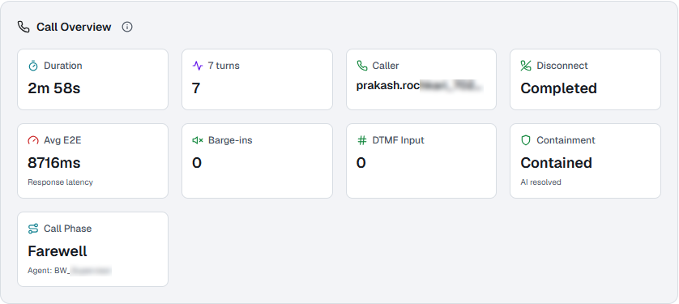

A session is one conversation between a user and the agents in your project. The platform creates the session when the conversation starts and keeps it until the conversation closes, even when the user moves between agents. The **Sessions** page lists these conversations and opens each one in a detail view built for investigation.

## Investigate a session

Use this workflow when an agent gives a wrong answer, a call goes badly, or a user reports a problem.

<Steps>
  <Step title="Find the session">
    Go to **Operate** > **Sessions**. Search by session ID or agent, or filter by **Caller phone number** or **channelUID** to find a specific user. See [Sessions list](#sessions-list).
  </Step>
  <Step title="Read the conversation">
    Select the session ID. The **Timeline** tab shows what the user and the agents said, next to the turn-by-turn trace.
  </Step>
  <Step title="Go to the failing turn">
    Select the issue count in the trace toolbar to show only steps with errors or warnings, or press **N** to jump to the next issue.
  </Step>
  <Step title="Inspect the step">
    Select the step and press **Enter**. For a model call, open **Request** to see exactly what the model received. See [Inspector](#inspector).
  </Step>
  <Step title="Check timing and audio">
    For slow responses, switch the trace to **Latency** or open the **Performance** tab. For voice calls, play the recording from the message and open **Voice quality**.
  </Step>
  <Step title="Share the evidence">
    Select **Export JSON** to download the session for offline review or a support ticket. See [Export a session](#export-a-session).
  </Step>
</Steps>

## Sessions list

The list shows sessions for the selected date range and environment. Select **Conversations** to list sessions, or **Traces** to list trace runs.


| Control | What it does |
| --- | --- |
| **Search session ID or agent** | Finds sessions by full or partial session ID, or by agent name. |
| **Last 7 days** | Sets the date range. |
| **All environments** | Limits the list to one environment, such as `working-copy`. |
| **More filters** | Filters by any field in the **Filters** list after this table. Select **Apply** to filter, or **Reset filters** to clear them. |
| **Columns** | Shows or hides columns. **Reset to default** restores the six default columns. |
| **Refresh** | Reloads the list. |
| **Rows per page** | Sets how many sessions each page shows. The default is 25. |

Select a session ID to open the session. Select the copy icon next to an ID to copy it without opening the session.

<AccordionGroup>
  <Accordion title="Columns">
    | Column | Shows | Default |
    | --- | --- | --- |
    | **Session** | Session ID, in the format `s-<uuid>` | Always on |
    | **channelUID** | The user's identifier on the channel, such as an email address or phone number. The platform encrypts it at rest. | Off |
    | **Agent** | Agent the session started with | On |
    | **Status** | Current [status](#session-statuses) | On |
    | **Channel** | Channel the session ran on, such as **Pipeline Voice**, **Voice**, or **Web Debug** | On |
    | **Channel Type** | Channel category, such as **Voice** or **Messaging** | Off |
    | **Environment** | Environment the session ran in | On |
    | **Trace Events** | Number of recorded trace events | Off |
    | **Duration** | Session length | Off |
    | **Messages** | Number of messages exchanged | Off |
    | **Created** | Date and time the session started | On |
  </Accordion>
  <Accordion title="Filters">
    | Filter | Values |
    | --- | --- |
    | **channelUID** | Email address, phone number with country code, or another channel identifier |
    | **Agent** | Agents in the project |
    | **Status** | **Active**, **Completed**, **Failed**, **Abandoned**, **Escalated**, **Ended**, **Idle**, **Archived** |
    | **Source** | **User initiated**, **Workflow**, **Eval**, **Synthetic**, **Debug**, **Demo Insights** |
    | **Channel Type** | **Messaging**, **Voice**, **SDK**, **Webhook**, **Protocols**, **Workflow** |
    | **Channel** | Channels that have sessions in the selected range |
    | **Caller phone number** | A caller's phone number. Returns every session from that caller. |
  </Accordion>
</AccordionGroup>

## Session detail page

The detail page keeps the header and tabs fixed while you scroll, so the session's identity and actions stay in view.


| # | Area | Use it to |
| --- | --- | --- |
| 1 | **Header** | See the session ID, entry agent, channel, time range, status, issue count, and totals. |
| 2 | **Header actions** | Open details, move between sessions, refresh, export, and see shortcuts. |
| 3 | **Tabs** | Switch between **Timeline**, **Performance**, **Summary**, **Voice quality**, **Data**, and **Historical source**. |
| 4 | **Conversation pane** | Read what the user and each agent said. |
| 5 | **Trace views** | Switch the trace between **Steps**, **Events**, and **Latency**. |
| 6 | **Trace** | Expand a turn to see every step the agents ran. |

### Header

| Element | Shows |
| --- | --- |
| **Session** | Session ID. Select the copy icons to copy the session ID or **Copy all identifiers**. |
| Subtitle | Entry agent, channel, and start and end time |
| Status | Session status, followed by the disposition when the two differ, such as `escalated · transferred` |
| Issue count | Errors and warnings found in the loaded history |
| **Session length** | Total length of the session |
| **Messages** | Number of messages exchanged |
| **Trace events** | Number of recorded trace events |
| **History · coverage unverified** | Appears when the page can't confirm that every recorded event loaded. The page shows the events it has. |

### Header actions

| Action | What it does |
| --- | --- |
| **Details** | Opens the session facts. See [Summary tab](#summary-tab). |
| Previous and next arrows | Open the previous or next session in the list. |
| **Refresh snapshot** | Reloads the session. Use it to follow a live call. |
| **Export JSON** | Downloads the session as a JSON file. See [Export a session](#export-a-session). |
| **Keyboard shortcuts** | Lists the [keyboard shortcuts](#keyboard-shortcuts). |

### Export a session

Export a session to analyze it offline, attach it to a support ticket, or keep a copy beyond the retention period.

<Steps>
  <Step title="Start the export">
    In the session header, select **Export JSON**. The button shows a spinner while the platform prepares the file.
  </Step>
  <Step title="Save the file">
    When the page shows **Export prepared**, your browser downloads `debug-trace-<session-id>-<timestamp>.json`.
  </Step>
</Steps>

| Section | Contains |
| --- | --- |
| `session` | Tenant, project, session, and deployment identifiers |
| `trace` | Every recorded trace event, with its type, time, agent, payload, and error flags |
| `conversation` | Every message in the session |
| `investigation` | Completeness details, such as how many events loaded and whether the trace or transcript was truncated |

<Warning>
  The export contains the full conversation text, including personal data that users typed or said, such as phone numbers. Store and share the file according to your data policy.
</Warning>

## Timeline tab

The **Timeline** tab shows the conversation on the left and the trace on the right. Drag the divider to resize the panes. For voice sessions, the **Recording** panel appears above both panes.

### Recording

The **Recording** panel plays the call audio and lines it up with the conversation and the trace.


<Steps>
  <Step title="Load the recording">
    Select **Load recording**. The panel draws a waveform for each recorded channel and measures silence.
  </Step>
  <Step title="Play it">
    Select **Play**. Skip back or forward 10 seconds, change the speed, adjust **Volume**, or drag **Recording position**. Use **Zoom** to widen the waveform.
  </Step>
  <Step title="Jump to a moment">
    Select **Play from here** on a message, the headphone icon on a trace row, or select a row and then **Play from selection**.
  </Step>
  <Step title="Download it">
    Select **Download recording**.
  </Step>
</Steps>

Two options help with long calls:

- **Compress measured silence in the display** shortens silent stretches in the waveform only. Playback keeps the real elapsed time.
- **Skip measured silence during playback** skips verified silent ranges. Speech and unknown ranges still play.

<Note>
  The waveform shows the two recorded channels but doesn't label which speaker is on which channel.
</Note>

<AccordionGroup>
  <Accordion title="Recording details">
    | Field | Shows |
    | --- | --- |
    | **Call ID** | Voice gateway call identifier |
    | **System call ID** | Platform identifier for the call |
    | **Recorded** | Length of the recording |
    | **Size** | File size |
    | **Created** | When the platform created the recording |
    | **Retention** | Date until which the platform keeps the recording |
  </Accordion>
  <Accordion title="Recording states">
    | State | Meaning |
    | --- | --- |
    | **Checking for a recording** | The page is looking for a recording for this call. |
    | **Pending** | The call ended, and the recording is queued for processing. |
    | **Fetching** | The platform is collecting and processing the recording. |
    | **Ready** | You can play and download the recording. |
    | **Failed** | The platform couldn't collect or process the recording. The panel shows the reason, such as `media_not_available`. |
    | **Deleted** | The retention period ended, and the platform removed the audio. The entry stays for reference. |

    Processing usually takes a few minutes, and up to 15 minutes for long calls. Select **Refresh recording** to check the latest state.
  </Accordion>
  <Accordion title="Requirements and retention">
    To play or download a recording:

    - Turn on call recording for the project. See [Recording settings](/agent-platform/administration/agent-behavior-settings#recording).
    - Have the **View Recordings** permission. Every system role has it by default.

    The platform keeps a recording until its **Retention** date, then deletes the audio and sets the state to **Deleted**. Deletion runs on a schedule, so a recording can stay available for up to one hour after that date. A project admin or owner can change the retention period in [Recording settings](/agent-platform/administration/agent-behavior-settings#recording).
  </Accordion>
  <Accordion title="Compliance">
    - **Tell the caller yourself.** The platform doesn't play a "this call is recorded" notice. If your region requires consent or notice, add it to the agent's opening prompt.
    - **Choose where audio lives.** The platform stores recordings in the storage configured for your workspace. Use your own storage account to keep audio in a specific region.
  </Accordion>
  <Accordion title="Turn recording off">
    | Goal | Action | Result |
    | --- | --- | --- |
    | Stop recording new calls in one project | In project **Settings** > **Recording**, turn off **Enable call recording**. | New calls aren't recorded. Existing recordings stay playable. |
    | Hide recording across the workspace | Turn off the workspace **Call Recording** switch. | Every project hides its recording settings and audio. Nothing is deleted. |
    | Remove the feature | Contact the support team. | Every recording surface disappears. |
  </Accordion>
</AccordionGroup>

### Conversation pane

Each message shows its speaker (**Assistant**, **User**, or the agent name) and time. Hover over a message to use **Inspect message** or **Play from here**.

| Control | What it does |
| --- | --- |
| Search icon | Searches the loaded messages. |
| More icon | Opens **Older messages**, **Newer messages**, **Refresh messages**, and **Follow loaded messages**. |

### Trace pane

The trace records every step the agents ran. Choose a view in the trace toolbar:

<Tabs>
  <Tab title="Steps">
    Groups the trace into **Setup and greeting**, one row per turn, and **Session events**. Each turn row shows its time range, the agent handoff (such as `Supervisor → Identity_Agent`), how long the turn took, and its step count.

    Expand a turn to see its steps. Repeated steps collapse into one row, such as **Routing & checks ×10**. Select **Show more steps** to load the rest of a long turn.
  </Tab>
  <Tab title="Events">
    Lists every recorded event in time order, with its category, time, and issue status. Use it when you need the exact sequence of events.
  </Tab>
  <Tab title="Latency">
    Lists every event with its category and duration. Use it to find the step that slowed a response.
  </Tab>
</Tabs>

Use the toolbar to find a problem fast:

| Control | What it does |
| --- | --- |
| Issue count | Shows the errors and warnings in the loaded range. Select it to show only steps with issues. |
| Down arrow | Jumps to the next issue. |
| **Search loaded trace headers** | Searches the step names in the loaded range. |
| **Search loaded evidence** | Searches the recorded content of the loaded events. |
| **Filter** | Shows or hides steps by event family, category, or issue severity. **Expand all** and **Collapse all** apply to every group. |
| More icon | Loads an **Older range** or **Newer range** of a long trace. |

<Accordion title="Filter options">
  | Section | Options |
  | --- | --- |
  | **Event families** | **Audio**, **Conversation**, **Flow**, **Guardrails**, **Memory**, **Model**, **Plumbing**, **Routing**, **Runtime**, **Tools** |
  | **Recorded categories** | `agent`, `flow`, `llm`, `message`, `session`, `system`, `tool`, `voice` |
  | **Issue severity** | **All issues**, **Errors**, **Warnings** |
</Accordion>

### Inspector

The inspector shows everything recorded for one step or message. Select a row and press **Enter**, or select **Inspect message** on a message. Use the arrows in the inspector to move to the previous or next row. On a narrow screen, the inspector opens below the trace.

| Tab | Shows |
| --- | --- |
| **Summary** | Time, duration, turn, agent, status, category, phase, key details, and identifiers such as span and trace IDs |
| **Request** | Model calls only. Model, provider, provider options, and model parameters. Select **View recorded value** for the full request. |
| **Response** | Model calls only. The model's reply. |
| **Payload** | The step's recorded data, in a JSON viewer |
| **Events** | Related steps in the loaded trace page |
| **Raw** | The recorded event exactly as stored |

<Tip>
  When an agent's reply surprises you, open the model call's **Request** before you change the agent's ABL. It shows exactly what the model received.
</Tip>

## Performance tab

The **Performance** tab shows how the session used models and tools.

<Tabs>
  <Tab title="Overview">
    Shows **Trace Events**, **LLM Calls**, **Tool Calls**, **Total Tokens**, and **Duration**, followed by an execution tree of every step with its agent and duration.
  </Tab>
  <Tab title="Model and tool exchanges">
    Lists every model and tool call with its type, model or tool name, agent, tokens in and out, cost, duration, and time. The header shows the call counts, total tokens, and the session's recorded cost. Select **Inspect** to open a call in the [inspector](#inspector).
  </Tab>
  <Tab title="Logs">
    Shows the latest 256 log lines with time, level, and message. Filter by **All levels**, **Information**, **Warnings**, or **Errors**. Select **Clear local logs** to clear the view.
  </Tab>
</Tabs>

## Summary tab

The **Summary** tab lists the session facts and the project settings that affect sessions. **Details** in the header shows the same facts.

<AccordionGroup>
  <Accordion title="Session facts">
    | Field | Shows |
    | --- | --- |
    | **Started**, **Finished** | When the session started and ended |
    | **Duration** | Total session length |
    | **Last activity** | Time of the latest activity |
    | **Final agent** | Agent that handled the session last |
    | **Engaged time** | Time the user actively engaged with the agent |
    | **Segments** | Number of engagement periods in the session |
    | **First interaction**, **Last interaction** | Times of the first user interaction and the latest interaction |
    | **Escalated to a human** | Whether the session went to a human agent |
    | **Finalized** | When the platform closed out the session |
    | **Deployment** | Deployment the session ran on. **None recorded** means the working copy. |
    | **Persisted disposition** | Why the session ended. See [Dispositions](#dispositions). |
  </Accordion>
  <Accordion title="Current project diagnostics">
    These are the project's current settings, which can differ from the settings during the session. Each value shows its source.

    | Field | Shows |
    | --- | --- |
    | **Guardrails** | Guardrail policy status, such as **no active policy** |
    | **Browser idle** | How long Studio stays open without activity before it signs you out |
    | **Access token TTL** | How long a Studio access token lasts before it refreshes |
    | **Runtime idle** | How long a runtime session lasts without user messages |
    | **Runtime max age** | Maximum lifetime of a runtime session, regardless of activity |
  </Accordion>
</AccordionGroup>

## Voice quality tab

The **Voice quality** tab appears for voice sessions. It loads voice evidence in batches. If it stops early, select **Continue reading** or **Read again**.



| Card | Shows | Look for |
| --- | --- | --- |
| **Call details** | Call SID, call ID, SBC call ID, caller, called number, direction, originating IP, account and application SIDs, gateway trace ID, and voice gateway | IDs to share with your telephony provider |
| **Voice configuration** | STT provider, TTS provider, TTS voice, and gateway connection time | A provider or voice that differs from what you configured |
| **Turn latency** | Stage latencies for each turn | End-to-end latency is green under 800 ms, amber under 1,500 ms, and red above. |
| **Call Overview** | Duration, turns, caller, disconnect, average end-to-end latency, barge-ins, DTMF input, containment, and call phase | A high barge-in count can mean long or slow agent responses. |
| **Network Quality (MOS)** | Inbound and outbound network quality, when Homer data is available | Low scores point to network problems, not agent problems. |
| **TTS Quality** | Combined, proxy, and network MOS, average time to first byte, and average time to first audio | Slow first audio adds to every turn's latency. |
| **Call Activity** | Share of the call spent on agent speech, user speech, processing, and dead air, with a silence breakdown | Long processing time points to slow model or tool calls. Long dead air points to waiting gaps. |
| **Call Termination** | Who ended the call, and Homer data availability | An unexpected party ending the call |
| **SIP Ladder** | The SIP message flow. Select **Reveal** to show it. | Failed or unexpected SIP responses |

## Data tab

The **Data** tab shows the values recorded for the session. It reads from the stored session record, not from the agent editor.

| Tab | Shows |
| --- | --- |
| **Raw sections** | **Session state**, **Gather**, and **Context** values |
| **Full state** | The complete recorded state |
| **Phase** | The conversation phase, such as `complete` |
| **Gather overview** | Field collection progress from the agent's gather flow |
| **Flow** | Flow state |
| **Constraints** | Constraint results |
| **Session memory** | Memory values for the session |

Select **Download full value** to save the masked value as JSON, or **Refresh recorded data** to reload it.

## Historical source tab

The **Historical source** tab shows the agent definition that ran the session, so you can compare it with the current agent.

<Steps>
  <Step title="Choose the agent">
    Select an agent. The list includes the entry agent and every agent recorded on the loaded trace page.
  </Step>
  <Step title="Choose the source">
    Select **Recorded source** for the definition that ran, or **Current draft** for the agent as it is now.
  </Step>
  <Step title="Read the definition">
    Select **DSL** for the ABL source, **Compiled IR** for the compiled version, or **Recorded test context** for the test conditions.
  </Step>
</Steps>

<Note>
  Sessions that ran the working copy have no recorded source. Deploy a version to keep its definition with each session.
</Note>

## Keyboard shortcuts

Select **Keyboard shortcuts** in the header, or press **?**, to see every shortcut. Shortcuts apply to the focused pane. To turn off single-letter shortcuts, clear **Enable optional character shortcuts**.

<Tabs>
  <Tab title="Trace">
    | Action | Key |
    | --- | --- |
    | Focus the previous or next row | **↑** or **↓** |
    | Focus the first or last row | **Home** or **End** |
    | Expand a row, or collapse it | **→** or **←** |
    | Inspect the focused row | **Enter** |
    | Toggle the focused group | **E** |
    | Expand or collapse all groups | **Shift+E** or **Shift+C** |
    | Inspect the previous or next visible row | **[** or **]** |
  </Tab>
  <Tab title="Search and issues">
    | Action | Key |
    | --- | --- |
    | Search the focused pane | **/** |
    | Go to the next or previous search hit | **Enter** or **Shift+Enter** |
    | Go to the next or previous issue | **N** or **Shift+N** |
    | Close an overlay, clear search, or close the inspector | **Esc** |
    | Show keyboard help | **?** |
  </Tab>
  <Tab title="Recording">
    | Action | Key |
    | --- | --- |
    | Play or pause | **Space** |
    | Seek back or forward 10 seconds | **←** or **→** |
  </Tab>
</Tabs>

## Session statuses

A session moves through these statuses from creation to archival. The **Status** column and filter show them as labels, such as **Completed**.

| Status | Meaning |
| --- | --- |
| `active` | The agent is processing. |
| `idle` | The agent is waiting for user input. |
| `completed` | The agent finished by calling `COMPLETE`. |
| `ended` | The user ended the session, or a timeout closed it. |
| `escalated` | The session went to a human or another system. |
| `abandoned` | The user left after an idle period. |
| `failed` | A fatal error or a guardrail violation ended the session. |
| `archived` | The session moved to cold storage after the retention period. |

## Session closure

When a session closes, the platform saves pending conversation data, records the disposition and final status, publishes a completion event, and releases the session's resources. It also finalizes billing and reporting metrics. A session is the billable unit, and its duration and engaged time feed metrics such as containment, resolution, and abandonment rates.

### Dispositions

The disposition records why the session ended. The platform derives the status from it.

| Disposition | Meaning | Status |
| --- | --- | --- |
| `completed` | The conversation reached its natural end. | `completed` |
| `abandoned` | The user walked away. | `abandoned` |
| `agent_hangup` | The agent side dropped the conversation. | `abandoned` |
| `transferred` | The conversation went to a human or another system. | `escalated` |
| `failed` | A system failure ended the conversation. | `abandoned` |
| `timeout` | The platform closed the session after inactivity. | `ended` |
| `unengaged` | The session opened, but the user never engaged. | `ended` |

### How a session closes

<Tabs>
  <Tab title="The agent completes">
    Define completion conditions in the agent's `COMPLETE` block. When a condition matches, the agent sends its final response and closes the session as `completed`.

    ```abl
    COMPLETE:
      WHEN: issue_resolved == true
        RESPOND: "Glad I could help. Have a great day!"

      WHEN: intent contains "bye"
        RESPOND: "Thanks for contacting us. Goodbye!"
    ```

    - The platform checks conditions in order and applies the first match.
    - Put the `COMPLETE` block in the agent that owns the conversation, such as the supervisor or a closing agent. A child agent that returns to its parent ends only its own work.
    - With `TERMINAL: false`, the interaction ends but the session stays open, and the user's next message starts a new interaction. See [COMPLETE](/agent-platform/abl/reference/multi-agent-and-supervisor#complete).
  </Tab>
  <Tab title="A timeout fires">
    The platform closes a session when it passes either limit, and records the `timeout` disposition and `ended` status:

    - **Idle timeout**: the longest a user can stay inactive.
    - **Maximum session age**: the longest a session can last, regardless of activity.

    The recorded end time is when the session became inactive, not when the platform detected the timeout. Default limits vary by plan.

    On asynchronous channels such as WhatsApp, SMS, and email, a session stays open through long gaps. The platform keeps one session and tracks engagement segments inside it.

    SDK channels also record a `terminal_source`: `sdk_idle_timeout` for inactivity, and `sdk_end_session` when the application or user ends the session. Query these fields in the [Analytics explorer](/agent-platform/analytics-insights/analytics-explorer#query).
  </Tab>
  <Tab title="A transfer ends">
    A transfer to a human or an external system sets the disposition to `transferred` and the status to `escalated`. The routing's **Post-Agent Action** decides what happens next.

    **End Conversation** closes the session. The disposition follows the end reason that the contact center sends:

    | End reason | Disposition | Status |
    | --- | --- | --- |
    | `transferred` | `transferred` | `escalated` |
    | `completed`, `agent_completed`, `conversation_complete` | `completed` | `completed` |
    | `abandoned`, `user_left`, `user_exit` | `abandoned` | `abandoned` |
    | `agent_hangup` | `agent_hangup` | `abandoned` |
    | `failed`, `error` | `failed` | `abandoned` |
    | Missing or unrecognized | `completed` | `completed` |

    **Return to bot** keeps the session open. The platform writes the transfer details to the session, sets the status back to `active`, and the bot handles messages again.
  </Tab>
</Tabs>

## Troubleshoot

| Problem | Fix |
| --- | --- |
| The recording shows **Failed** with `media_not_available`. | Confirm that recording was on before the call started, then select **Refresh recording**. |
| A recording never appears. | Check that the workspace shows **Call Recording** and its switch is on, that the project's **Enable call recording** is on and saved, and that the call started after you saved. Wait 15 minutes, then select **Refresh recording**. If it's still missing, contact support with the project name, session ID, and call time. |
| **Voice quality** keeps loading. | Select **Continue reading** or **Read again**. The other tabs keep working. |
| The inspector shows **The exact trace is unavailable for this access or source**. | Select the same step in the **Timeline** trace, or open **Raw**. |
| **History · coverage unverified** appears in the header. | Some events didn't load. Select **Refresh snapshot**, or use **Older range** and **Newer range** in the trace. |
| **Historical source** shows no definition. | The session ran the working copy. Deploy a version so future sessions keep their definition. |

{{related}}

- [Recording settings](/agent-platform/administration/agent-behavior-settings#recording)
- [Analytics explorer](/agent-platform/analytics-insights/analytics-explorer)
- [Session APIs](/agent-platform/api-reference/analytics-list-session-summaries)
- [COMPLETE in multi-agent setups](/agent-platform/abl/reference/multi-agent-and-supervisor#complete)
