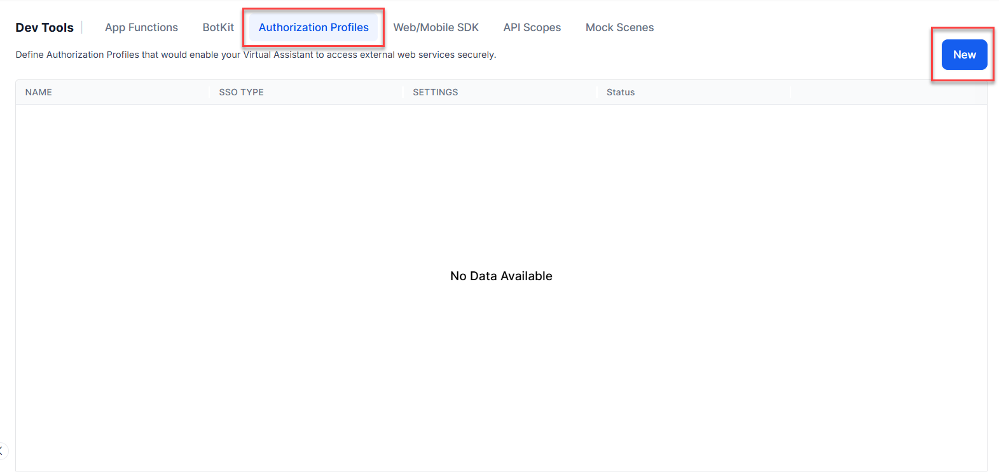
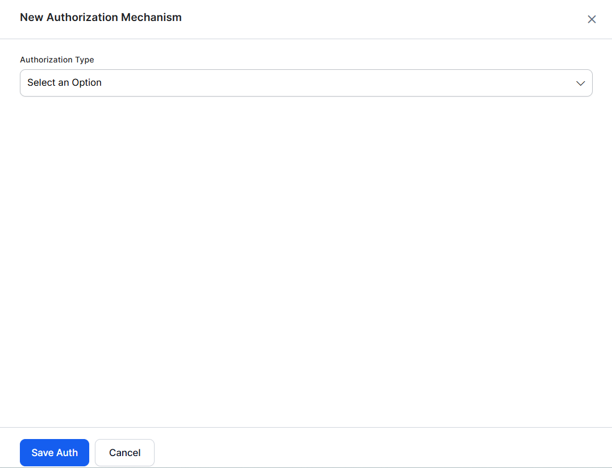
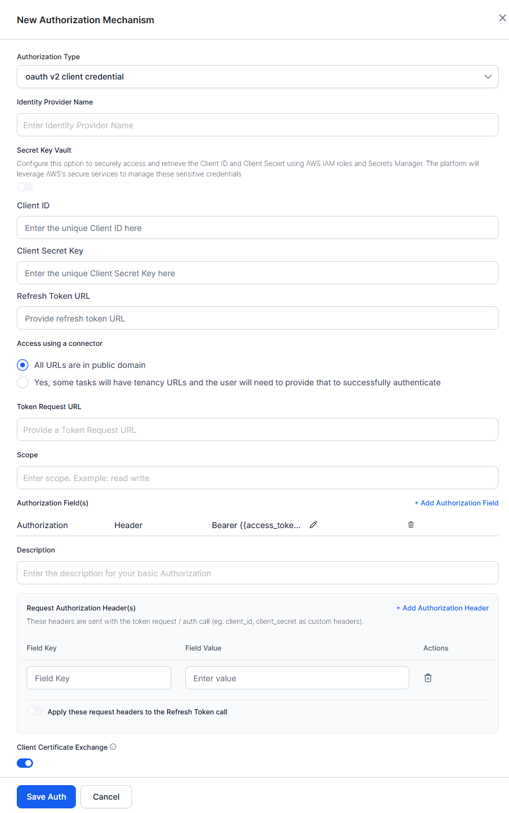
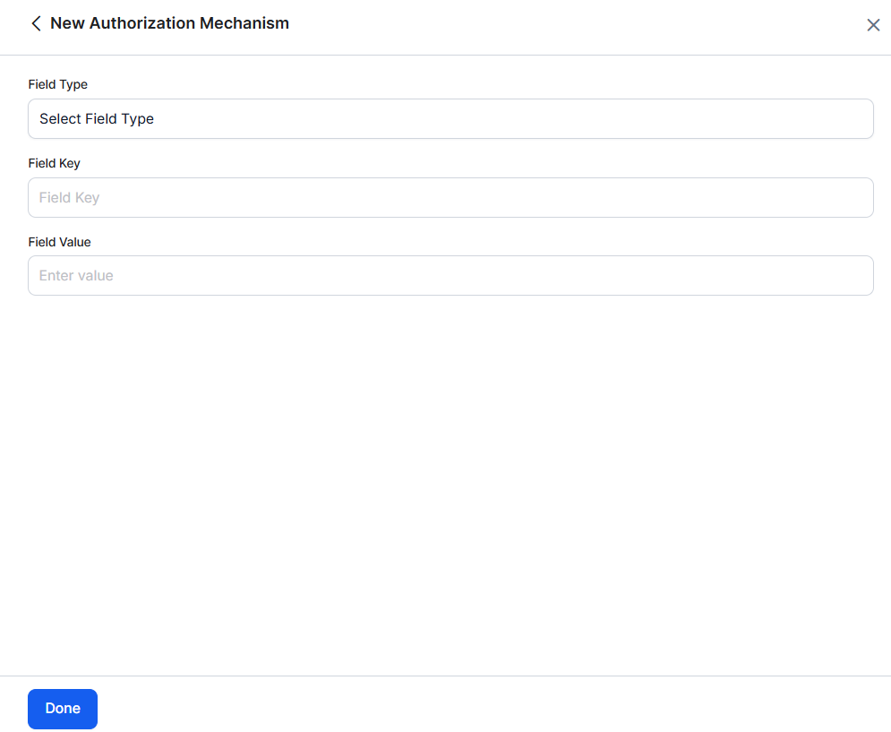
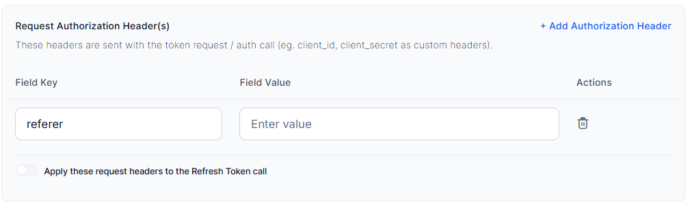
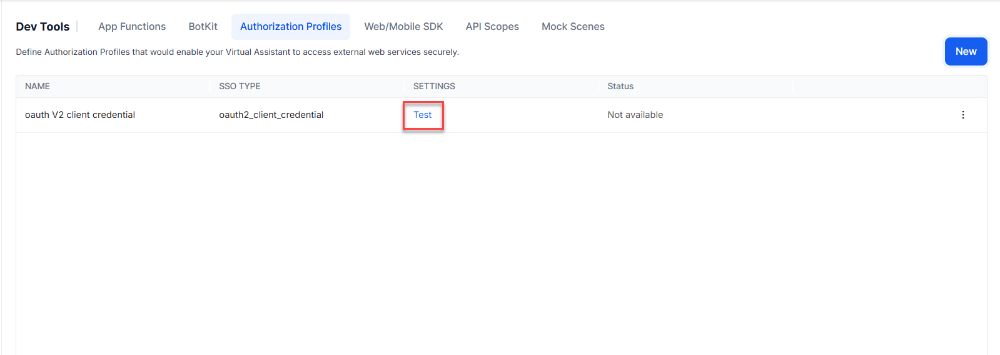

<Badge icon="arrow-left" color="gray">[Back to App Settings](/ai-for-service/app-settings)</Badge>

OAuth v2 is the new version of the open protocol to allow secure authorization via a standard method from web, mobile, and desktop applications.

To use oAuth v2, you must first register an account with the web application — you will need the sign-in credentials for that application to configure the Authorization Mechanism settings.

The Client Credentials grant type is used when applications request an access token to access their own resources, not on behalf of a user.

---

## Configuring oAuth v2 Using Client Credentials

1. Open the assistant for which you want to configure an Authorization profile.

2. From the left menu, select **App Settings**, then select **Dev Tools > Authorization Profiles**.

    

3. Select **New**. The **New Authorization Mechanism** dialog opens.

    

4. In the **Authorization Type** drop-down list, select **oauth v2 client credentials**.
5. In the **Name** field, enter the name for your authorization.

The following illustration shows the **oAuth v2** fields you must define to enable authorization for your assistant.

Define the fields as described in the following table:

| FIELD NAME | DESCRIPTION |
|---|---|
| Authorization Type | Set to oAuth v2 Client Credentials. |
| Identity Provider Name | The name of the web application or web service, for example, Asana. This field is required. |
| Client ID | The ID of the Kore.ai client. The Platform accepts a maximum length of 255 characters. |
| Client Secret Key | The value provided as the Kore.ai application authentication based on the Client ID to the web application. The Platform accepts a maximum length of 255 characters. |
| Token Request URL | The URL used by the Kore.ai application to obtain an unauthorized request token. A request token is a value used by the Kore.ai application to obtain authorization from the end-user to obtain an access token. The Platform accepts a valid URL with a maximum length of 3000 characters. After end-user authorization, an access token can be requested by the Kore.ai application. This field is required. |
| Scope | If the web service requires additional values for authorization, add one or more Key/Value pairs. For example, some web services support using a scope key using read-only, write, or both as the value. |
| Refresh Token URL | Enter a Refresh Token URL, if required, for cases when the authentication token expires and must be refreshed. The Platform accepts a valid URL with a maximum length of 3000 characters. |
| Description | Enter a description for your authorization. |
| Client Certificate Exchange | Enable this toggle to enforce certificate-based client authentication during the TLS handshake using a digital certificate. |

---

## Authorization Fields

By default, authorization fields are configured as part of the header of the task request message. If your task request requires additional authorization fields or the expected authorization isn't part of the header (for example, a verification code), click **+ Add Authorization Field** and define the fields as shown in the following illustration.

1. In the **Field Type** field, select one of the following depending on where in the task request message the authorization fields are required:
    - **Header** - The AI Agent expects the authorization fields as part of the header of the request.
    - **Payload** - The AI Agent expects the authorization fields as part of the content of the body of the request.
    - **Query String** - The AI Agent expects the authorization fields as a query in the body of the request.
    - **Path Param** - The AI Agent expects the authorization fields as part of the URL path for the request.

2. In the **Field Key** field, enter the name of the field for the selected **Field Type**.
3. In the **Field Value** field, enter the value for the **Field Key** specified.
4. Select **Done**. The new authorization field is added in the **Authorization Fields** section.

### Adding Request Authorization Header(s)

If your request requires additional authorization headers supported by the external system, click + Add Authorization Header to configure the required header fields.

1. In the **Field Key** field, enter the header name.
2. In the **Field Value** field, enter the corresponding header value.
3. Select **+ Add Authorization Header** to add multiple headers as needed. Use the delete option to remove any headers that aren't required.
4. Enable the **Apply these request headers to the Refresh Token call** toggle to include the configured headers in Refresh Token requests, if required by the external system.

---

## Testing the Authorization

After saving the authentication, test your authorization definition on the **Authentication** page by clicking **Test** before continuing to develop the remaining steps of your task. The test is executed using the authentication token URLs and the **Client ID** and **Client Secret Key**. If tenancy was defined, the **Test Authorization** dialog is displayed.

Click **Test** to begin the authorization test.

When validation completes, the results — either success or failure — are displayed. If the authorization fails, the Auth Test Failed message is displayed along with the **Headers** and **Response** tabs.

---

## Access Token Caching and Refresh

The platform caches access tokens for one hour per bot and Authorization Profile, regardless of the token's actual lifetime (`expires_in`).

* **Token reuse**: The platform obtains a token when the Authorization Profile is first used and reuses it for subsequent API calls. The token endpoint isn't called again while the cached token is available.
* **Token refresh**: The platform requests a new token when the cache expires or when the target API returns `401`. For a `401` response, the platform deletes the cached token, obtains a new one, and retries the API call once. If the retry fails, the platform passes the error to the dialog.
* **Expiry handling**: The platform doesn't check the token's expiry before making an API call. If the token expires before the one-hour cache period ends, the platform continues using it until the target API returns `401`. Other status codes, such as `400` or `403`, don't trigger a refresh. The platform fetches a new token only after the one-hour cache period ends.
* **401 requirement**: Ensure your API returns `401` when the token expires so the platform can refresh the token automatically.
* **Cache scope**: The cached token is shared across users, sessions, channels, dialogs, and Service Nodes that use the same Authorization Profile in a bot. The cache is shared across platform server instances. Different bots and profiles maintain separate tokens.
* **Token storage**: Use the built-in cache instead of storing tokens in context or session variables. Session-based storage increases token requests because each session fetches its own token, and it puts bearer tokens in session data.
* **Token lifetime**:
  * If the token lifetime is more than one hour, the platform fetches a new token every hour.
  * If the token lifetime is less than one hour, the platform makes one failed API call (`401`) each time the token expires, then automatically refreshes the token and retries the call. If this behavior matters, set the token lifetime to one hour or more on your identity provider.