My Dashboard provides agents with a personalized view of their performance across conversations, scorecards, sentiment, and resolution results. It highlights performance using Auto QA and audit scores. Agents can review strengths, gaps, and evaluated interactions based on their access permissions.

The dashboard also includes supervisor-assigned scorecards, sentiment trends, resolution effectiveness, and dispute activity from evaluated interactions. When you enable agent disputes, agents can acknowledge metric-level scores, raise disputes with supporting comments, and track review status until resolution. 

By default, agents can only access data from their assigned queues. Cross-queue visibility isn't supported. 

## Access My Dashboard

Navigate to **Quality AI** > **AutoQA** > **My Dashboard**.

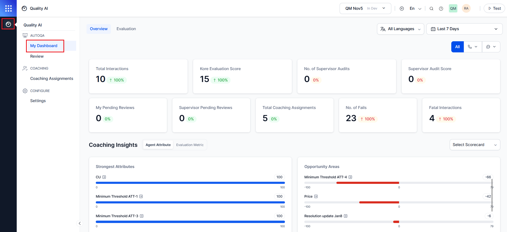

In **Quality AI** > **Settings** > **Quality AI General Settings**, enable **Auto QA**, **Agent Scorecard**, and **Agent Access to Scored Interactions** to view dashboard data. Enable **Agent Accept & Dispute** to activate the acknowledgement and dispute workflow.

Additionally, ensure that the evaluation forms are updated, configured with disputes, and published so they are available for agents to review.

---

## My Dashboard Filters

My Dashboard uses shared global filters across all widgets to refine data by language, date range, channel, and contact direction. All metrics update dynamically based on the selected filters.

| Filter | Description |
|:--------|:-------------|
| **Language** | Filter by one or more configured languages. Evaluation metric settings in **Configure** > **Settings** > **Language Settings** determine the available options. By default, the system selects all languages. |
| **Date Range** | Filter data using predefined ranges (Today, Yesterday, Last 7/28/90 Days) or a custom range of up to 31 days. The system displays data in the agent’s time zone and sets the default view to the last 7 days for performance analysis and comparison. |
| **Channel** | Filter by Voice, Chat, or All Channels. Metrics update based on the selected channel. |

   <Note>By default, all languages are selected. Metrics display only for languages configured at the evaluation metric level.</Note>

### Filter-Driven Metrics

Based on **Language**, **Date Range**, **Channel**, and **Contact Direction** applied, the following widgets update:

| Widget | Update |
|:--------|:--------|
| **Total Audits** | Displays audit counts for the selected filters. |
| **Avg. Audits per Agent** | Displays the average audits per agent for the selected languages. |
| **Evaluation Score** | Updates Manual and Auto QA scores. |
| **Fail Statistics** | Displays failed evaluation metrics for the selected languages. |
| **Performance Monitor** | Updates overall performance metrics trends. |

---

## Agent Performance Metrics

Displays key performance indicators based on selected filters. Each widget shows the current value and % change (↑ improvement, ↓ decline). 

| Metric | Description |
|:--------|:-------------|
| **Total Interactions** | Displays total interactions during the selected period. |
| **Kore Evaluation Score** | Displays the average automated Kore evaluation score for completed interactions. |
| **No. of Supervisor Audits** | Displays the total manual audited interactions completed by supervisors. |
| **Supervisor Audit Score** | Displays average score from manual supervisor audits, reflecting the latest revised score for any re-evaluated interactions. |
| **My Pending Reviews** | Displays the total number of completed manual evaluations assigned to the agent that are awaiting acknowledgment or dispute action. |
| **Supervisor Pending Reviews** | Displays the number of agent-submitted disputes awaiting QA re-evaluation. |
| **Total Coaching Assignments** | Displays the total number of coaching sessions assigned during the selected period. |
| **No. of Fails** | Displays the total number of failed scorecards during the selected period. |
| **Fatal Interactions** | Displays the interactions that failed critical compliance or quality criteria. |

<Note>My Pending Reviews and Supervisor Pending Reviews are visible only when **Agent Accept & Dispute** is enabled in **Quality AI** > **Settings** > **Quality AI General Settings** and at least one published evaluation form has disputes configured.</Note>

---

## Coaching Insights

Coaching Insights displays an agent’s strengths and improvement areas using scorecard attributes and evaluation metrics. Insights are based on the selected scorecard and evaluation results.

The feature is available in **My Dashboard**, **Supervisor View** (Agent Dashboard), and the **Evaluation** tab.

### Scorecard Selection

The Coaching Insights feature highlights an agent’s strengths and improvement areas based on selected scorecards. It recalculates insights when you update the scorecard selection.

To select a scorecard, use the **Select Scorecard** dropdown and choose one or more scorecards. The system automatically updates the insights. It includes the following two tabs:

| Tab | Description |
|:-----|:-------------|
| **Agent Attribute** | Displays performance grouped by agent attributes. |
| **Evaluation Metric** | Displays performance grouped by individual evaluation metrics derived from forms assigned at the queue level. |

### Agent Attribute Tab

The Agent Attribute tab displays attribute-level performance for the selected scorecard.

| Section | Description |
|:---------|:-------------|
| **Strongest Attributes** | Displays the highest-performing attributes based on adherence score.  |
| **Opportunity Areas** | Displays attributes with lower adherence scores that may require coaching. |

Each attribute is displayed as a labeled bar representing adherence across the selected period.

---

#### Click-through (Attribute to Metric Modal)

Selecting an attribute opens a detailed metric-level view.

| Column | Description |
|:--------|:-------------|
| **Evaluation Metric** | Displays the evaluation metrics associated with the selected attribute.|
| **Adherence %** | Displays the metric adherence percentage with a performance indicator. |

#### Adherence Color Coding

| Color | Range | Meaning |
|:-------|:-------|:---------|
| **Green** | High | Meets or exceeds expectations. |
| **Yellow** | Moderate | Moderately meets expectations. |
| **Orange** | Low | Below expectations, coaching recommended. |
| **Red** | Very Low | Significant performance gap. |
| **NA** | Not Applicable | Not triggered or evaluated. |

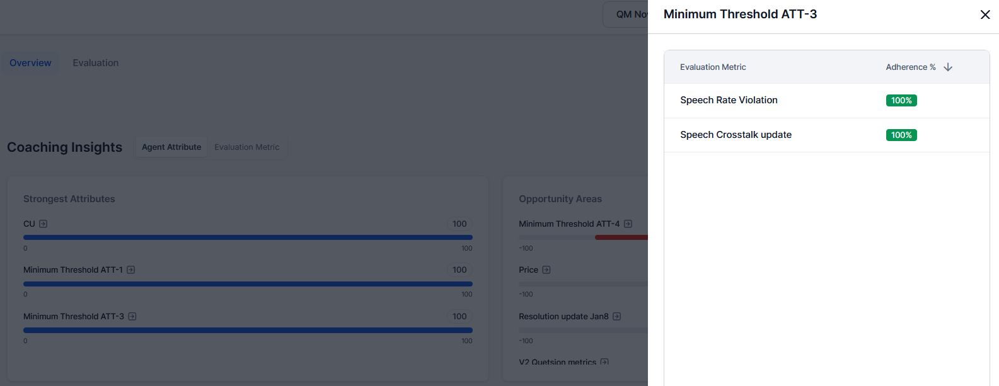

---

### Evaluation Metric Tab

The **Evaluation Metric** tab displays performance at the individual metric level.

| Section | Description |
|:---------|:-------------|
| **Strongest Evaluation Metrics** | Displays the highest-performing evaluation metrics based on adherence score.|
| **Coaching Opportunity Metrics** | Displays evaluation metrics with lower adherence scores that may require improvement.|

Each metric is displayed as a labeled bar indicating adherence across the selected period. Metrics are based on evaluation forms assigned at the queue level. 

---

#### Hover Insight (Metric and Attribute Mapping)

Hover over a metric to view its mapped agent attribute for quick traceability without changing views.

**Example**: Hovering over an evaluation metric displays the mapped **Agent Attribute**.

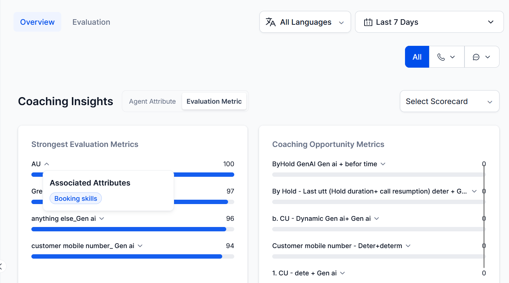

---

## Sentiment Insights

Displays customer sentiment across the agent's own conversations. Helps agents recognize strengths and identify recurring issues. 

| **View**                              | **Description**                                                                                             |
| ------------------------------------- | ----------------------------------------------------------------------------------------------------------- |
| **Average Sentiment Score**           | Displays overall sentiment across all topics, including positive and negative counts with trend indicators. |
| **Top 5 Highest Sentiment L3 Topics** | Lists the top five L3 topics with the highest sentiment scores in descending order.                         |
| **Top 5 Lowest Sentiment L3 Topics**  | Lists the top five L3 topics with the lowest sentiment scores in ascending order.                           |

   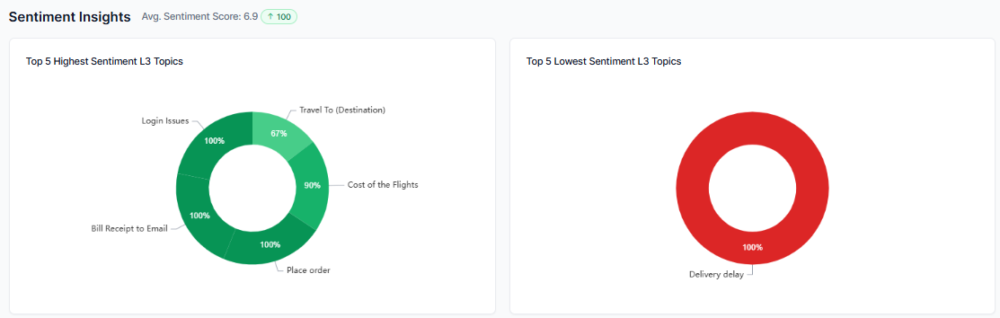

---

## Resolution Insights

Shows how well the agent resolves customer issues.

| View | Description |
|:------|:-------------|
| **Average Resolution Rate** | Shows the agent’s overall resolution rate across all conversations. |
| **Top 5 Highest Resolution L3 Topics** | Lists the top five L3 topics with the highest resolution rates in descending order. |
| **Top 5 Lowest Resolution L3 Topics** | Lists the top five L3 topics with the lowest resolution rates in ascending order. |
| **Resolved/Unresolved Breakdown** | Displays counts and percentages of resolved and unresolved conversations per topic. |

   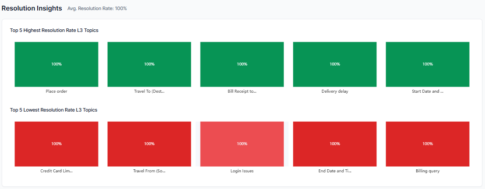

**Visual Indicators**

* **Green**: Positive sentiment
* **Red**: Negative sentiment

---

## Scorecard Trend

Track agent performance over time by selecting a **Scorecard**, **Language**, and **Time Interval** (**Daily**, **Weekly**, or **Monthly**). The view displays the average scorecard score and attribute-level score trends for the selected period. 

| **Feature**              | **Description**                                                                                                                      |
| ------------------------ | ------------------------------------------------------------------------------------------------------------------------------------ |
| **Scorecard**            | Select a scorecard to view its associated attribute trends and average score.                                                        |
| **Avg. Scorecard Score** | Displays the average score for the selected scorecard. Data is available only after evaluated conversations exist for the scorecard. |
| **Language Filter**      | Filter trends by a configured language or view all configured languages.                                                             |
| **Time Interval**        | View attribute score trends by **Daily**, **Weekly**, or **Monthly** intervals.                                                      |
| **Attributes**           | Displays the attributes in the selected scorecard and their scores across the selected time intervals.                               |

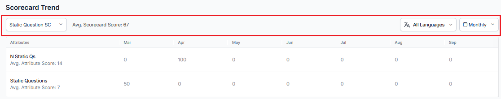

---

## Evaluation Tab

This section displays completed agent interactions along with Date and Time, Queue, Auto QA Score (if available), Audit Score, and evaluation review status based on the user’s access settings.

### Access to Evaluation Tab

Navigate to **Quality AI** > **My Dashboard** > **Evaluation**.

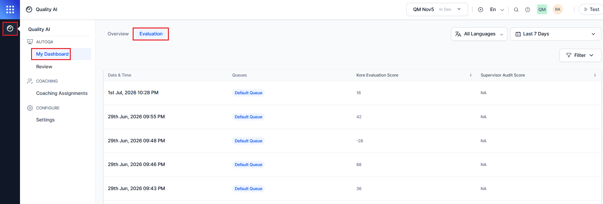

<Note>The **Evaluation** tab displays automated interaction scores only when the following are enabled in **Quality AI** > **General Settings**: **Auto QA**, **Agent Scorecard**, and **Agent Access to Scored Interactions**.</Note>

### Filter 

Filtering options vary based on the agent’s access level. Use the **Queues** filter to refine report results by selecting one or more queues to view associated interactions. Use the **Audit Status** filter to view interactions based on their audit state, with options for **Audited** (evaluated interactions) and **Not Audited** (unevaluated interactions). The filter panel displays the number of interactions that match the selected criteria, and selecting **Apply** updates the report results. 

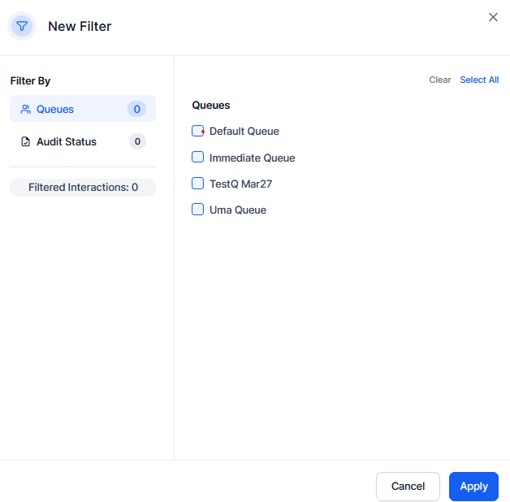

#### Available Interaction Views

The interactions displayed depend on the **Agent Access to Scored Interactions** configuration.

* **Only Manually Audited Interactions**: Displays supervisor-audited interactions with Date and Time, Queue, Supervisor Audit Score, Review Status, and Dispute Round. 

  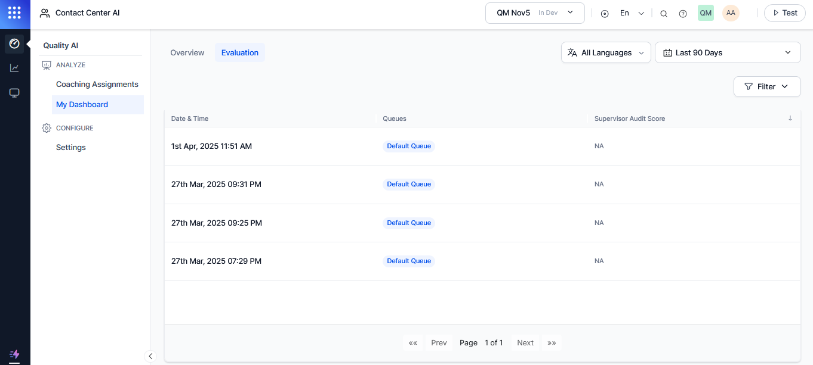

* **Manually Audited + Auto QA Scored Interactions**: Displays interactions with Date and Time, Queue, Auto QA Score (Kore Evaluation Score), Supervisor Audit Score, Review Status, and Dispute Round. 

   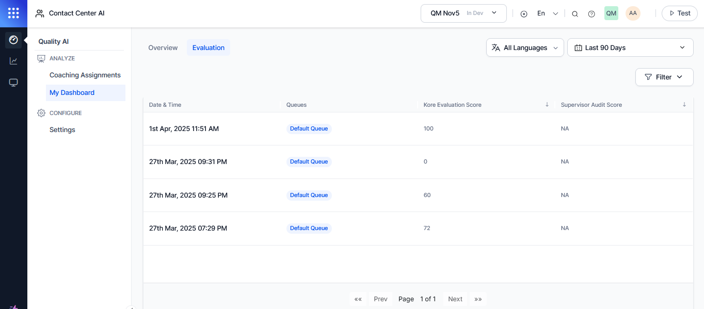

Select any reviewed conversations or interactions on the Evaluation page, you can view the detailed audit review of its interactions.

#### Interaction Comments and Transcripts

- Agents can view transcripts and comments only for interactions assigned to them.
- In each interaction, the **Audit** tab displays comments within the **Transcript** section for each interaction.
- Dispute comments submitted by the agent and QA responses display in the **Comments and Dispute** section for each metric.

  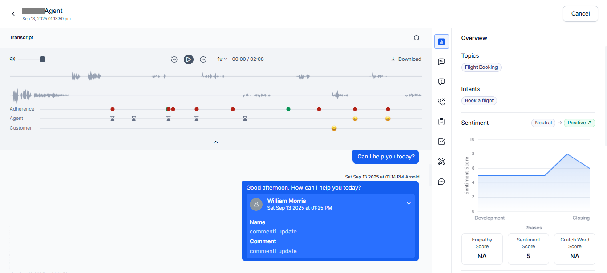

  <Note> Users with the **Download** Conversations permission can download conversation recordings directly from the audit screen. This permission is available by default to App Owner, App Developer, App Tester, and Supervisor roles.</Note>

---

## Review

The **Review** page gives agents a dedicated view of all their manually evaluated conversations, grouped by review state.

Agents can track evaluations awaiting action, monitor active disputes, and view completed or closed dispute outcomes from one place.

---

### Access Review

Navigate to **Quality AI** > **Review**.

### Review Tabs

Tabs represent the different evaluation groupings available in the Review tab.

| Tab                | Description                                                                      |
| :----------------- | :------------------------------------------------------------------------------- |
| **Pending Review** | Evaluations the agent hasn't acknowledged or disputed. Select a row to open the audit screen and respond at the metric level. If no evaluated conversations exist, the tab displays: `No Evaluated Conversations Found.`  |
| **Disputes**       | Evaluations with an active dispute submitted by the agent. If no disputes exist, the tab displays: `No disputes raised`.  |
| **Resolved**       | Includes evaluations with completed reviews, accepted outcomes, and closed disputes. |

---

### Evaluation Filters

| Filter | Available For | Description |
|:--------|:--------------|:-------------|
| **Queues** | All access types | The system filters interactions by queue and limits the list to the queues the agent belongs to. |
| **Audit Status** | Manually Audited + Auto QA | Filters audited and unaudited interactions individually. Visible only when Auto QA interactions are included. |
| **Review Status** | All access types | Filters manually audited interactions by their current acknowledgment or dispute status. |

---

### Responding to an Evaluation

When an agent opens a conversation from the Pending Review tab, the audit screen displays each metric with the evaluator's score, outcome, and notes or criteria. Agents review each metric individually and choose a response.

To respond to an evaluation,

1. Select a conversation from the **Pending Review** tab to open the audit screen.
1. For each metric, review the outcome and the evaluator's notes.
1. Select **Accept** to acknowledge the metric score or **Dispute** to contest the score, subject to the configured dispute-round limit.
1. For any disputed metric, add a comment explaining the reason for the dispute.
1. Agents can accept some metrics and dispute others within the same evaluation — they don't need to contest the evaluation as a whole.
1. Select **Submit** to send the response.

### Pending Review Tab

| Column | Description |
|:--------|:-------------|
| **Date** | Date and time when the evaluation completed. |
| **Queues** | Queue associated with the conversation. |
| **Kore Evaluation** | Displays the automated QA evaluation score for the conversation. |
| **Supervisor Audit Score** | Manual audit score assigned by QA. |

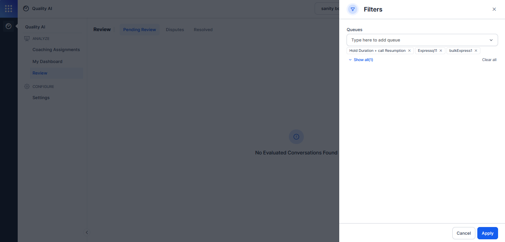

### Reviewing a QA Re-evaluation Response

When a QA completes the re-evaluation, the evaluation status changes to **Re-evaluation Received**. 

The agent can:

1. Open the conversation from the **Disputes** tab.
2. Review the QA's revised score and written response per disputed metric in the **Comments and Dispute** section.
3. Select **Accept** to acknowledge the QA's decision or **Dispute** to raise another dispute, provided the current round isn't the final configured round.

<Note> For an evaluation configured with n total dispute rounds, the agent can accept or dispute the QA's response in rounds 1 through n−1. In the final (nth) round, only the Accept option is available. The agent can't raise another dispute in the final round.</Note>

If further disputes are disabled or the final dispute round is reached, the Dispute option isn't available. The agent must accept the QA's final decision to complete the review.

### Dispute Round Restriction

The agent's available actions depend on the total number of dispute rounds configured for the evaluation.

* For rounds 1 through n−1, the agent can either Accept the QA re-evaluation or Dispute it to raise another dispute.

* In the final (nth) round, the agent can only Accept the QA re-evaluation. The **Dispute** option is unavailable.

Once the agent accepts the evaluation in the final round, the dispute is resolved and the review status is updated accordingly.

If an agent submits a dispute without comments for all disputed metrics, the following message displays:

`If one or more disputed metrics are missing comments. Add comments to all disputed metrics to continue.`

After submission, the system routes the disputed metrics to the assigned QA for re-evaluation according to the form's routing rules. The evaluation status changes to **Awaiting QA Response**.

---

### Disputes Tab

| Column | Description |
|:--------|:-------------|
| **Date** | Date and time when the evaluation completed. |
| **Queues** | Queues associated with the conversation. |
| **Supervisor Audit Score** | Manual audit score for the conversation, reflecting the latest revised score after any re-evaluation. |
| **Dispute Rounds** | Number of dispute rounds completed for the evaluation. |

<Note> The **Disputes** menu item is visible only for users with Agent Dashboard permission when **Agent Accept & Dispute** is enabled in **Quality AI** > **Settings** > **Quality AI General Settings** and disputes are configured for at least one evaluation form.</Note>

---

## Disputes

The **Disputes** tab provides agents with a single view of all evaluations they have actively disputed, including the current round, QA response status, and auditor details.

### Access Disputes

<Note> The **Disputes** menu item is visible only for users with Agent Dashboard permission when **Agent Accept & Dispute** is enabled in **Quality AI** > **Settings** > **Quality AI General Settings** and disputes are configured for at least one evaluation form.</Note>

---

### Disputes Attributes

| Column | Description |
|:--------|:-------------|
| **Conversation Date and Time** | Date and time the original conversation took place. |
| **Audit Score** | The audit score assigned to the conversation, reflecting the latest revised score after any re-evaluation. |
| **Review Status** | Current dispute state of the evaluation. |
| **Dispute Round** | The current round number of the dispute. |
| **Auditor** | The QA evaluator who completed the evaluation or re-evaluation. Displayed based on the **Hide Auditor Details** app-level setting.  |

---

### Review Status Values (Disputes View)

| Status | Description |
|:--------|:-------------|
| **Disputed** | The agent has submitted a dispute, which is awaiting QA review. |
| **Awaiting QA Response** | The system routes the dispute to QA and waits for their re-evaluation response. |
| **Re-evaluation Received** | The QA has responded, and the agent can review the decision and accept or raise a further dispute if permitted. |
| **Resolved** | The agent accepted the QA's re-evaluation outcome. |
| **Closed** | The system closes the dispute process after it reaches the maximum number of rounds or when the form configuration ends the dispute. |

<Note>When **Hide Auditor Details** is enabled at the app level, the Auditor column anonymizes the QA's name.</Note>

---

### Review Status Values

The **Review Status** column reflects the current acknowledgment or dispute state for each manually evaluated conversation.

| Status | Description |
|:--------|:-------------|
| **Pending Review** | The evaluation is complete and awaiting the agent’s acknowledgment or dispute response. |
| **Acknowledged** | The agent has accepted all metric scores. |
| **Disputed** | The agent has disputed one or more metrics, and the dispute is active or is in progress. |
| **Awaiting QA Response** | The agent has submitted a dispute, and the QA re-evaluation is pending. |
| **Re-evaluation Received** | QA has responded to the dispute, and the agent can review the decision or updated outcome. |
| **Resolved** | The agent accepted the disputed evaluation after re-evaluation or acceptance of the QA decision. |

<Note> **Review Status** values are displayed only when **Agent Accept & Dispute** is enabled in **Quality AI** > **Settings** > **Quality AI General Settings** and disputes are configured for the published evaluation form associated with the interaction. Evaluations associated with unpublished forms or forms without dispute configuration do not display a Review Status.</Note>

#### Queue Filter

The Queues filter helps you to refine evaluations by selecting one or more queues. It supports multi-select search, enabling users to find and apply relevant queue filters to narrow down the displayed evaluation results and assist with queue filtering and dispute tracking.

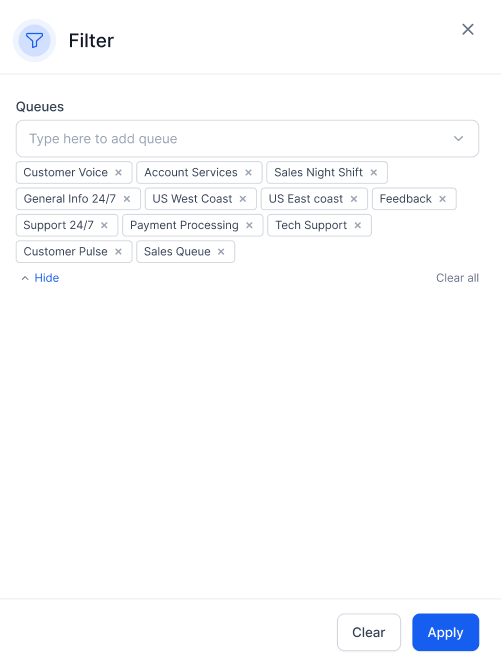

<Note> The **Review Screen** is available only when **Agent Accept & Dispute** is enabled in **Quality AI** > **Settings** and at least one evaluation form has disputes configured. If the setting is off or no forms have disputes enabled, the **Review** screen isn’t accessible. </Note>

---

### Dispute Restrictions and Limitations

#### Resolved Tab

The **Resolved** tab displays completed evaluation reviews including the evaluation date, associated queues, latest supervisor audit score, number of dispute rounds, and final review status.

| Column | Description |
|:--------|:-------------|
| **Date** | Date and time when the evaluation completed. |
| **Queues** | Queues associated with the conversation. |
| **Supervisor Audit Score** | Latest revised manual audit score after re-evaluation. |
| **Dispute Rounds** | Number of dispute rounds completed before resolution or closure. |
| **Review Status** | Final state of the evaluation — Resolved or Closed. |

---

#### Settings

The **Settings** page displays all available options in view-only mode.

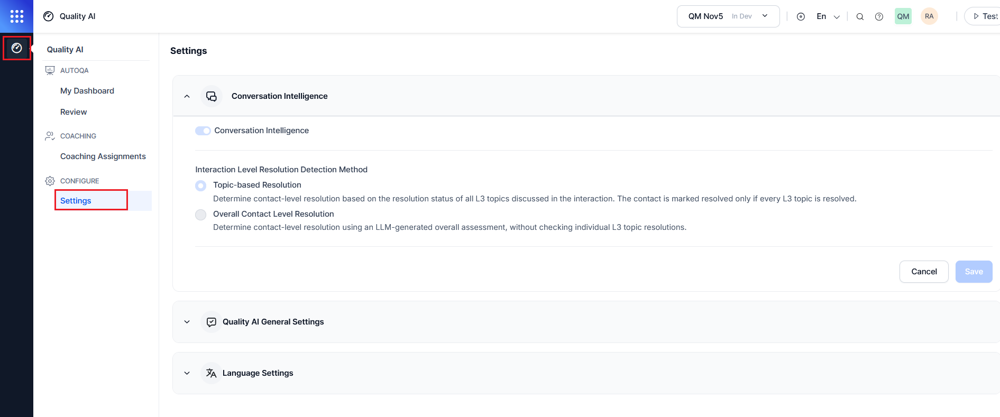

----
