Monitor agent performance and usage across AI for Work.

## Overview

Analytics provides a history of all administrative tasks through two views: the **Dashboard view** and the **Data view**. Switch between them using the toggle at the top right of the Analytics page.

The views display key performance metrics, trends, and reports, enabling you to gauge real-time usage and performance.

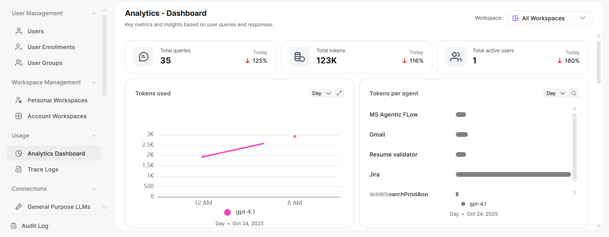

The **Usage** section of the Admin Console also includes the [Model Spendings](#model-spendings) page, which tracks LLM spend in dollars, and [Rate Limits](#rate-limits), which control how much users can spend.

---

## Dashboard View

The Dashboard view provides graphical reports on usage, performance, and feedback. At the top, you can see the total queries, total tokens, and total active users for the day.

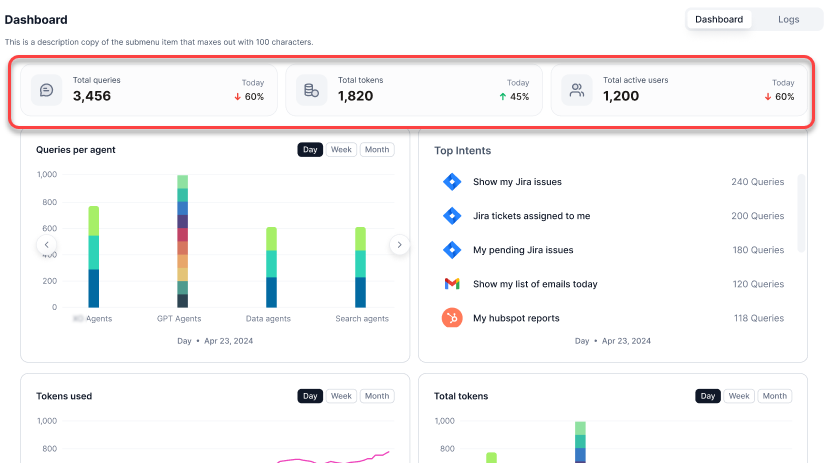

The following reports are available:

| Report | Description |
|--------|-------------|
| **Tokens Used** | Token usage trends across models |
| **Tokens Per Agent** | Token consumption broken down by agent |
| **Queries Per Agent** | Query volume per agent by type |
| **Top Agents** | Agents ranked by query volume |
| **Top Users** | Top 10 users by query count |
| **Users** | Unique users by platform (web vs. native) |
| **Average Response Time** | Average response time of the service |
| **Errors** | Queries with errors over time |
| **Feedback** | End-user feedback on responses |

All graphical reports support **Day**, **Week**, and **Month** views with left-right navigation for detailed metrics at each time point. Time averaging: 30-minute average (daily), 6-hour average (weekly), daily average (monthly).

---

### Tokens Used

Displays token usage trends across models.

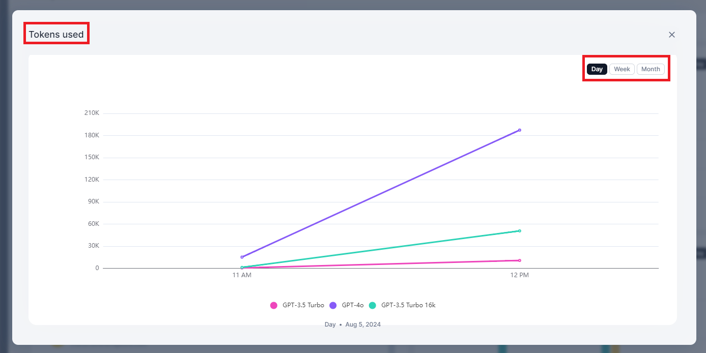

| Metric | Description |
|--------|-------------|
| Model Name | The LLM model used |
| Total Tokens Used | Combined context and generation tokens |
| Context Tokens | Tokens in the input/context |
| Generation Tokens | Tokens in the response |
| Timestamp | Date and time of usage |

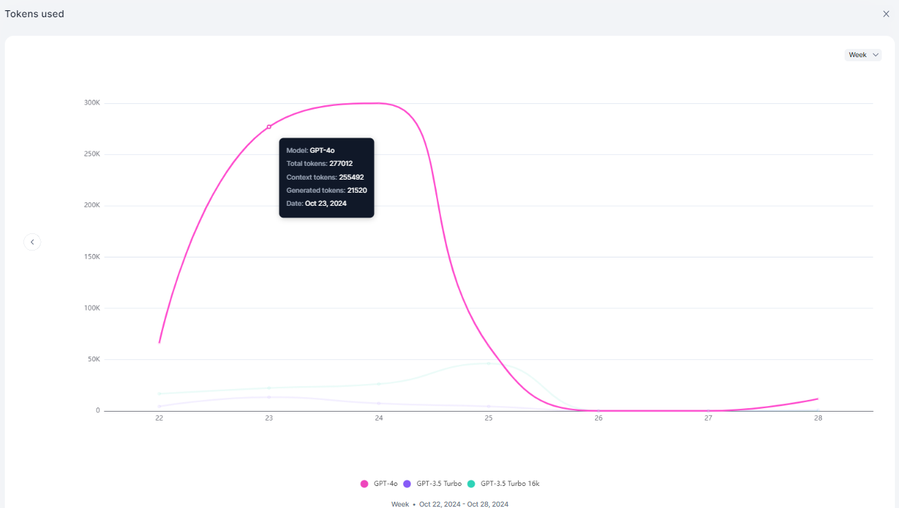

---

### Tokens Per Agent

Displays token consumption broken down by agent.

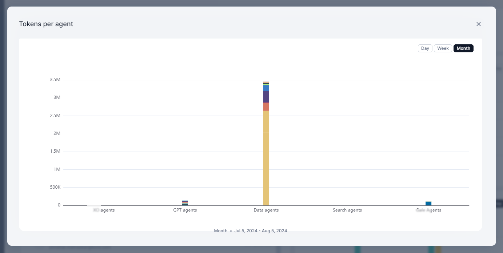

| Metric | Description |
|--------|-------------|
| Agent Name | Name of the agent |
| Model Name | LLM model used by the agent |
| Total Token Count | Combined context and generation tokens |
| Generation Token Count | Tokens in the response |
| Context Token Count | Tokens in the input/context |

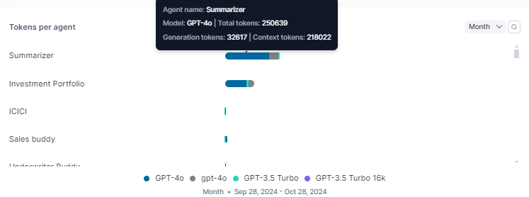

---

### Queries Per Agent

Displays query volume by agent, categorized by agent type: AI for Service, GPT, Data, Search, and Workflow.

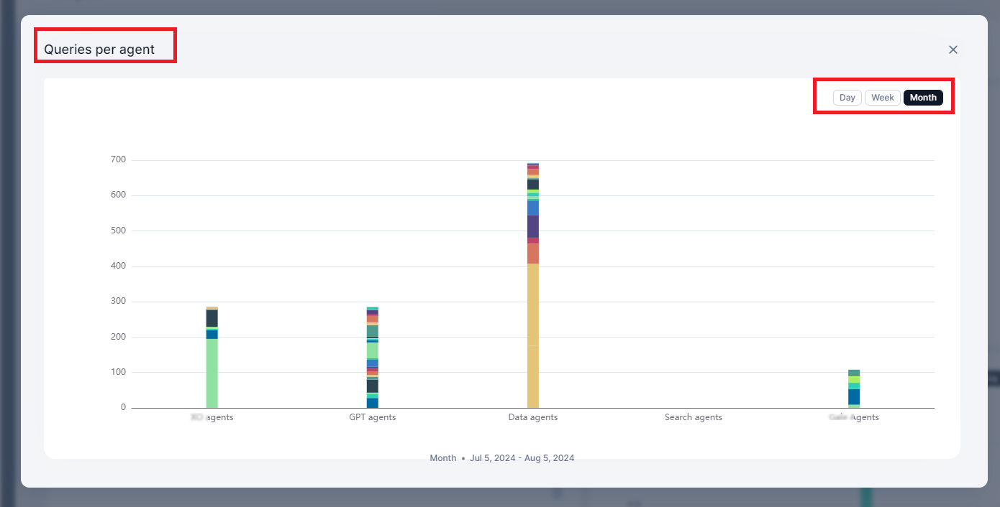

| Metric | Description |
|--------|-------------|
| Agent Name | Name of the agent |
| No. of Queries | Total queries handled |
| Timestamp | Date and time |

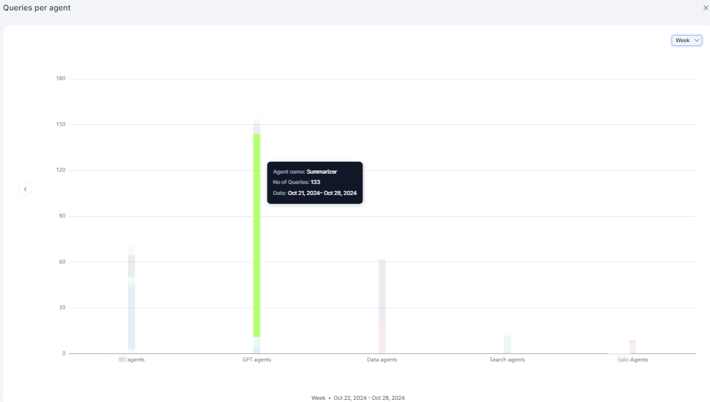

---

### Top Agents

Displays agents ranked by query volume in descending order.

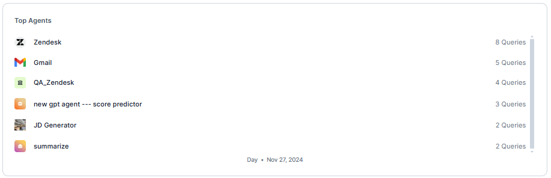

---

### Top Users

Displays the top 10 users by query count.

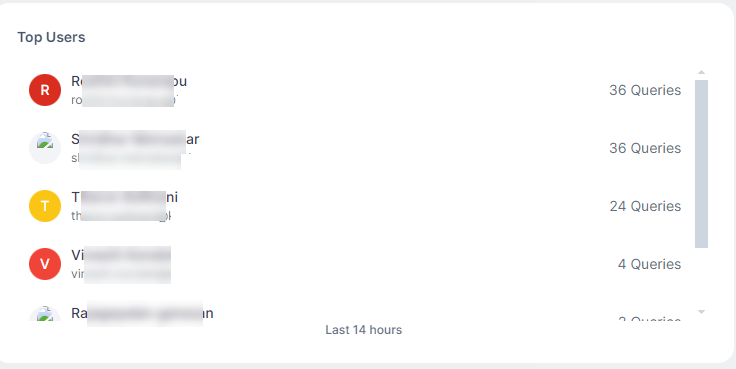

---

### Users

Displays unique users interacting with the system, comparing web vs. native platforms.

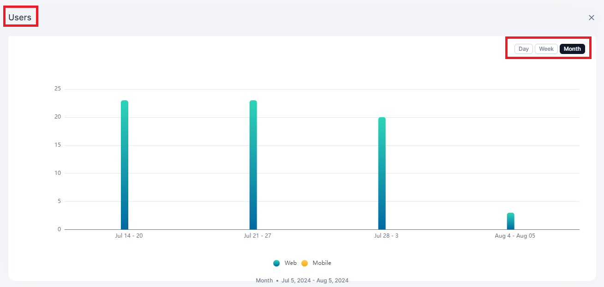

| Metric | Description |
|--------|-------------|
| Total Users | Unique user count |
| Channel | Web or native platform |
| Timestamp | Date and time |

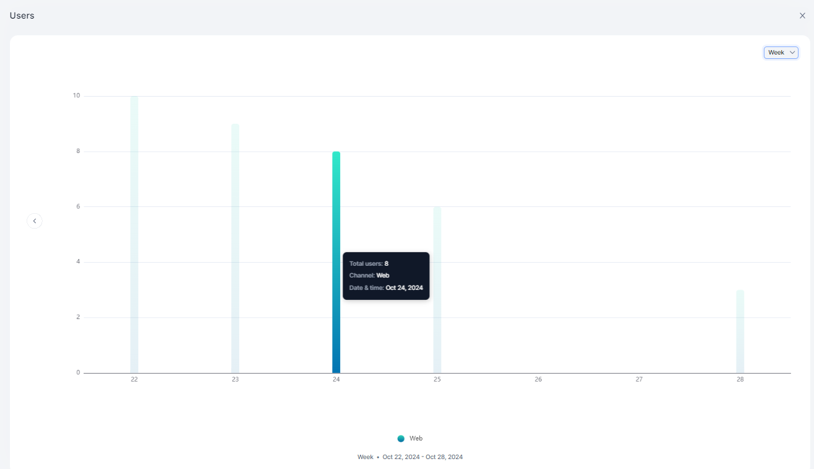

---

### Average Response Time

Displays the average response time of the service over time.

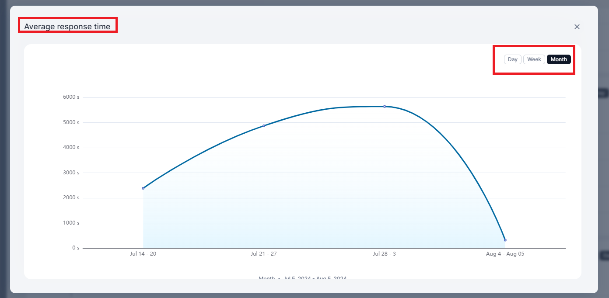

| Metric | Description |
|--------|-------------|
| Average Response Time | Mean response time per period |
| Timestamp | Date and time |

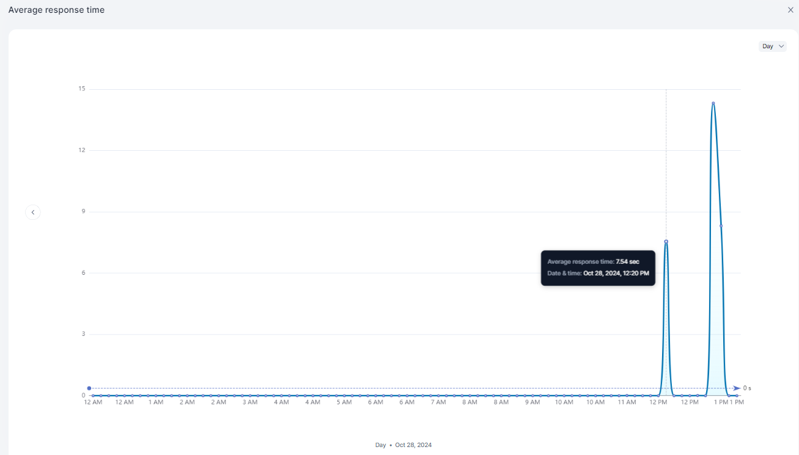

---

### Errors

Displays the number of queries that resulted in errors over time.

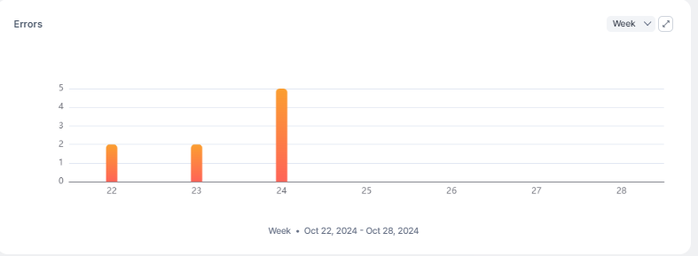

| Metric | Description |
|--------|-------------|
| Total Errors | Count of error responses |
| Timestamp | Date and time |

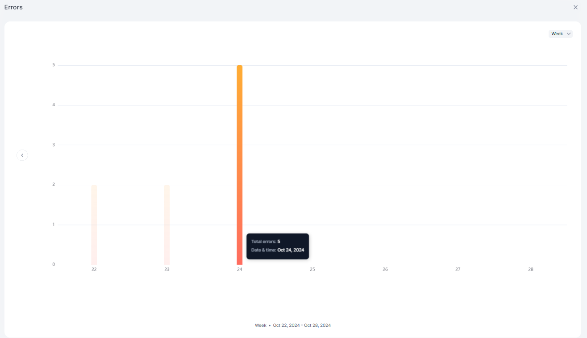

---

### Feedback

Displays end-user feedback on responses.

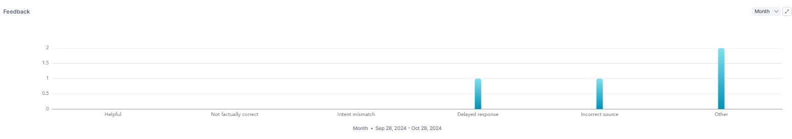

| Metric | Description |
|--------|-------------|
| Feedback | Feedback type (positive/negative) |
| Queries | Associated query count |
| Timestamp | Date and time |

---

## Trace Logs

Trace logs record how the platform processed each user query, from request to response. Each record maps to one user query. Use trace logs to investigate a response, review what a query cost, and see which source answered it.

**Navigation**: Admin Console → Usage → Trace logs

### Find a Trace Log

The Trace logs page lists records for the selected time range, newest first.

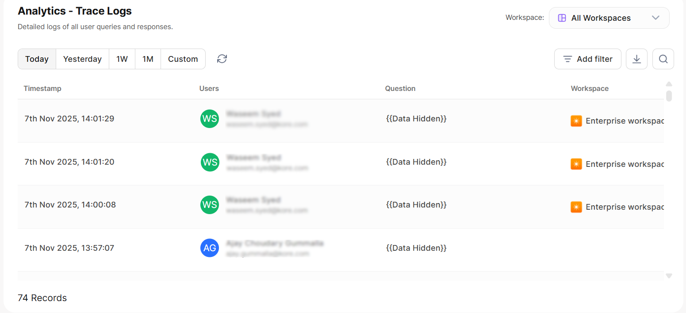

| Column | Description |
|--------|-------------|
| Request ID | Unique identifier for the request |
| Users | User who submitted the query |
| Questions | The user query |
| Overall Tokens | Total tokens that the query consumed |
| Response Time | Time taken to respond |
| Agent Type | Type of agent that handled the query |
| Status | Response status |
| Timestamp | Date and time of the request |

Use the following options to narrow the list:

| Option | Use it to |
|--------|-----------|
| **Search** | Find records by keyword. |
| **Quick filters** | Switch between preset time ranges, such as **Today**, **Yesterday**, and the last week. |
| **Workspace** | Show records from one or more workspaces. Search the list to find a workspace. |
| **Filters** | Filter by the source that answered the query: its type, name, or ID. |
| **Hide scheduled logs** | Hide records that schedulers created, so the list shows only queries that users sent. |

### Record Details

Select **More** on a record to open its detail panel.

**Summary**

The top of the panel shows the outcome of the request:

| Field | Description |
|-------|-------------|
| **Response** | Response status, for example, Success or Blocked. |
| **Response time** | Time the platform took to respond. |
| **Error type** | The error code, when the request fails. |
| **Blocked by** | What blocked the request, for example, Guardrail. Appears only when the platform blocks the request. |

**Request fields**

Every record shows the following fields, whatever the source:

| Field | Description |
|-------|-------------|
| **Trace ID** | Unique identifier for the request trace. |
| **Request ID** | Short request identifier, prefixed with `#`. |
| **User** | Name of the user who sent the query. |
| **Question** | The query the user sent. |
| **User ID** | System identifier for the user. |
| **Channel** | Where the user sent the query, for example, Web. |
| **Device** | Device the user sent the query from. |
| **Previous context** | Whether the query used context from earlier messages (Yes or No). |
| **Feedback comments** | Comments the user added with feedback. Shows a dash when there are none. |
| **Timestamp** | Date and time of the request. |
| **Query points** | Number of key points the platform extracted from the query. |
| **Total Usage Cost** | Dollar cost of the request. See [How the platform calculates spend](#model-spendings). |
| **Rate limits - profile** | Rate limit profile of the user, for example, Default. See [Rate Limits](#rate-limits). |
| **Thread ID** | Identifier of the conversation thread. |
| **Source** | What answered the query: Enterprise Search, Agent, Project, Attachment, or AI Model. |

**Source fields**

The value of **Source** decides which fields follow it. Each source adds a type, an ID, and a name:

| Source | Type field | ID field | Name field |
|--------|-----------|----------|------------|
| **Enterprise Search** | **Search Type**: the search platform, for example, Artemis Agent | **KnowledgeBases ID**: IDs of the knowledge bases in scope for the query | **KnowledgeBases name**: search application and knowledge bases, for example, Artemis project name (Knowledge base 1, Knowledge base 2) |
| **Agent** | **Agent Type**: for example, Autonomous Agent | **Agent ID** | **Agent name** |
| **Project** | None | **Project ID** | **Project name** |
| **Attachment** | **Attachment Type**: file format, for example, PDF | **Attachment ID**: one ID per file | **Attachment name**: file name, for example, Resume.pdf |
| **AI Model** | None | **Model ID** | **Model name**: the user-facing model name, followed by the model in parentheses |

For Enterprise Search records:

- Queries that use exclusive search log **Enterprise Search** as the source.
- **KnowledgeBases ID** lists only the knowledge bases in scope for that query, not every knowledge base in the search application.
- When the search runs on the XO Platform, **KnowledgeBases ID** contains a single ID, and **KnowledgeBases name** shows the bot name.

**Execution Analyzer**

Open the **Execution Analyzer** to examine each background step of the request. The analyzer shows the total response time at the top and lists each step, such as a search and any filtered searches that followed it. For each step, it shows:

- **Trace ID** of the step
- **Request**: the prompt or payload that the platform sent
- **Response**: what the step returned
- **Response time** of the step

Use the steps to find where a request slowed down or failed.

### Trace Log API

Retrieve trace log records programmatically through the Trace Log API to pull them into your own reporting tools, data warehouses, or dashboards. For the endpoint, parameters, and response reference, see [Trace Log API](/ai-for-work/administration/apis#trace-log-api).

---

## Feedback Management

Feedback Management gives administrators visibility into user feedback submitted across the platform, with configurable email notifications and scoped access by role.

**Navigation**: Admin Console → Usage → Feedback

### Accessing the Feedback Page

Access to the Feedback page is role-based:

| Role | Scope |
| --- | --- |
| **Account-level admins** with Usage access | All feedback across the account |
| **Workspace Owners** | Feedback scoped to their workspace only. The **Workspace** column is not shown. |
| **Agent-level access** | Feedback scoped to that specific agent only. The **Agent Name** column is not shown. |

### Feedback Detail View

Click any feedback entry to open its detail view. The view displays the associated trace log and the submitted feedback — type, category, and any additional comments.

### Notify Feedback

Click **Notify Feedback** on the Feedback page to configure email notifications. Select which feedback types should trigger notifications and add recipients. Recipients can be any valid email address or distribution list and do not need to belong to the account.

Notification scope follows the level at which it is configured — account-level covers all workspaces and agents, workspace-level covers all agents in that workspace, and agent-level covers only that specific agent.

**Email notifications include:** user email, query, agent name, workspace, feedback type, feedback category, and additional comments (if provided).

---

## Model Spendings

The Model Spendings page shows how much your account spends on LLM usage, in US dollars, for a selected month.

**Navigation**: Admin Console → Usage → Model Spendings

Use the month selector at the top of the page to choose a month. The page opens on the current month, and every widget reflects the month you select. For the current month, the widgets show month-to-date figures.

| Widget | Description |
|--------|-------------|
| **Total Spend** | Total dollars spent across the account in the selected month. |
| **Usage Over Time** | Spend across the selected month. Switch between the daily view, which shows one bar per day, and the monthly view, which shows one bar per week. |
| **Top Users** | Users ranked by spend, from highest to lowest. Select a user to open that user's trace logs for the selected month. Select **View more** to list every user in the account. |
| **Profiles** | The pool limit of each rate limit profile. Select a profile to open it on the Rate Limits page. This widget appears only when you configure rate limits. |

**How the platform calculates spend**

The platform calculates spend for each trace from the LLM model that the trace used and the tokens it consumed. It prices input and output tokens separately when the model prices them differently, and applies the current per-token rate for that model. Every dollar figure on the Spend and Rate Limits pages comes from this calculation.

<Note>Model Spendings does not include Amazon Bedrock usage, embedding model usage, or container creation.</Note>

---

## Rate Limits

Rate Limits control LLM usage by dollar amount. Set a budget for the account, group users into profiles that share a pool, and limit how much each user can spend in a day, week, or month.

**Navigation**: Admin Console → Usage → Rate Limits

### Turn On Rate Limits

Use the toggle at the top of the Rate Limits page to turn rate limits on or off for the account.

| State | Effect |
|-------|--------|
| **On** | The platform enforces every profile pool limit and per-user limit. |
| **Off** | No limits apply, and the platform does not block any user. The platform keeps the consumption data for reporting. |

The top of the page also shows the total budget across all profiles, converted to a monthly amount. The total updates whenever you change a profile pool limit or its time window.

### Profiles

A profile groups users who share a pool limit.

- Every account includes an **All users** profile that you cannot delete. New users join **All users** unless you assign them to another profile.
- Create a custom profile with **New Profile**. Enter a name, set its pool limit and per-user limit, and add users.
- A user belongs to one profile at a time. Adding a user to a profile removes the user from the previous profile.

**Add users to a custom profile**

1. Open the profile and select the option to add users.
2. Search for users and select them, or import a file that lists the users. The popup shows the current profile of each user.
3. Select **Add**.

To remove a user from a custom profile, hover over the user and select the remove option. The user moves to **All users** and starts with zero usage for the current time window. The custom profile keeps a record of the user's earlier usage until the profile resets.

### Pool and Per-User Limits

| Limit | Behavior |
|-------|----------|
| **Profile Pool limit** | The total dollar amount that all users in the profile can spend per day, week, or month. When the pool runs out, the platform blocks every user in the profile. Current consumption appears below the setting. |
| **Per user limit** | Optional. Turn it on to set the dollar amount that each user can spend per day, week, or month. The platform blocks a user who reaches this limit or when the pool runs out, whichever comes first. When this limit is off, only the pool limit applies. |

Each profile sets its own time windows for the pool limit and the per-user limit. The platform measures consumption within calendar windows, not rolling windows:

| Window | Period |
|--------|--------|
| **Day** | 00:00 to 23:59 |
| **Week** | Sunday 00:00 to Saturday 23:59 |
| **Month** | First day to last day of the month |

The platform counts all consumption in the current window, even when you set a limit partway through it. When you change the time window, the platform converts the amount: a daily amount multiplies by 7 for a week and by 30 for a month, and the reverse applies when you shorten the window. You cannot set a limit to zero.

**Confirmations and warnings**

The platform asks you to confirm changes that affect users immediately, including when you:

- Change a daily limit to a weekly or monthly limit, which increases the effective budget.
- Set a limit below the amount that users already spent in the current window.
- Set per-user limits that together exceed the pool, or a per-user limit larger than the whole pool.
- Use different time windows for the pool and the per-user limit.
- Turn off the per-user limit or turn off rate limits for the account.
- Delete a profile that has users. The users return to **All users**, and their limits change immediately.

### Monitor Usage

The **Usage** panel of a profile lists its users and their consumption for the current window. When the pool limit and the per-user limit use different time windows, the panel shows a consumption column for each window.

Select **View all user usage** to open the **Manage users usage** popup. The popup has a tab for each profile and an **All users** tab. The **All users** tab lists every user in the account with a **Profile** column. Select a user in any tab to open that user's trace logs for the applicable time window.

### Add Extra Budget

When a user reaches the per-user limit, you can add extra budget from that user's row.

- The extra amount applies to the current time window only. At the next window boundary, the limit returns to the configured amount.
- You can add extra budget more than once in the same window. The amounts add up.
- The user can send requests again immediately, as long as the profile pool has budget left. If the pool is also exhausted, the platform tells you that the extra budget does not unblock the user.

### End-User Experience

**Usage alerts**: When users cross 50%, 75%, 90%, and 95% of their limit, an alert appears below the compose bar. Users can dismiss the alert, and it reappears after a page refresh or in a new session.

**Usage screen**: Users can view their own usage at any time. The screen shows:

- Personal consumption for the configured time window and when it resets. Users see their consumption even when no per-user limit applies.
- The profile pool total, the pool consumption, and when the pool resets.
- A bar graph of consumption, with a daily view for the last 30 days and a weekly view for the current month.
- Spend by agent for the month, with the top 10 agents and a **View all** option.

**When a limit blocks a user**: The message states which limit the user reached, the shared profile pool or the personal per-user limit, the time window, and when access resets. Blocked users cannot send new requests but can still open their existing conversations and their usage screen.